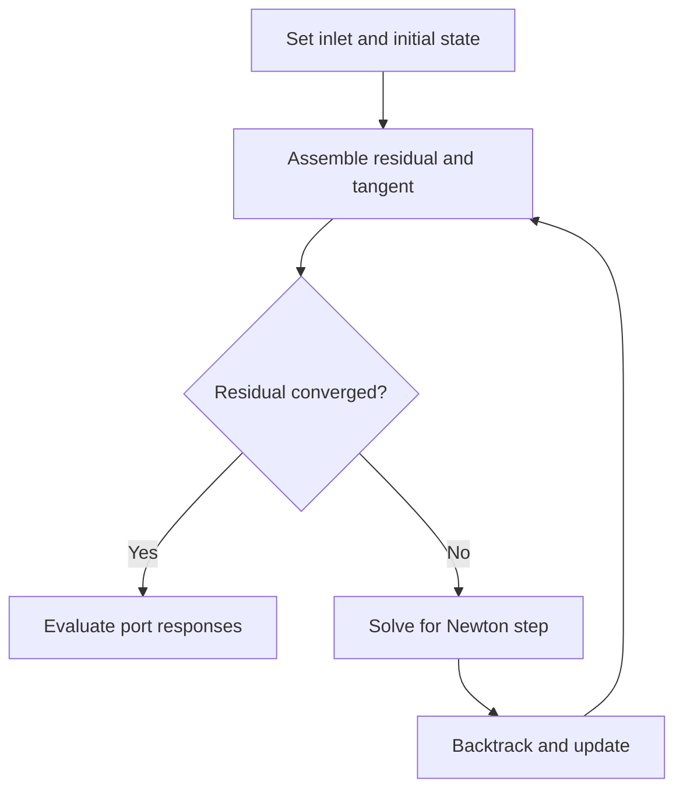

# Project 4 technical appendix and checklist

[Read the main report](Project%204.md)

### 1–3. Summary, formulation, and flow equations

The executive summary, engineering motivation, design variables, state, power objective, and side-flow constraint are in the main report. The dimensional flow equations are

$$
\nabla\cdot u=0,\qquad \rho(u\cdot\nabla)u=\nabla\cdot\sigma-\alpha u,\qquad
\sigma=-pI+2\mu D(u),\qquad D(u)=\tfrac12(\nabla u+\nabla u^\top).
$$

Scale position with main height $H=4$ mm, velocity with $U=0.0125476$ m/s, and pressure with $\mu U/H$. Then $Re=\rho UH/\mu=50.00$, and the coefficient of the nondimensional drag is $\alpha H^2/\mu$. At the inlet, $u_x=6U(y/H)(1-y/H)$, $u_y=0$. This has mean $U$. Both outlets impose $\sigma n=0$. The remaining boundary is stationary no-slip wall. In the geometry below, the west port is the inlet, the east port is the main outlet, and the north port is the side outlet.

**Geometry evidence** — [Original 20 × 4 mm channel and 1 mm branch](https://github.com/evl-jack/Coolant_Manifold/blob/cc9ecd49d64b4a5ff143a331d62f67eab14adf3f/evidence/pilot/local/stage_03_beta_8/images/original_physical_geometry.png) · [Design domain and density grid](https://github.com/evl-jack/Coolant_Manifold/blob/cc9ecd49d64b4a5ff143a331d62f67eab14adf3f/evidence/pilot/local/stage_03_beta_8/images/editable_brinkman_region.png).

### 4. Brinkman map

Model porous drag as the momentum sink $-\alpha u$. In the fluid limit $\bar\gamma=1$, drag vanishes. In nominal solid $\bar\gamma=0$, drag reaches $\alpha_{\max}$. Balancing viscous diffusion with drag near an interface gives $\mu u''-\alpha u=0$, with exponential decay length $\ell_B=\sqrt{\mu/\alpha}$. For $\alpha_{\max}=10^5$ kg/(m³·s), $\ell_B=0.1001$ mm, about 1.60 finest target intervals. Residual flow in nominal solid remains possible.

The Helmholtz equation $\tilde\gamma-r_f^2\Delta\tilde\gamma=m$ discretizes to $(M+r_f^2 K)\tilde\gamma=Mm$. Eliminating fixed anchor values gives $H_{EE}\tilde\gamma_E=M_E m_E-H_{EF}m_{0,F}$. The projected density and derivatives on editable cells are

$$
\Pi_\beta(s)=\frac{\tanh(\beta t)+\tanh(\beta(s-t))}{\tanh(\beta t)+\tanh(\beta(1-t))},\qquad
\Pi_\beta'(s)=\frac{\beta\,\mathrm{sech}^2(\beta(s-t))}{\tanh(\beta t)+\tanh(\beta(1-t))},\qquad t=0.5.
$$

At $\beta=0$ take the identity map. With $q=0.1$, $\alpha'(\bar\gamma)=-\alpha_{\max}q(q+1)/(q+\bar\gamma)^2$. The raw wall is the 0.5 contour of the bilinearly interpolated projected field. Marching squares uses the bilinear saddle to resolve ambiguous cells. The contour is clipped to the design region and joined to the fixed fluid geometry before fitted meshing.

**Actual density fields** — [Initial field](https://github.com/evl-jack/Coolant_Manifold/blob/cc9ecd49d64b4a5ff143a331d62f67eab14adf3f/evidence/pilot/local/stage_01_beta_0/images/initial_density.png) · [β = 0](https://github.com/evl-jack/Coolant_Manifold/blob/cc9ecd49d64b4a5ff143a331d62f67eab14adf3f/evidence/pilot/local/stage_01_beta_0/images/optimized_density.png) · [β = 2](https://github.com/evl-jack/Coolant_Manifold/blob/cc9ecd49d64b4a5ff143a331d62f67eab14adf3f/evidence/pilot/local/stage_02_beta_2/images/optimized_density.png) · [β = 8](https://github.com/evl-jack/Coolant_Manifold/blob/cc9ecd49d64b4a5ff143a331d62f67eab14adf3f/evidence/pilot/local/stage_03_beta_8/images/optimized_density.png).

### 5. Finite elements and nonlinear solve

Multiply momentum by a velocity test $v$ and integrate the stress divergence by parts. The boundary term $-\int_{\partial\Omega}v\cdot\sigma n\,ds$ vanishes because $v=0$ at prescribed-velocity boundaries and traction is zero at both outlets. Add the signed continuity test $-\int_\Omega q_p\nabla\cdot u\,dA$ to obtain the main report's mixed weak form.

Taylor–Hood triangles carry one pressure DOF per vertex and two velocity components per vertex and edge midpoint. In barycentric coordinates $L_i$, pressure basis functions are $L_i$, velocity vertex functions $L_i(2L_i-1)$, and velocity edge functions $4L_iL_j$. The affine map $x=x_1+J\hat x$ uses $J=[x_2-x_1,\ x_3-x_1]$, $\nabla_x=J^{-\top}\nabla_{\hat x}$, and $dA=|\det J|\,d\hat A$. The code uses a 25-point triangle quadrature rule.

For velocity basis vectors $\phi_i$ and pressure bases $\psi_k$, viscosity and drag assemble as $A_{ij}=\int[2\mu D(\phi_j):D(\phi_i)+\alpha\phi_j\cdot\phi_i]\,dA$. The divergence block is $B_{ki}=-\int\psi_k\nabla\cdot\phi_i\,dA$. Newton linearizes the convective residual into

$$
C_{ij}(u)=\int \rho\{(\phi_j\cdot\nabla)u+(u\cdot\nabla)\phi_j\}\cdot\phi_i\,dA.
$$

Element contributions assemble into the free-DOF tangent $[A+C(u),B^\top;B,0]$. Taylor expansion of the residual gives $R_z\Delta z=-R$, followed by the damped update $z\gets z+s\Delta z$.

**Solver evidence** — [Finite-element implementation](https://github.com/evl-jack/Coolant_Manifold/blob/cc9ecd49d64b4a5ff143a331d62f67eab14adf3f/evidence/verification/source/project4_fem/fem.py) · [Mesh counts and DOFs](https://github.com/evl-jack/Coolant_Manifold/blob/cc9ecd49d64b4a5ff143a331d62f67eab14adf3f/evidence/verification/mesh-evidence/mesh_report.json).

### 6. Verification and energy balance

For a straight channel, $0=G+\mu u_x''$, with no slip at $y=0,H$. Integrating twice gives $u_x=Gy(H-y)/(2\mu)$, hence $Q=GH^3/(12\mu)$. The main report lists analytical/computed errors, rotational invariance, and mass balance. The manufactured field uses $a(t)=t^2(1-t)^2$, $u=8(a(x)a'(y),-a'(x)a(y))$, $p=x+0.5y$, and forcing $-\Delta u+\nabla p+c(u\cdot\nabla)u$ with $c=0$ or 35. The nonlinear residual decreased through $1.63\times10^{-2}$, $2.36\times10^{-3}$, $1.44\times10^{-7}$, and $2.69\times10^{-16}$. The historical manufactured case independently checked the convection tangent against finite differences. The final response-gradient tests exercise the assembled tangent and material transfer together.

Dot the strong momentum equation with $u$ and integrate by parts. The mechanical port flux then balances viscous and Brinkman dissipation plus the boundary viscous-work correction and discrete divergence term. The combined raw fitted energy residual was 0.001788 µW/m, compared with a 0.448696 µW/m paired saving.

**Benchmark and audit evidence** — [Analytical and computed fields, residual history, and leakage data](https://github.com/evl-jack/Coolant_Manifold/blob/cc9ecd49d64b4a5ff143a331d62f67eab14adf3f/historical/baseline_verification.json) · [Manufactured convergence plot](https://github.com/evl-jack/Coolant_Manifold/blob/cc9ecd49d64b4a5ff143a331d62f67eab14adf3f/assets/manufactured_convergence.png) · [Fitted fields and energy audit](https://github.com/evl-jack/Coolant_Manifold/blob/cc9ecd49d64b4a5ff143a331d62f67eab14adf3f/evidence/verification/mesh-evidence/mesh_report.json).

### 7–8. Adjoint and performance

The main report gives the power and side-flow state derivatives and transpose solve. At each drag quadrature point, the drag cotangent is $-w_q u_q\cdot\lambda_q$. With cell transfer and $H^2/\mu$ scaling included in $\nabla_{\alpha_E}F$, the complete reverse map is

$$
\nabla_{m_E}F=M_E^\top H_{EE}^{-\top}\operatorname{diag}(\Pi_\beta')
\operatorname{diag}(\alpha')\,\nabla_{\alpha_E}F.
$$

Directional differences used $[F(m+hd)-F(m-hd)]/(2h)$ in the interior and $[-3F(m)+4F(m+hd)-F(m+2hd)]/(2h)$ for inward directions at bounds. A first-order Taylor subtraction should leave an $O(h^2)$ remainder. The six flagged initial tests reached order 2.001–2.006 in the larger-step follow-up.

| Design | Best scaled power errors, random / junction / collar | Best scaled side-flow errors, same order |
|---|---|---|
| Original | 1.921e−7 / 5.147e−7 / 4.713e−7 | 1.372e−8 / 2.707e−8 / 8.587e−8 |
| Gray | 2.280e−10 / 7.979e−9 / 1.025e−8 | 3.496e−11 / 7.464e−10 / 8.276e−10 |
| β = 0 | 1.134e−7 / 1.922e−7 / 1.973e−7 | 3.089e−8 / 2.291e−8 / 2.552e−8 |
| β = 2 | 2.142e−7 / 4.351e−7 / 3.344e−7 | 2.270e−9 / 3.453e−8 / 3.523e−8 |
| β = 8 | 2.533e−6 / 3.156e−7 / 5.901e−7 | 2.957e−7 / 2.659e−9 / 1.789e−8 |

The matched serial comparison used 257 forward solves (one baseline and two perturbations per variable) versus one forward solve and two adjoint right-hand sides sharing one factorization. Measured times were 120.379 s versus 1.990 s end to end. The archived forward and adjoint subtotals were 1.752 s and 0.233 s, respectively. At 52,347 DOFs the scaling results below use eight workers for finite differences, so those elapsed times describe a different comparison.

| Controls | Adjoint (s) | Eight-worker finite differences (s) |
|---:|---:|---:|
| 32 | 10.672 | 40.339 |
| 128 | 12.472 | 112.083 |
| 512 | 12.741 | 395.261 |

**Gradient and timing evidence** — [Initial Taylor plot](https://github.com/evl-jack/Coolant_Manifold/blob/cc9ecd49d64b4a5ff143a331d62f67eab14adf3f/evidence/verification/adjoint-evidence/adjoint_taylor_remainders.png) · [Follow-up Taylor plot](https://github.com/evl-jack/Coolant_Manifold/blob/cc9ecd49d64b4a5ff143a331d62f67eab14adf3f/evidence/verification/adjoint-coordinate-evidence/adjoint_taylor_remainders.png) · [Runtime comparison plot](https://github.com/evl-jack/Coolant_Manifold/blob/cc9ecd49d64b4a5ff143a331d62f67eab14adf3f/evidence/verification/timing-2408534/figures/fixed_pipe_sensitivity_cost.png) · [Matched benchmark subtotals](https://github.com/evl-jack/Coolant_Manifold/blob/cc9ecd49d64b4a5ff143a331d62f67eab14adf3f/evidence/verification/timing-2408534/pilot-128/benchmark.json).

### 9–10. MMA and KKT

MMA builds separable convex approximations using moving asymptotes and the current response gradients. Each iteration follows density → filter → projection → drag → nonlinear FEM → port responses → adjoints → MMA update. The three stages took 17, 18, and 62 unique evaluations. The first two stopped at design tolerance. The final stage stopped at objective tolerance. Recorded end-to-end optimization times were 217.466 s for Navier–Stokes and 220.520 s for Stokes, from different run environments and evaluation counts.

For $g\le0$ and $0\le m\le1$, write $\mathcal L=f+\lambda g-a^\top m+b^\top(m-\mathbf1)$. Primal feasibility requires the original inequalities. Dual feasibility requires $\lambda,a,b\ge0$ for their inequality signs. Stationarity requires $\nabla f+\lambda\nabla g-a+b=0$. Complementarity requires $\lambda g=0,\ a_i m_i=0,\ b_i(m_i-1)=0$. Eliminating box multipliers gives the projected residual $\|m-\operatorname{clip}(m-\nabla f-\lambda\nabla g,0,1)\|_\infty$. A slack flow floor with zero multiplier means a sufficiently small increase has zero first-order local power cost. These conditions audit local first-order stationarity.

| Residual | Tolerance | Navier–Stokes | Stokes |
|---|---:|---:|---:|
| Primal | 1e−6 | 0 | 0 |
| Dual | 1e−8 | 0 | 0 |
| Stationarity | 1e−4 | 1.369e−8 | 1.069e−5 |
| Complementarity | 1e−5 | 0 | 4.789e−8 |

**Optimization evidence** — [Objective history](https://github.com/evl-jack/Coolant_Manifold/blob/cc9ecd49d64b4a5ff143a331d62f67eab14adf3f/evidence/nonlinear/figures/objective_history.png) · [Side-flow history](https://github.com/evl-jack/Coolant_Manifold/blob/cc9ecd49d64b4a5ff143a331d62f67eab14adf3f/evidence/nonlinear/figures/side_flow_history.png) · [Runtime comparison](https://github.com/evl-jack/Coolant_Manifold/blob/cc9ecd49d64b4a5ff143a331d62f67eab14adf3f/evidence/nonlinear/figures/optimization_runtime.png) · [Intermediate geometry](https://github.com/evl-jack/Coolant_Manifold/blob/cc9ecd49d64b4a5ff143a331d62f67eab14adf3f/evidence/pilot/local/stage_02_beta_2/images/optimized_physical_geometry.png) · [Final geometry](https://github.com/evl-jack/Coolant_Manifold/blob/cc9ecd49d64b4a5ff143a331d62f67eab14adf3f/evidence/pilot/local/stage_03_beta_8/images/optimized_physical_geometry.png) · [Spatial stationarity and active bounds](https://github.com/evl-jack/Coolant_Manifold/blob/cc9ecd49d64b4a5ff143a331d62f67eab14adf3f/evidence/verification/kkt-results/fixed_pipe_kkt_spatial.png) · [Independent Navier–Stokes audit](https://github.com/evl-jack/Coolant_Manifold/blob/cc9ecd49d64b4a5ff143a331d62f67eab14adf3f/evidence/verification/kkt-results/fixed_pipe_kkt.json) · [Stokes audit](https://github.com/evl-jack/Coolant_Manifold/blob/cc9ecd49d64b4a5ff143a331d62f67eab14adf3f/evidence/nonlinear/stokes_run/stage_03_beta_8/kkt.json).

### 11–13. Mesh convergence, nonlinear comparison, and final results

The immersed study refined the analysis mesh while keeping the projected density pattern fixed. The fitted study remeshed each fixed reconstructed wall at the same three target spacings. Within each representation, compare original and selected power on each mesh, then screen the power difference using the larger of the two successive paired changes and the corresponding sums of absolute individual changes. This gives a descriptive uncertainty of 0.011197 µW/m for the raw fitted saving. The smoothed case failed the first fitted side-flow step (0.02505 percentage points versus the 0.020 limit).

| Design | Evaluator | Power (µW/m) | Side flow | Common immersed floor |
|---|---|---:|---:|---|
| Original | Stokes | 10.200410 | 7.545020% | Pass |
| Original | Navier–Stokes | 8.893614 | 7.414738% | Pass |
| Stokes optimized | Stokes | 10.117120 | 7.414742% | Pass |
| Stokes optimized | Navier–Stokes | 8.907379 | 6.990948% | Fail |
| Navier–Stokes optimized | Stokes | 10.279525 | 9.204333% | Pass |
| Navier–Stokes optimized | Navier–Stokes | 8.830644 | 8.412628% | Pass |

Removing $\rho(u\cdot\nabla)u$ gives a linear fixed-density Stokes state. Under the nonlinear evaluator, convective momentum transport changed branch delivery enough for the Stokes design to miss the side-flow floor. The fitted metrics in the main report quantify the engineering difference. Both area and flow redistribution changed, which limits causal attribution to wall rounding.

**Mesh and field evidence** — [Complete three-level mesh tables and paired calculation](https://github.com/evl-jack/Coolant_Manifold/blob/cc9ecd49d64b4a5ff143a331d62f67eab14adf3f/evidence/verification/mesh-evidence/mesh_report.json) · [Power and side-flow convergence](https://github.com/evl-jack/Coolant_Manifold/blob/cc9ecd49d64b4a5ff143a331d62f67eab14adf3f/evidence/verification/mesh-evidence/mesh_convergence.png) · [Original and optimized fitted pressure and speed](https://github.com/evl-jack/Coolant_Manifold/blob/cc9ecd49d64b4a5ff143a331d62f67eab14adf3f/evidence/verification/mesh-evidence/fitted_pressure_speed.png) · [Original, raw, and smoothed overlay comparison](https://github.com/evl-jack/Coolant_Manifold/blob/cc9ecd49d64b4a5ff143a331d62f67eab14adf3f/assets/three_panel.png).

**Matched Stokes and Navier–Stokes evidence** — [Three-geometry comparison](https://github.com/evl-jack/Coolant_Manifold/blob/cc9ecd49d64b4a5ff143a331d62f67eab14adf3f/evidence/nonlinear/figures/geometry_comparison.png) · [Stokes density](https://github.com/evl-jack/Coolant_Manifold/blob/cc9ecd49d64b4a5ff143a331d62f67eab14adf3f/evidence/nonlinear/figures/stokes_density.png) · [Navier–Stokes density](https://github.com/evl-jack/Coolant_Manifold/blob/cc9ecd49d64b4a5ff143a331d62f67eab14adf3f/evidence/nonlinear/figures/navier_stokes_density.png) · [Density difference](https://github.com/evl-jack/Coolant_Manifold/blob/cc9ecd49d64b4a5ff143a331d62f67eab14adf3f/evidence/nonlinear/figures/density_difference.png) · [Wall contours](https://github.com/evl-jack/Coolant_Manifold/blob/cc9ecd49d64b4a5ff143a331d62f67eab14adf3f/evidence/nonlinear/figures/optimized_walls_overlay.png) · [Pressure](https://github.com/evl-jack/Coolant_Manifold/blob/cc9ecd49d64b4a5ff143a331d62f67eab14adf3f/evidence/nonlinear/figures/pressure_comparison.png) · [Velocity](https://github.com/evl-jack/Coolant_Manifold/blob/cc9ecd49d64b4a5ff143a331d62f67eab14adf3f/evidence/nonlinear/figures/velocity_comparison.png) · [Fitted Stokes mesh comparison and run notes](https://github.com/evl-jack/Coolant_Manifold/blob/cc9ecd49d64b4a5ff143a331d62f67eab14adf3f/evidence/nonlinear/README.md).

### 14–16. Website, limits, and reproduction

[Public GitHub Pages viewer](https://evl-jack.github.io/Coolant_Manifold/) · [Final viewer and report source](https://github.com/evl-jack/Coolant_Manifold/blob/cc9ecd49d64b4a5ff143a331d62f67eab14adf3f/index.html)

The public page loaded with the original and optimized viewer panels and pressure, velocity, and cylindrical controls. It serves the earlier pilot release. Acceptance of the final release still requires deployment and functional checks for camera synchronization, cylindrical and extrusion modes, field colors and units, element picking, playback, metric panels, phone layout, and load time.

Install NumPy, Shapely, scikit-image, and Mistune. Run **python rebuild_site.py** at the root of the solver repository to rebuild the site from the frozen data. The linked Bash and Slurm scripts document numerical launches. Verified end-to-end CFD reproduction, firsthand team derivations and checks, and a specific defect caught in the graded solver remain open. The main report records modeling and AI-use limitations.

**Source and execution** — [FEM source](https://github.com/evl-jack/Coolant_Manifold/blob/cc9ecd49d64b4a5ff143a331d62f67eab14adf3f/evidence/verification/source/project4_fem/fem.py) · [MMA driver](https://github.com/evl-jack/Coolant_Manifold/blob/cc9ecd49d64b4a5ff143a331d62f67eab14adf3f/evidence/verification/source/project4_fem/project43_topology/optimize.py) · [Pilot entry point](https://github.com/evl-jack/Coolant_Manifold/blob/cc9ecd49d64b4a5ff143a331d62f67eab14adf3f/evidence/verification/source/project4_fem/project43_topology/fixed_pipe_pilot.py) · [Pilot Slurm job](https://github.com/evl-jack/Coolant_Manifold/blob/cc9ecd49d64b4a5ff143a331d62f67eab14adf3f/evidence/verification/source/project4_fem/project43_topology/fixed_pipe_pilot.sbatch) · [Verification Bash launcher](https://github.com/evl-jack/Coolant_Manifold/blob/cc9ecd49d64b4a5ff143a331d62f67eab14adf3f/evidence/verification/launch_sol_audit.sh) · [Nonlinear Bash launcher](https://github.com/evl-jack/Coolant_Manifold/blob/cc9ecd49d64b4a5ff143a331d62f67eab14adf3f/evidence/nonlinear/launch_remaining_sol.sh) · [Dependencies and rebuild instructions](https://github.com/evl-jack/Coolant_Manifold/blob/cc9ecd49d64b4a5ff143a331d62f67eab14adf3f/README.md).

The remaining supplemental figures are a standalone resistance curve, projection curve, labeled P2/P1 element, Newton residual and solid-leakage plots, and a dedicated boundary-condition schematic. The formulas, data, and geometry needed to construct them are linked above.

[Course specification](https://designinformaticslab.github.io/DesignOptimization2025/project4.html) · [Borrvall and Petersson, 2003, *Topology optimization of fluids in Stokes flow*](https://doi.org/10.1002/fld.426)
