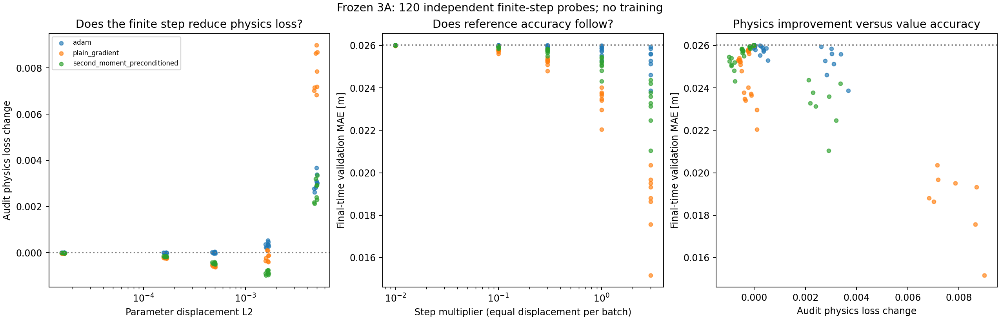

# MAE 494 — Project 3: DeepReach Air3D Reproduction

> Technical report revised October 28, 2026. Outreach and interview documentation are omitted in this revision. The report emphasizes the problem, minimal replication, P1–P5 diagnostics, and completed research. Reproducibility, the recommendation memo and final presentation polish remain later tasks. Research status is the previously reviewed October 28 snapshot; this structural revision adds no results.

## 1. Problem brief — replicating DeepReach on Air3D

Our project reproduces the core DeepReach physics-informed neural network (PINN) workflow on the Air3D collision-avoidance benchmark. The scientific problem is to approximate a Hamilton–Jacobi reachability value function: for a given relative state and time remaining, can a worst-case pursuer force a collision despite optimal evasion?

The evader chooses a bounded turn rate to avoid collision; the pursuer chooses its own bounded turn rate to force collision. The value represents a minimum-separation margin. For the ideal solution, nonpositive values identify states from which collision can be forced. This makes both value accuracy and unsafe-region classification relevant. Spatial derivatives also determine candidate controls, but their control usefulness must be evaluated separately.

A conventional grid solver supplies an approximate numerical reference for this fixed three-state game. Grids become expensive as state dimension grows, motivating neural reachability methods. This reduced replication does not demonstrate that a PINN is faster or more accurate than a cached grid on Air3D; its measured comparison appears under P1 and P5.

The immediate goal is to reproduce and diagnose the small PINN, then learn as much as possible from that scale before enlarging the network or adding reference supervision. The researcher's broader interest in gradient-based safe control motivates the application, while the completed study measures values, residuals and classifications. It does not establish closed-loop collision avoidance or certified safety.

## 2. Minimal case formulation — reduced Air3D replication

### Physical model, scope and difficulty knob

The evader chooses a turn rate to avoid collision; a worst-case pursuer chooses its turn rate to force collision. The model uses relative position and heading in the evader's rotating coordinate frame. It does not include altitude, thrust or full quadrotor dynamics.

| Parameter | Value |
| --- | --- |
| Both drone speeds | 0.75 m/s |
| Evader and pursuer turn bounds | ±3 rad/s |
| Collision radius | 0.25 m |
| Reduced experiment horizon | 0.5 s |
| Full experiment horizon | 1 s |
| State | Relative x, y, heading psi |
| Network input | Time remaining tau and the three states |

The minimal case retains the nonlinear max–min reachability equation, the collision boundary, and the need to learn useful state derivatives. It simplifies the application to planar relative motion with three state variables. It cannot establish performance for full quadrotor flight.

**Difficulty knob: evaluation look-ahead τ (time remaining).** We vary τ from 0 to 0.5 s at 21 points, spaced 0.025 s apart, while holding each trained checkpoint fixed. Longer look-ahead asks the network to represent the reachability solution farther from the known terminal condition. The original 0, 0.25 and 0.5 s comparisons are retained. Section 3 (P3) plots relative L² error against this knob. This measures difficulty within the trained horizon T=0.5 s; it does not locate a collapse threshold or compare independently trained maximum horizons.

**Study framing:** a diagnosis study with an exploratory remedy comparison (closest to Path B, with evidence relevant to Path C). The baseline reproduces a limitation and the candidates test loss weighting, sampling and additional optimization. The evidence implicates sensitivity to training choices; it does not uniquely identify the root cause or establish complete Path B/C rubric coverage.

Experiment 3 changes the output and training phases as described in Section 4.

### Governing equation and candidate controls

With evader turn u and pursuer turn d:

```text
xdot   = v*(cos(psi)-1) + u*y
ydot   = v*sin(psi) - u*x
psidot = d-u
l(s)   = sqrt(x*x+y*y)-R
```

For p=grad_s(V), the avoid Hamiltonian is max_u min_d p.f:

```text
H  = v*((cos(psi)-1)*p_x + sin(psi)*p_y)
     + omega*abs(y*p_x-x*p_y-p_psi) - omega*abs(p_psi)
u* =  omega*sign(y*p_x-x*p_y-p_psi)
d* = -omega*sign(p_psi)
```

Using time remaining tau=T-t:

```text
max(V_tau-H, V-l) = 0
V(0,s) = l(s)
```

For the ideal solution, V<=0 identifies states from which collision can be forced despite optimal evasion. Controls derived from a learned approximation are candidates and are not certified safe.

### Neural solver and comparison workflow

1. **Problem:** dynamics, collision target, control/disturbance bounds and max-min Hamiltonian.
2. **Neural solver:** a sine network predicts the scalar value from time and state. Terminal pretraining learns the known zero-time function; physics training then expands the sampled time interval. Autodiff supplies the derivatives in the HJI loss.
3. **Independent grid solver:** NumPy local Lax–Friedrichs differences, periodic heading, explicit CFL and target-obstacle projection provide an approximate reference. Spatial boundaries use constant extension and are checked from an interior region against a larger domain.
4. **Comparison:** after training, measure held-out terminal and physics errors, value errors, unsafe-region overlap, false-safe fractions, and value/zero-contour slices. Reference labels never enter PINN training.

### Original baseline and Experiment 2 settings

| Setting | Completed reduced runs |
|---|---|
| Network | Three sine hidden layers, width 64; 8,705 trainable parameters |
| Samples per step | 2,048; 256 terminal samples during baseline physics training |
| Optimizer | Adam, learning rate 0.0001 |
| Baseline/A/B schedule | 2,000 terminal-pretraining + 10,000 expanding-time physics steps |
| Candidate C schedule | Baseline checkpoint + 10,000 full-horizon steps; 22,000 cumulative |
| Horizon | 0.5 s |
| Spatial training domain | Relative x and y each in [-2, 2] m |
| Interior comparison region | Relative x and y each in [-0.6, 0.6] m |
| Comparison heading | [-π, π), with periodic reference interpolation |
| Seed and hardware | Seed 7; Intel Core Ultra 7 165U, two CPU threads, CPU PyTorch 2.5.1 |

Later candidate changes are described with each experiment. The numerical reference is used for evaluation, not as training supervision.

## 3. Baseline and diagnostics — P1–P5

This is the central evaluation section. **Conventional baseline** means the independent numerical grid solver (P1); **PINN training baseline** means Experiment 1. Later experiments reuse these reference checks and evaluation definitions where applicable. The [project diagnostic kit](https://designinformaticslab.github.io/DesignOptimization2025/project3.html#pinn-pino-diagnostic-kit-required) supplies the P1–P5 organization.

### P1 — Conventional baseline: accuracy and solve cost

The independent solver uses local Lax–Friedrichs finite differences, explicit Euler with a CFL restriction, target-obstacle projection, periodic heading and constant spatial boundary extension. We compare in an interior region and check sensitivity to a larger spatial domain.

The finest approximate reference uses 129 × 129 spatial nodes and 96 headings. Later comparisons extend the time evaluation to 21 saved direct snapshots at 0.025 s spacing; the original three-time measurements remain preserved. Every run is compared on the same 24,000 interior states at 0, 0.25 and 0.5 s remaining. Separate full-box diagnostic samples measure terminal error and the variational-inequality (VI) residual. No reference values or gradients enter training.

The baseline reference checks used 65/97/129 spatial-node grids with 48/72/96 headings. At 0.5 s, successive refinement MAEs decreased from 0.004420 m to 0.002206 m; the matched-spacing expanded-domain maximum change was 1.11e-16 m. These checks support using the grid for comparison but do not provide a rigorous error bound. Its first-order discretization retains numerical diffusion and nonsmooth-target error.

| Look-ahead | MAE between 65- and 97-node references [m] | MAE between 97- and 129-node references [m] | Expanded-domain maximum change [m] |
|---|---:|---:|---:|
| 0.25 s | 0.003914 | 0.001955 | 0 |
| 0.5 s | 0.004420 | 0.002206 | 1.11e-16 |

A standalone 129×129×96 solve took **136.73 s** and exactly reproduced the original saved three-time reference. The older **696.7 s** timing covers a multi-solve verification suite and must not be presented as the single-solve cost. The separate 21-output solve took 132.99 s and differs slightly because output times shorten Euler steps. These measurements do not imply that requesting more snapshots makes the solver faster; machine conditions and step schedules differ.

Analytic no-turn and frozen-dynamics checks complement refinement and boundary checks. Grid-to-grid agreement is evidence of numerical sensitivity, not a rigorous bound on exact-solution error.

### Evaluation metrics used throughout P1–P5 and the experiments

| Metric | Meaning and direction |
|---|---|
| Value MAE [m] | Mean absolute difference between PINN and reference values; lower is better |
| Relative L² error [%] | 100 × sqrt(sum((PINN − reference)²) / sum(reference²)) on the same evaluation states at each τ; lower is better |
| Unsafe-region IoU | Intersection divided by union of predicted/reference unsafe regions; higher is better |
| False-safe / reference-unsafe | Count(PINN > 0 and reference ≤ 0) / count(reference ≤ 0); lower is better |
| False-unsafe / reference-safe | Count(PINN ≤ 0 and reference > 0) / count(reference > 0); lower is better |
| Full-box terminal MAE [m] | Error against the known zero-time function on separate full-box samples |
| Full-box VI MAE | Mean absolute implemented equation/obstacle residual; a diagnostic, not a value-error or safety bound |

The baseline's **0.01184 m time-zero interior value MAE** and **0.00891 m full-box terminal MAE** use different evaluation distributions. They are not conflicting estimates of the same sample statistic.

After using these held-out comparisons to choose promising settings, they should be treated as validation results. A final generalization claim would require independent testing.

### P2 — Separate training-loss components

The baseline records terminal and physics losses separately; terminal pretraining is followed by an expanding-time physics curriculum. The initially calibrated terminal multiplier is fixed afterward. Weighted total loss must be interpreted alongside the individual terms and held-out errors: a small or declining training loss does not demonstrate an accurate value function.


*Training-loss diagnostic. Saved baseline history; this measures training batches, not the held-out reference error in P3.*

For 3A–3C, the analytic terminal condition is exact by construction, so the analytic terminal loss is identically zero and has zero training weight. Zero-time coordinates still contribute to the physics residual. Logarithmic plots must handle a zero terminal term explicitly rather than inventing a positive value.

The per-run histories are preserved in the experiment workspace. Full component-plot coverage and log-axis presentation across every candidate remain a reporting check; this revision does not claim that a single baseline figure completes that work for all runs.

### P3 — Difficulty knob: relative L² error versus look-ahead

The evaluation was extended to 21 direct reference snapshots at 0.025 s spacing through 0.5 s. The original models and metrics were preserved. These are evaluations of fixed models within their trained horizon, not independently trained horizon experiments.


*Difficulty knob τ on the horizontal axis; relative L² error [%] on the left vertical axis. The middle and right panels show value MAE and false-safe rate. All curves use the same 24,000 development states. Experiment 2A reduces final-horizon relative L² from 48.88% to 24.24%; Experiment 3A subsequently reduces it to 19.12% (the 3A comparison in Section 4). The plot above contains the original four models, not the later constrained candidates.*

[21-point diagnostic and reference checks](report_assets/project3_20261028/evidence/lookahead_21points_20261027/README.md) · [Underlying error-versus-knob data](report_assets/project3_20261028/evidence/lookahead_21points_20261027/metrics.csv)

The 21-time solve stores direct snapshots rather than interpolating values in time. Its shortened output-aligned Euler steps introduce a maximum shared-snapshot difference of 0.00001375 m relative to the original three-time solve. This small difference is recorded rather than treating the two reference runs as numerically identical.

Relative L² is a normalized aggregate value error, not a sign-classification rate. Its denominator is the reference-value L² norm on the same states at that time. The original three-time and newer 21-time results support the measured growth in error with look-ahead; no precise collapse threshold is claimed.

### P4 — Where the error occurs: fields and Fourier spectra

The diagnostic supplement evaluated error fields on the reference's interior spatial nodes and periodic heading nodes. Selected space–time slices use the three original stored times; they do not invent intermediate-time values. Later 21-time comparisons and outlier analyses add temporal and geometric detail.


*Error-location diagnostic for the original four models. These selected slices show variation with space and look-ahead; they are not drone trajectories.*


*Frequency diagnostic for Experiment 1 and Experiment 2 A/B/C. The spatial transform uses a centered Hann-windowed crop; heading spectra use periodic transforms with the mean removed. These statistics differ from held-out RMSE.*

Most centered/windowed error energy is at lower frequencies. The spectra do not establish high-frequency representation as the dominant bottleneck. Windowing, heading seams, nonsmooth solution structure and the approximate reference affect interpretation. A time Fourier spectrum cannot be inferred reliably from only three snapshots. Later constrained models are not included in this original spectral comparison.

[Field/spectrum methods and checks](report_assets/project3_20261028/evidence/diagnostics_20261027/README.md)

### P5 — Training cost, inference cost and hardware

The original-model timing supplement used CPU PyTorch 2.5.1, two threads and 14 logical processors. Inference measurements are warm value-only calls with prepared inputs, excluding loading, conversion, gradients and control calculations. The grid interpolator is built once and reused.

| Model | Recorded training/build [s] | Single-state query [µs] | Batch of 1,024: per state [µs] |
|---|---:|---:|---:|
| Experiment 1 | 206.38 | 351.14 | 2.69 |
| Experiment 2A | 326.54 | 333.40 | 2.36 |
| Experiment 2B | 341.51 | 330.83 | 2.49 |
| Experiment 2C, cumulative | 436.94 | 277.61 | 2.31 |
| Cached grid | Build: 136.73 | 352.38 | 0.89 |


*Measured warm value-query cost. Training/build costs and query costs are both relevant; measurements are not accuracy-matched and historical training workloads differed.*

For this fixed game, compare training plus repeated network queries with one grid build plus repeated interpolation. Charging a new PDE solve for every reference query would misrepresent the conventional alternative. Grid construction and batched interpolation were both cheaper in these measurements, so the batched comparison has **no PINN cost break-even**. Single-state estimates imply crossovers of roughly 4–56 million state queries, but small latency differences and differing workloads do not establish a practical speedup.

3A–3C recorded training times of 220.28, 339.46 and 203.98 s respectively. They were not included in the original warm-inference benchmark. Their update budgets and execution differences are retained in Section 4; equal updates do not imply equal computation or wall time.

[Timing protocol and complete records](report_assets/project3_20261028/evidence/diagnostics_20261027/README.md)

### Diagnostic coverage and remaining limits

The saved supplement fills the earlier missing relative L², spectrum, standalone-solve timing and inference-timing measurements. The difficulty knob is evaluation look-ahead within a fixed trained horizon, not a claim of an independently trained horizon sweep. Remaining reporting work includes complete P2 component figures across candidates and later-model frequency/inference comparisons. Numerical agreement remains reference-relative, and reused evaluation states are development data.

## 4. Experiments and research

The experiments below explain what changed, why it was tested, what happened and what the evidence supports. They use the common P1–P5 definitions above. Diagnostics performed on frozen models are distinguished from new training runs.

### 4.1 Experiment 1 — establishing the PINN training baseline

#### Question and motivation

Can a reduced CPU implementation learn the time-dependent Air3D reachability solution, and how does its error change with time remaining?

#### Design and evaluation

The reduced model uses three sine hidden layers of width 64, 2,048 samples per iteration, 2,000 terminal-pretraining steps and 10,000 physics-curriculum steps. Training took 206.4 seconds on two CPU threads, with a 0.5 s horizon.

The shared evaluation protocol is defined above. These are time slices of one trained model, not separately trained horizon experiments.

#### Results

| Time remaining | Value MAE | Unsafe-region IoU | False-safe among reference-unsafe |
|---|---|---|---|
| 0 s | 0.01184 m | 0.930 | 6.28% |
| 0.25 s | 0.04230 m | 0.695 | 23.77% |
| 0.5 s | 0.09150 m | 0.478 | 46.42% |

False-safe here means PINN>0 while the approximate grid reference is <=0, divided by the reference-unsafe sample count. The comparison uses 24,000 held-out interior states. At 0.5 s, 5,276 are reference-unsafe; false-safe among all states is 10.20%. These are reference-relative classifications, not certified ground truth.

#### Interpretation, tradeoffs and limits

The network learned the terminal condition considerably better than the time-dependent reachability solution. Checkpoint reload and optimizer restart checks passed. Reference refinement improved, and the larger-domain test showed negligible interior sensitivity. The reduced PINN nevertheless misses substantial unsafe regions, so successful reproduction of the paper's reported accuracy is not claimed.


*Baseline value slices and zero contours. White contours show the approximate reference; dashed red contours show the PINN.*

**Conclusion:** the baseline provides a working implementation and a reproducible approximation failure to investigate. Its growing error with time motivates testing training choices before enlarging the model.


### 4.2 Experiment 2 — loss weighting, focused sampling and additional training

#### Question and motivation

Experiment 1 learned the known time-zero collision-distance function more accurately than the time-dependent reachability solution. At 0.5 s it missed 46.42% of reference-unsafe states. We tested whether loss balance, the spatial distribution of physics samples, or insufficient training at the full horizon contributed to this error. The aim was to improve the reduced model before committing to a larger network or paper-scale computation.

#### Design

We ran three separate candidates against the unchanged Experiment 1 baseline:

| Candidate | Change | Reason for testing it |
|---|---|---|
| **A — Lower terminal-loss weight** | Divide the initially calibrated terminal multiplier by 10, from about 106.43 to 10.64; keep it fixed afterward | Give the physics equation more influence relative to matching the zero-time condition |
| **B — Focused physics sampling** | Draw 50% of nonterminal physics samples uniformly by area inside a radius-1 m disk; retain uniform-box sampling for the other 50% | Spend more of the same sample budget near the region where collision can occur within the modeled horizon |
| **C — Additional full-horizon training** | Continue Experiment 1's exact model, Adam optimizer and random state for 10,000 additional updates, with time sampled over the full [0,0.5] s interval | Test whether more optimization at the final horizon helps after the original expanding-time curriculum |

A and B each started fresh with the original 2,000 terminal-pretraining + 10,000 physics-curriculum steps. C inherited the original 12,000 steps and finished at 22,000 cumulative steps; it therefore has a larger training budget. The radius in B follows the physical bound R+2*v*T=1 m. Terminal/pretraining coordinate samples remain uniform. B retains the original automatic loss-calibration rule, whose changed first physics batch produces a terminal multiplier of about 125.35.

All candidates retain the same three sine hidden layers of width 64, 2,048 samples per step, Air3D dynamics, 0.5 s horizon, spatial domain, Adam learning rate of 1e-4, seed 7 and two CPU threads. Each run saved its own configuration, checkpoint, optimizer state, training history, runtime, metrics and plots in the local project. Experiment 1's checkpoint and numerical-reference arrays were preserved and their hashes checked.

We reproduced the baseline measurements, then reused the checked numerical grid and the same 24,000 held-out interior states at 0, 0.25 and 0.5 s for every comparison. Separate full-box samples measured terminal and physics errors. **No numerical-reference values or gradients entered training**: Experiment 2 remains physics-informed training, not hybrid supervised training.

#### Results

Results at **0.5 seconds remaining**:

| Run | Value MAE [m] | Unsafe-region IoU | False-safe / reference-unsafe | False-unsafe / reference-safe | Full-box terminal MAE [m] |
|---|---|---|---|---|---|
| Experiment 1 baseline | 0.09150 | 0.478 | 46.42% | 3.43% | 0.00891 |
| **A — Lower terminal weight** | **0.04477** | **0.688** | **10.82%** | 8.33% | 0.01457 |
| B — Focused sampling | 0.07189 | 0.626 | 20.00% | 7.86% | 0.01045 |
| C — Additional full-horizon training | 0.06048 | 0.613 | 22.80% | 7.31% | **0.00708** |


*Saved comparison from the completed Experiment 2 runs. C uses more cumulative training than A/B. Metric definitions and evaluation domains are given in Section 3.*

#### Interpretation and tradeoffs

- **A produced the strongest final-horizon improvement:** value MAE decreased 51.1%, false-safe decreased 35.60 percentage points, and IoU increased from 0.478 to 0.688. However, terminal error increased and more reference-safe states were labeled unsafe. Lower weighting improved the balance for this run, rather than improving every metric.
- **B improved value MAE by 21.4%** and reduced false-safe to 20.00%. It outperformed the baseline on the final-horizon classification metrics, but its full-box physics residual increased from 0.09033 to 0.09979. Better regional predictions did not imply better physics residual everywhere.
- **C improved value MAE by 33.9%** and reduced false-safe to 22.80%. It also improved terminal error. Its value MAE was lower than B's, while B had fewer missed reference-unsafe states and higher IoU.

A and B recorded 326.5 s and 341.5 s of training, respectively. C added 230.6 s to the baseline's 206.4 s, for 436.9 s cumulative training. These exclude evaluation/setup time; debugger overhead and machine workload prevent interpreting the runtime differences as optimizer-efficiency results.

**Finding:** the tested training changes improved final-horizon value MAE for this small PINN without enlarging the network. A had the lowest measured final-horizon value MAE and false-safe rate and the highest IoU among the tested candidates; its higher false-unsafe rate and terminal error remain costs of that improvement. Extra training helped C but was not the strongest result.

#### Conclusion and limits

These are exploratory results for one seed and selected settings. A and B are separate experiments; no combined candidate was run. Because the same held-out results were used to select improvements, they now serve as validation comparisons; a new untouched test set and repeated seeds would strengthen a final performance claim. The study measured values, residuals and unsafe-region classifications. It did **not** establish reference-gradient accuracy, closed-loop collision-avoidance performance, or certified safety. Improving those requires further evaluation, not an inference from lower value error alone.

### 4.3 Experiment 3 — known constraints and remaining defects

Experiments 3A–3C completed on October 27, 2026. They build on Experiment 2A and retain three sine hidden layers of width 64, 2,048 samples per step, Adam at 1e-4, seed 7 and the 0.5 s horizon. All comparisons remain development/validation results against the approximate numerical reference. Reference labels did not enter training.

#### 3A — exact terminal and obstacle output

**Question.** Can imposing known physical conditions improve the reduced model? Failure analysis found that Experiment 2A violated V ≤ l and predicted positive values for 571 of 3,319 already-collided initial states. Of its 571 reference-relative false-safe cases, 567 occurred inside the initial collision disk. The two totals describe slightly different sets because reference interpolation differs slightly from analytic geometry near the boundary.

**Design.** Replace the directly predicted value with

```math
V_\theta(\tau,s)=l(s)-\beta\frac{\tau}{T}g_\theta(\tau,s)^2,
\qquad \beta=R=0.25\ \mathrm{m},\quad T=0.5\ \mathrm{s}.
```

For nonnegative time remaining, this enforces V(0,s)=l(s) and V(τ,s)≤l(s). It uses the physical target, without numerical-reference bounds. The output bias is shifted by +1 to initialize the correction away from zero. Because terminal values are exact, the 2,000 terminal-only pretraining steps are omitted; 256 zero-time points per batch still contribute to the physics residual. The run uses 10,000 physics updates, matching 2A's physics schedule rather than its 12,000 total updates. Initialization and output semantics differ. This tests the combined construction and necessary training changes, not terminal enforcement and obstacle enforcement separately.

**Result.** Final-horizon MAE decreased 41.87% relative to 2A, from 0.04477 to 0.02602 m. Relative L² decreased from 24.24% to 19.12%; IoU rose from 0.688 to 0.799. There were zero observed false-safe classifications, while false-unsafe decreased from 8.33% to 7.10%.

**Interpretation and limits.** Preventing already-collided states from receiving positive values follows from the construction; it is not independent evidence of better avoidance control. At 0.5 s, 1.78% of predictions still fall below the separate physical minimum −R, and 25.04% of states show an upward value increment from 0.475 to 0.5 s at the stated diagnostic tolerance. Heading inconsistency also remains. The working baseline becomes 3A, with these defects retained in the report.


*Saved 21-time comparison for 3A. Relative L², values and sign classifications complement the imposed constraint checks.*

[3A design](report_assets/project3_20261028/evidence/experiments/experiment_3_a/README.md) · [3A results](report_assets/project3_20261028/evidence/experiments/experiment_3_a/RESULTS.md)

#### 3B — periodic heading inputs

**Question and design.** Remaining 3A outliers exposed different values for headings separated by a full turn. 3B replaces raw heading with sine/cosine inputs while retaining the squared output and 10,000 physics updates. Physical sample sequences were matched. The input change adds 64 parameters (8,769 versus 8,705) and changes initialization, so it is not an identical-initialization comparison.

**Result and tradeoff.** The equivalent-heading endpoint gap decreased from 0.03151 m to about 4.06e-8 m. Error on the fixed 240-state 3A outlier cohort decreased 26.02%. However, overall final-horizon MAE increased 35.14%, to 0.03517 m, and false-unsafe rose to 9.52%. Lower-bound and temporal-monotonicity violations also worsened.

**Conclusion.** Periodic encoding removes a real representation defect but this trial did not improve overall accuracy. It does not establish that periodic features are generally inferior or identify why optimization regressed. Keep 3A as the overall baseline.

[3B results and controls](report_assets/project3_20261028/evidence/experiments/experiment_3_b/RESULTS.md)

#### 3C — more late-time sampling within the existing budget

**Question and design.** Does the expanding-time curriculum underexpose later times? 3C uses 3A's raw-heading network, identical initialization and 10,000 updates. Each batch retains 256 zero-time points; of 1,792 nonterminal points, 896 use the full horizon from the start and 896 retain the original curriculum. Spatial/heading draws and final sampling RNG states match 3A. Expected nonterminal exposure in [0.4,0.5] s increases from 2.15% to 11.07%.

**Result and tradeoff.** Final-horizon MAE increased 15.14%, to 0.02996 m, and false-unsafe rose to 8.68%. MAE worsened at all 20 nonzero evaluation times. The fixed old outlier cohort improved 10.35%, but the candidate's own worst-240 mean error worsened from 0.20121 to 0.21482 m.

**Conclusion.** This particular 50/50 mixture was insufficient to improve the model at the fixed budget. It does not rule out all time-sampling changes. Keep 3A as the baseline.

[3C design and results](report_assets/project3_20261028/evidence/experiments/experiment_3_c/RESULTS.md)

#### Common final-horizon comparison

All rows use 24,000 reused development states at 0.5 s. False-safe is divided by the 5,276 reference-unsafe states; false-unsafe by the 18,724 reference-safe states.

| Run | Value MAE [m] | Relative L² [%] | IoU | False-safe [%] | False-unsafe [%] | Total optimizer steps | Training [s] |
|---|---:|---:|---:|---:|---:|---:|---:|
| Experiment 1 | 0.09150 | 48.88 | 0.478 | 46.42 | 3.43 | 12,000 | 206.38 |
| Experiment 2A | 0.04477 | 24.24 | 0.688 | 10.82 | 8.33 | 12,000 | 326.54 |
| **Experiment 3A** | **0.02602** | **19.12** | **0.799** | **0 observed** | **7.10** | 10,000 | 220.28 |
| Experiment 3B | 0.03517 | 24.86 | 0.748 | 0 observed | 9.52 | 10,000 | 339.46 |
| Experiment 3C | 0.02996 | 21.41 | 0.764 | 0 observed | 8.68 | 10,000 | 203.98 |

These training times were recorded under different machine/debugger conditions; they are not controlled speed comparisons. Zero observed false-safe cases are not a safety certificate. Improvements on a selected old outlier cohort do not establish improvements on the candidate's new tail or the full domain.

### 4.4 Further research on the unchanged 3A checkpoint

#### Remaining outliers

The worst 240 of 24,000 states (1%) have MAE 0.20121 m and account for 19.67% of total squared error. All are initially separated, ahead in the evader's relative frame, and underestimated by 3A. Equivalent-heading and reflection inconsistencies were measured. Observed grid-refinement disagreement on this cohort averages 0.00787 m, much smaller than the network discrepancy, although this is not a rigorous reference-error bound.

Clipping predictions to −R offline reduces aggregate MAE only 1.18% and changes no sign classifications. Removing that defect alone would therefore leave most error. No saved model was clipped and no controller was evaluated.

[Outlier analysis](report_assets/project3_20261028/evidence/experiments/experiment_3_a/outliers/README.md)

#### Parameter-learning signals

Frozen-checkpoint diagnostics found strong physics-loss parameter gradients on the outliers; none of the worst 240 states were near the squared correction's flat point. This argues against vanishing output gradients as the main explanation for that cohort.

Final-time-only physics-loss gradients can locally oppose lower reference value error. Full-training-distribution gradients and hypothetical saved-Adam directions behave differently. These parameter gradients study optimization, not the reliability of spatial value gradients for drone controls. Reference-error gradients were evaluation-only: they did not update weights.

Twenty-four thousand fresh final-evaluation states were reserved. At the reviewed cutoff, no predictions or reference labels had been generated for them.

[Learning-signal diagnostic](report_assets/project3_20261028/evidence/experiments/experiment_3_a/learning_signals/README.md)

#### Finite direction and step-size probes — completed October 28

The main chat evaluated 120 independent temporary parameter changes from frozen 3A: eight construction batches × three directions × five displacement multipliers. The directions were hypothetical Adam, a norm-matched plain gradient, and a norm-matched gradient scaled by saved second moments. A separate physics-loss batch selected the candidate; reference data did not construct directions or choose step size.

| Selected probe measurement | Frozen 3A | Temporary candidate |
|---|---:|---:|
| Audit physics loss | 0.00896378 | 0.00799754 |
| Final-horizon value MAE [m] | 0.02602121 | 0.02526663 |
| Fixed worst-240 MAE [m] | 0.20120562 | 0.19691151 |
| IoU | 0.798789 | 0.803656 |
| False-unsafe [%] | 7.0978 | 6.8842 |

Audit physics loss decreased 10.78%; final-horizon value MAE decreased 2.90%. No replacement checkpoint or sequential training trajectory was produced. The reserved final states remained unused. The probe does not establish optimizer superiority: repeated updates can behave differently, and some larger steps improved value error while worsening physics loss. The additional candidate assessments also cost computation.



*Saved finite-step probes from the unchanged 3A checkpoint. Temporary candidates are diagnostics, not new trained model baselines.*

[Probe protocol, costs and results](report_assets/project3_20261028/evidence/experiments/experiment_3_a/step_direction_probe/README.md)

### 4.5 Findings and limitations

**Current working baseline: Experiment 3A.** Loss reweighting improved the original soft-output model; imposing the analytic terminal/obstacle construction improved values and sign classifications further. Periodic inputs and the specified time mixture removed or reduced particular defects without improving overall accuracy. The evidence favors judging each proposed change across the full domain and both sign-error rates.

The remaining outliers have strong learning signals. Local physics-loss descent and reference-error descent need not agree, and neither a generally broken Adam optimizer nor a unique causal explanation has been established. Frozen finite-step probes motivate the separate refinement comparison now being prepared/run in the main chat.

All trained comparisons remain single-seed and development-data based. The numerical reference is approximate. Exact imposed output properties do not imply accurate values, valid lower bounds, time monotonicity, accurate control gradients or closed-loop collision avoidance. Full-scale/6D transfer and certified safety remain unestablished.


### 4.6 Work in progress at the reporting cutoff

On October 28 the experiment chat began a short refinement comparison from 3A: 200 steps for continued Adam and two directions with step-size control, with Adam also planned through 800 steps to help account for extra selection evaluations. Evaluation counts and wall-clock time are to be reported separately. **No completed refinement result is included in this update.** The status is a dated snapshot of the main chat, not a new experiment launched here.

### 4.7 Proposed work — not completed results

- Complete and assess the already-authorized refinement in the experiment chat, including its additional selection cost.
- Use the reserved final states only after choosing a protocol; repeat seeds before claiming generalization.
- Evaluate spatial value gradients, derived controls and closed-loop encounters separately.
- Treat lower-bound enforcement, trajectory/costate consistency, further training choices, scale-up and reference supervision as separate future options.

## 5. Reproducibility — retained for later polish

- [Experiment 1 report](https://github.com/evl-jack/MAE_494_2026/blob/Main/outputs/deepreach/experiments/experiment_1/README.md)
- [Experiment 1 measured metrics](https://github.com/evl-jack/MAE_494_2026/blob/Main/outputs/deepreach/experiments/experiment_1/metrics.json)
- [Experiment index](https://github.com/evl-jack/MAE_494_2026/blob/Main/outputs/deepreach/experiments/README.md)
- [Implementation and setup](https://github.com/evl-jack/MAE_494_2026/blob/Main/outputs/deepreach/README.md)
- [Experiment 2 comparison data](https://github.com/evl-jack/MAE_494_2026/blob/Main/outputs/deepreach/experiments/experiment_2/comparison.csv)

Experiments 1 and 2 completed on October 22, 2026; 3A–3C completed on October 27. The finite-step probe completed on October 28. Experiment 2 candidates ran through VS Code Run and Debug. Experiment 1 training used a managed process with the selected interpreter; it was not launched by the debugger. Checkpoint reload and optimizer restart checks passed.

Selected later reports, CSV/JSON summaries and figures are published under report_assets/project3_20261028/evidence/. Full raw arrays, checkpoints, source and training records remain in the experiment workspace. These reporting snapshots are not a complete runnable experiment checkout. Source documents may describe proposals subsequently tested; Section 4 gives the research synthesis at the reporting cutoff.

From the repository root with Python 3.12:

```powershell
python -m venv .venv
.\.venv\Scripts\python.exe -m pip install -r outputs/deepreach/requirements.txt
.\.venv\Scripts\python.exe outputs/deepreach/preflight.py --config outputs/deepreach/configs/cpu.json --out outputs/deepreach/checks/preflight_cpu.json
```

Preflight never trains. [The implementation README](https://github.com/evl-jack/MAE_494_2026/blob/Main/outputs/deepreach/README.md) contains training, resuming and comparison commands. Training requires an explicit --train flag, and existing checkpoints are protected against accidental overwriting. The smoke and reduced CPU runs and optimizer/checkpoint restart tests have completed.

## 6. Recommendation memo — deferred

The researcher-facing memo will be prepared after the technical findings and reporting structure are settled. This revision does not draft or send a memo.

## 7. Presentation and clarity — later polish

The present revision establishes the requested section order and keeps measured results separate from ongoing work. Final editing will focus on concise explanations, consistent notation, figure references, and the reproducibility instructions.

## Appendix A. Reproduction choices and configuration scope

The implementation is grounded in the [paper](https://arxiv.org/abs/2011.02082) and [official source pinned at a8127aa](https://github.com/smlbansal/deepreach/tree/a8127aa7825d58623e9646211644876c83dd71d0).

The baseline uses original **soft terminal loss**, distinct from the modern repository's exact-boundary default. Inputs and output have explicit normalization and autodiff chain rules. Hidden activations use sin(30*z) and SIREN initialization. The terminal/PDE weight is calibrated at curriculum start and then fixed; mean losses and this balancing choice are documented departures from modern adaptive/sum-loss options.

| Configuration | Actual sine hidden layers | Samples/step | Pretrain + curriculum iterations | Horizon |
| --- | --- | --- | --- | --- |
| Smoke | 3 × 32 | 256 | 20 + 40 | 0.5 s |
| Reduced CPU | 3 × 64 | 2048 | 2,000 + 10,000 | 0.5 s |
| Full paper-scale | 3 × 512 | 65,000 | 10,000 + 100,000 | 1 s |

All use Adam at 1e-4 and currently select CPU. The modern repository's num_hl=3 creates four sine hidden layers; actual layer counts are explicit here. Spatial boxes are widened to [-2,2] m for reduced runs and [-3,3] m for full, departing from upstream scaling to permit interior reference comparisons. See the implementation README for the dependency-region bound and numerical limitations. Full is a paper-scale configuration, not a claim of exact paper replication.

## Appendix B. Initial implementation verification

The [saved check data](https://github.com/evl-jack/MAE_494_2026/blob/Main/outputs/deepreach/checks/preflight_cpu.json) record **zero optimizer steps**.

| Check | Result |
| --- | --- |
| Dynamics/Hamiltonian against pinned official Air3D | Differences below 1e-15 |
| Candidate controls/disturbance against official source | Exact agreement on sampled cases |
| Hamiltonian against direct bounded max-min search | Maximum difference 1.78e-15 |
| Autodiff against float64 finite differences | Maximum difference 4.13e-7 |
| Explicit normalization chain rule | Maximum difference 1.42e-14 |
| Analytic time-to-go sign check | Zero residual |
| Physics-loss parameter derivatives | Finite; weights unchanged |
| Three configs and interior-domain bounds | Passed |
| Launcher without explicit --train | Refuses training |
| Syntax checks | Passed |

A small **0.1 s** grid test showed refinement differences decreasing from 0.00519 m to 0.00250 m in mean absolute value. In the no-turn analytic case, mean error decreased from 0.00691 m to 0.00265 m; fine-grid maximum error remained 0.0515 m. Matching grid spacing and time steps, expanded-domain values agreed at the sampled interior points for this short test. Frozen dynamics, obstacle projection and periodic heading checks also passed.

These initial results are implementation checks. The later Experiment 1 report records the trained comparison and reference refinement at its actual 0.5 s horizon. The full 1 s paper-scale experiment remains unexecuted.
