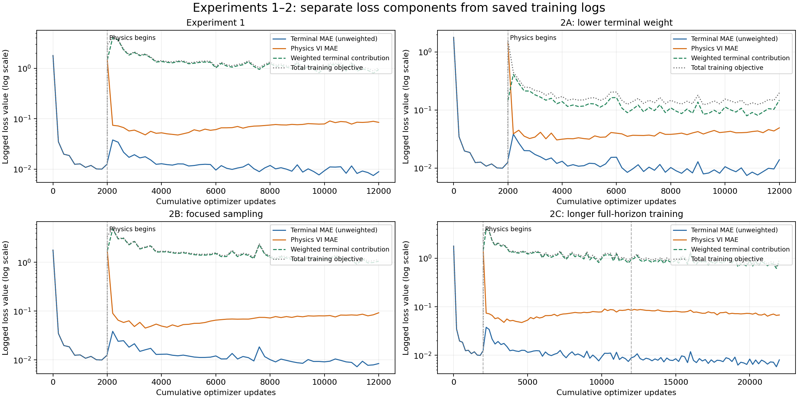
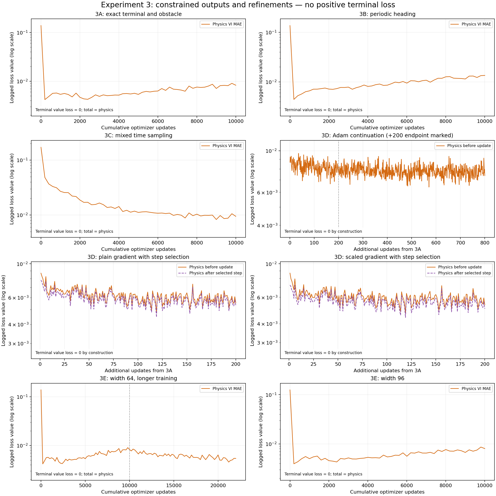
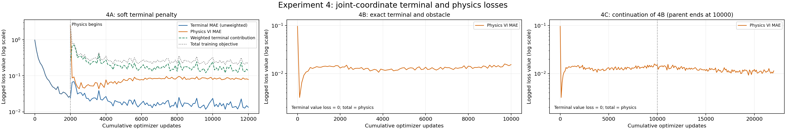
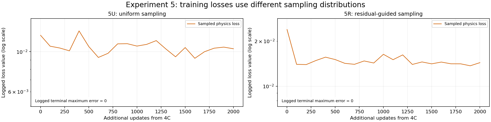

# Small Case Learning reachability: accuracy, gradients and control in Air3D

MAE 494 Project 3 — final technical analysis, 28 October 2026.  
Experiments 1–5 are complete. The relative-coordinate model was also tested on previously unused states. The joint-coordinate results are development tests used to guide the research; their reserved final test remains unused. The memo is an unsent draft.

## 1. Outreach and interview

After contacting several ASU researchers whose work involves partial differential equations, I contacted Professor Yi Ren on Monday, October 19, 2026. His work includes differential games, optimal control and physics-informed neural networks.

In our initial email exchange, he suggested exploring Hamilton–Jacobi equations for safe control and DeepReach. I expressed interest in the limitations of PINNs for safety-critical control and how researchers assess the safety of their results. He then suggested a meeting to discuss the topic further.

The interview raised concerns about using statistical evidence to assess safety and about the reliability of steering decisions from a learned model. DeepReach estimates a value function—a score describing the collision margin—and uses its gradients, or local rates of change, to choose turns. My study examines how accurately those predictions support control decisions. Professor Ren also indicated that reproducing DeepReach would be a viable small-scale experiment.

## 2. Problem brief — DeepReach Air3D replication

**Can formulation, optimization and sampling improve a small reachability model, and do better value predictions lead to better control?**

I reproduced the core [DeepReach](https://arxiv.org/abs/2011.02082) method on a CPU laptop using Air3D, a simplified two-vehicle collision-avoidance problem. One vehicle tries to avoid a collision while the other tries to cause one. This represents a worst-case interaction, which is useful when studying safety.

A physics-informed neural network (PINN) learns from the equations of motion. It predicts a **value function**: a collision-margin score for a starting situation and a chosen look-ahead time. For the ideal solution, a positive value means the evader can maintain separation; a nonpositive value means collision can be forced. Changes in this score also suggest which way to turn.

**Project route: Path B — diagnosis, with tested remedies.** I investigated why the small model was inaccurate, compared possible improvements, and checked whether better predictions led to better steering. The reduced case keeps the difficult connection between predicting safety and choosing a useful action. It leaves out full vehicle dynamics, sensing and real flight.

The study supports specific improvements in value accuracy. It also shows that a lower training error or a better average prediction does not by itself establish reliable control.

## 3. Minimal case formulation and replication

The vehicles move in a plane at a fixed speed of $v=.75$ m/s. Each can turn at up to 3 rad/s. A collision occurs when their centers are no more than $R=.25$ m apart. The model looks ahead by at most $T=.5$ s.

A **state** describes the vehicles' positions and headings. The model answers two questions: what collision margin is possible from that state, and which turn does its prediction suggest? The equations below specify the game for readers who want the mathematical detail.

Governing equations and control rule — technical detail

Here $\omega=3$ rad/s is the turn-rate limit.

Relative position and heading in the evader's frame are $s=(x,y,\psi)$:

$$
\dot x=v(\cos\psi-1)+uy,\qquad
\dot y=v\sin\psi-ux,\qquad
\dot\psi=d-u.
$$

With collision function $l(s)=\sqrt{x^2+y^2}-R$ and time remaining $\tau$:

$$
\max\{V_\tau-H(s,\nabla_sV),\ V-l\}=0,
\qquad V(0,s)=l(s).
$$

For $p=\nabla_sV$, the evader maximizes and the pursuer minimizes the Hamiltonian:

$$
H=v[(\cos\psi-1)p_x+\sin\psi\,p_y]
+\omega|yp_x-xp_y-p_\psi|-\omega|p_\psi|.
$$

For the ideal solution, $V\le0$ identifies states where collision can be forced. Candidate feedback is

$$
u^{\ast}=\omega\mathrm{sign}(yp_x-xp_y-p_\psi),\qquad
d^{\ast}=-\omega\mathrm{sign}(p_\psi).
$$

Value accuracy and the reliability of these gradient-derived controls are evaluated separately.

### Network and training

The main networks have three layers of 64 units, with sine activations. Each training step checks 2,048 sampled situations, including 256 with no time remaining. Adam is the optimization method used to adjust the network; its learning rate is $10^{-4}$. **Training uses the physics and known collision condition, without numerical-reference answers or gradients.**

The original baseline—the starting model—first spends 2,000 steps learning the known answer when no time remains. It then takes 10,000 physics-training steps while gradually increasing the look-ahead interval. Later models build the known condition directly into the output:

$$
V_\theta(\tau,s)=l(s)-.25(\tau/T)g_\theta(\tau,s)^2.
$$

Here $g_\theta$ is the network's learned correction. This construction guarantees the correct answer at zero look-ahead and prevents the predicted value from exceeding the current collision margin. Separate pretraining for that condition is therefore unnecessary. Other physical consistency checks can still fail, as discussed in Section 7.

The **3D model** uses relative position and heading—three state variables—plus time, with 8,705 adjustable parameters. The **6D model** uses both vehicles' separate positions and headings, plus time, with 8,897 parameters. Both describe the same physical game. The second tests whether extra coordinates make learning harder and whether moving or rotating an equivalent encounter changes the prediction.

## 4. Baseline and diagnostics — P1–P5

The [assignment diagnostic kit](https://designinformaticslab.github.io/DesignOptimization2025/project3.html#pinn-pino-diagnostic-kit-required) organizes the evaluation. The conventional baseline is the numerical solver; the original PINN baseline is Experiment 1.

### P1 — Conventional baseline

I compare the network with an independent numerical solver that calculates the solution on a grid. This provides an approximate reference answer. The grid covers $[-2,2]^2$ m in relative position and all headings; comparisons use the smaller interior square $[-.6,.6]^2$ m to reduce boundary effects.

I checked the reference using finer grids, a larger domain and simplified cases with known behavior. Smaller differences between successive grids increase confidence in the comparison:

| Look-ahead | MAE between 65- and 97-node references [m] | MAE between 97- and 129-node references [m] | Expanded-domain maximum change [m] |
|---|---:|---:|---:|
| 0.25 s | 0.003914 | 0.001955 | 0 |
| 0.5 s | 0.004420 | 0.002206 | 1.11e-16 |

These spatial grids use 48, 72 and 96 heading points. The solver uses local Lax–Friedrichs differences, CFL-controlled time steps, a collision-target constraint and periodic headings; outer spatial values use constant extension. A single fine-grid solve took **136.73 s**. Agreement between grids supports the reference but does not prove it is exact.

### Metrics and evaluation groups

- **Value MAE:** average absolute error in the collision-margin score, measured in meters; lower is better.
- **Relative L² [%]:** overall prediction error relative to the size of the reference values; lower is better. Its definition is

$$
100\sqrt{\frac{\sum_i(V_\theta(\tau,s_i)-V_{\mathrm{ref}}(\tau,s_i))^2}
{\sum_i V_{\mathrm{ref}}(\tau,s_i)^2}}\ \%.
$$

- **IoU:** how closely the predicted unsafe region overlaps the reference unsafe region; higher is better.
- **False-safe:** the model calls a reference-unsafe state safe, as a percentage of reference-unsafe states.
- **False-unsafe:** the model calls a reference-safe state unsafe, as a percentage of reference-safe states.

**Development data** were used to compare ideas; **final-test data** were kept separate until the models and test rules were fixed. The two 24,000-state 3D sets and later 6D sets must therefore be reported separately. Four equivalent poses are four placements of the same encounter, not four independent encounters; uncertainty calculations keep them together.

### P2 — Training-loss components

A **loss** is the error measure used to train the network. These plots separate disagreement with the known zero-time answer (**terminal loss**) from disagreement with the governing equation (**physics loss**). They use existing training logs, with logarithmic vertical axes.

*Blue: terminal error; orange: physics error; green: weighted terminal contribution; gray: total objective. The dashed phase marker shows when physics training begins. In 2C, the later marker is the start of the additional training.*

The constrained models build the zero-time answer into their output, so terminal-value loss is **exactly zero** and the total training objective is physics loss. Zero cannot appear on a logarithmic axis; it is labeled explicitly, without substituting an artificial small value.

Experiment 3 — constraints, periodic inputs, sampling and refinement

*3D shows the loss before each update and, where logged, after the selected step on that same batch. Adam's +200 endpoint is marked; its trace continues to +800. Other markers identify continuation from a saved parent.*

*4A retains a weighted terminal penalty. 4B/4C enforce the terminal condition directly; 4C includes its inherited 4B history and continues after the 10,000-step marker.*

Experiment 5 — uniform and residual-guided continuation

*The logged terminal maximum error is zero in both arms. Their physics curves use different sampling distributions and must not be used to rank the models; the common evaluation audit provides that comparison.*

The plots show every logged point without smoothing. Each panel has its own vertical range. Training losses are diagnostics, not value-error or safety guarantees. [Saved CSV histories and plotting notes](report_assets/project3_loss_components_20261028/README.md) document the components and exact-zero handling.

### P3 — Difficulty knob and relative L²

The **difficulty knob is look-ahead time $\tau$**: how far into the future the model must assess an encounter. I test 21 times from 0 to 0.5 s, spaced 0.025 s apart, without retraining each model. This shows how accuracy changes farther from the known zero-time answer, within the trained interval.

*Original development models: relative L² is on the left; MAE and false-safe rate are alongside it.*

The original model's MAE increases from .04230 m at .25 s to .09150 m at .5 s. Longer look-ahead is therefore harder in this comparison. The reference is solved directly at each plotted time. This is not a study of separately trained horizons, and it does not identify a precise failure threshold.

*Separate 3D final evaluation. Long22000 reaches 15.48% relative L² and 0.02008032 m MAE—about 2 cm average error in the collision-margin score—at 0.5 s. These states have now been used and are no longer an untouched test resource.*

### P4 — Error location and spectra

*Selected space–time error slices, not drone trajectories.*

*Spatial and heading spectra for the initial models.*

The error maps show **where predictions differ from the reference**. The Fourier spectra show whether those errors mainly vary smoothly or contain rapid spatial/heading changes. Most centered error energy is at lower frequencies, so these plots do not establish an inability to represent fine detail as the main problem.

The spectra remove mean error and use windowing to reduce artificial edge effects; they complement the value metrics. The original plots cover the initial models and three times, so they do not describe every later model or establish how error frequencies vary over time.

### P5 — Computational cost

Runs used an Intel Core Ultra 7 165U laptop, about 31.45 GiB RAM, CPU-only PyTorch 2.5.1 and two Torch threads.

| Measurement | Original PINN | Cached numerical grid |
|---|---:|---:|
| Training/build time [s] | 206.38 | 136.73 |
| Warm single-state value query [µs] | 351.14 | 352.38 |
| Batch of 1,024: per-state query [µs] | 2.69 | 0.89 |

Here a **query** means asking for one value prediction after setup. Timings exclude loading and steering calculations, and the two methods do not have equal accuracy. Both the network and grid can be saved and reused, so the fair cost comparison is

$$
T_{\rm train}+Nt_{\rm NN}\quad\text{versus}\quad
T_{\rm grid\ build}+Nt_{\rm interpolation}.
$$

For batches, the saved grid was faster. The study therefore demonstrates no practical speed advantage for the PINN on this fixed game. Later models were not all timed under the same query protocol.

Experiment 5 gives each method **2,000 training updates**. The residual-guided method also scores 327,680 candidate points, so it performs extra work. Recorded run times were 49.138 s for 5U and 49.090 s for 5R, including scoring; this small timing difference does not establish a speedup. Value/reference and simulated-control evaluation took 157.44 s and 145.96 s respectively, excluding startup and later verification.

## 5. Experiments, research and conclusions

### Experiments 1–3 — relative-state models

The first experiments ask whether changing training choices can improve the same small model. The table reports development results; final-test and 6D results use separate datasets.

| Experiment | Change | MAE at .5 s (m) | Interpretation |
|---|---|---:|---|
| 1 | Reduced soft-terminal baseline | .09150 | Core workflow ran, accuracy inadequate |
| 2A | Terminal multiplier divided by ten | .04477 | Loss balance materially affected this run |
| 2B | Spatially focused sampling | .07189 | Helped baseline; induced loss calibration also changed |
| 2C | Extra 10,000 full-horizon physics steps | .06048 | More updates helped, at extra cost |
| 3A | Exact terminal/obstacle output | .02602 | Large gain without more physics updates |
| 3B | Periodic heading features | .03517 | Fixed heading aliases, worsened overall MAE |
| 3C | Mixed curriculum/full-horizon times | .02996 | More late-time exposure alone did not fix error |
| 3D | Adam continuation, +200 updates | .02282 | Short refinement helped; longer was not uniformly better |
| 3E | Width-64 model continued to 22,000 updates | .01985 | Best value result in that development comparison |
| 3E | Fresh width-96 model, 10,000 updates | .02127 | Capacity helped, but not a controlled equal-runtime win |

The original model called 46.42% of reference-unsafe states safe at 0.5 s. Reducing the terminal-loss weight cut MAE by **51.1% without adding training steps**. This controlled comparison supports loss imbalance as a contributing problem. Building known conditions into the output then reduced MAE by another **41.87%**. That change also alters initialization and removes pretraining, so its effects cannot all be assigned to the output equation alone.

Other ideas were less successful. Making heading inputs repeat correctly after a full turn, or sampling more later-time situations, improved some large-error cases but worsened overall accuracy. Trial parameter changes also reduced physics loss without reliably improving values. These outcomes show why an appealing idea needs a broad comparison before being adopted.

### Completed 3D final evaluation

After I froze the models and protocol, evaluation on 24,000 previously unused states confirmed the development improvement:

| Fixed checkpoint | Final-set MAE at .5 s (m) | Unsafe-set IoU |
|---|---:|---:|
| Original 3A | .02628533 | .79701 |
| Adam +200 | .02297716 | .81636 |
| Long22000 | **.02008032** | **.84239** |

Long22000 reduced MAE **12.61%** versus Adam +200, with a paired 95% sampling interval of **11.93–13.25%**, and improved it at all 20 nonzero horizons. Maximum final-time error remained .26455 m. No false-safe classifications were observed at those horizons, but that does not certify controls or bound error everywhere.

These results confirm an improvement on new states in the same game. The final set has now been used and cannot serve as fresh evidence for later changes.

### Experiment 4 — joint coordinates and control

On the same grouped 6D development encounters, MAE was .08695 m for soft-output 4A, .02631 m for exact-output 4B, and .02573 m for its longer continuation, 4C. 4A and 4B each use 10,000 physics updates; 4A also uses 2,000 pretraining updates. 4C continues 4B to 22,000 physics updates. Formulation improved MAE **69.75%**; additional training improved it **2.19%**. The fixed 3D Long model was more accurate on these encounters at .01943 m.

Moving or rotating an otherwise identical encounter could still change the joint model's answer. Simulations also found situations where it chose the wrong turn, despite good average gradient agreement. Local checks suggested that its change from one turning direction to the other occurred in the wrong place. The physics loss flagged the difficult region, but did not reliably identify which turns were wrong. This motivated a sampling test.

### Experiment 5 — uniform versus residual-guided sampling

Both methods continue the same 4C model and optimizer state for 2,000 updates, reaching 24,000 total. **5U** keeps uniform random sampling. **5R** replaces 25% of the nonterminal samples with situations where the current physics error is high. Its selection bank is refreshed 40 times, scoring 327,680 candidates. Neither method uses reference answers in training.

Evaluation uses **6,000 new development encounters**, each placed in four equivalent poses, at 21 look-ahead times:

| Model | MAE at .5 s (m) | Improvement over 4C | Contacts vs reference pursuer on 628 reference-safe poses |
|---|---:|---:|---:|
| Parent 4C | .02543785 | — | 8 |
| 5U: uniform | .02284501 | 10.19% | 8 |
| 5R: residual-guided | .02277261 | 10.48% | 8 |

Both methods improve value accuracy by about 10%. However, 5R's advantage over 5U is only **0.3169%**, with a paired 95% sampling interval of **−0.2478% to +0.8802%**. Because the interval spans either method winning, the study establishes no clear sampling advantage; it also does not prove the methods equivalent.

5R reduces some large and later-time physics errors. But 5U performs better on average physics error, evader turning decisions and consistency across equivalent poses/headings. Neither fixes the known initial-turn error.

The control test simulates the vehicles using seven steering policies at two control intervals, covering **78,400 trajectories**. Against the reference pursuer, all three learned models collide in eight of the same 628 reference-safe starting poses. Halving the control interval does not change those outcomes. Those eight contacts are two underlying encounters in four poses each. The learned models had already labeled those starting states unsafe.

The numerical-reference controller also collides in **four poses**, reaching .24521 m separation despite positive initial values from both grids. The four poses represent one underlying encounter. Its value predictions and feedback are therefore imperfect too. Replaying the saved controls reproduces the results; resolving the reference failure remains future work.

### Conclusions

**The study produced useful improvements and a clear limit: better average predictions did not guarantee better steering.**

- **Formulation mattered:** changing loss weights and enforcing known physical conditions substantially improved value accuracy before adding physics-training steps.
- **More training helped the selected models:** the 3D improvement carried over to previously unused states.
- **The tested sampling change was not a clear improvement:** its small value advantage was uncertain, and collision counts were unchanged.

I recommend retaining **5U as the simpler 6D comparison model** because the extra sampling mechanism showed no clear benefit. **Long22000 is the best confirmed 3D value model in this study.** The evidence supports further research on learned reachability, but not using these models as a safety assurance system.

Next, resolve the numerical-reference collision before designing another steering or representation change, then check findings across training seeds. The **reserved 6D final set remains unused**. More complex games and real-world flight require separate validation.

## 6. Reproducibility and evidence

The [evidence register](report_assets/project3_final_20261028/source_packet/evidence.json) records source paths, hashes and headline metrics. The [archived analysis](report_assets/project3_final_20261028/source_packet/REPORT.md) and [reproduction guide](report_assets/project3_final_20261028/source_packet/REPRODUCIBILITY.md) retain full methods. Register paths refer to the original project root.

Experiment 5 [training records](report_assets/project3_final_20261028/evidence/experiments_6d/experiment_5_sampling/TRAINING_RESULTS.md), [evaluation](report_assets/project3_final_20261028/evidence/experiments_6d/experiment_5_sampling/evaluation/README.md), and [methodology](report_assets/project3_final_20261028/evidence/experiments_6d/experiment_5_sampling/evaluation/METHODOLOGY.md) include protocols and verification. Checks recalculated the saved measurements and replayed 5.88 million control updates. They verify the records, not a safety guarantee.

The [portable runnable packages](packages/README.md) include the original code, configurations, trained models and saved results. Start with the small code ZIP and add the three optional result ZIPs as needed. The guide explains setup, basic checks, model queries and results replay; training requires an explicit command. [Validation](packages/VALIDATION.md) passed from a separate Windows folder using existing dependencies. A clean installation and other operating systems remain untested.

The [recommendation memo draft](report_assets/project3_final_20261028/source_packet/RECOMMENDATION_MEMO.md) is available separately and remains unsent. [Earlier detailed reports](https://github.com/evl-jack/MAE_494_2026/blob/5461fdf9d07c7a170a6b1803a585fc2a1b1994b3/Project_3.md) remain available; their next-step statements are historical.

## 7. Assumptions and limitations

### Assumptions

- **Idealized motion:** both vehicles move in a plane at equal constant speed with bounded turn rates and a fixed collision threshold. Positions and headings are known; sensing noise, delays, wind, altitude and full vehicle dynamics are not modeled.
- **Fixed game:** results concern the specified parameters and 0.5 s horizon. The six joint coordinates describe the same three-state relative game; they do not establish scaling to a genuinely higher-dimensional interaction.
- **Physics-only training:** the governing equations and analytic collision target are assumed correct. Numerical-reference values and gradients are used only for evaluation.

### Limitations

- **Approximate reference:** grid resolution, interpolation and feedback discretization affect values and controls. The reference controller also collided in one tested encounter, so it is not a safety guarantee.
- **Limited generalization:** most configurations use one training seed, or random training setup. Sampling intervals measure variation across evaluation states, not across training seeds or reference solvers. Development encounters guided the research; the 3D final test has been used, and the 6D final test remains unused.
- **Incomplete causal isolation:** some comparisons change initialization, pretraining or compute alongside the intended modification. They do not identify a universal cause of error.
- **Control and consistency:** the built-in conditions do not guarantee matching answers for equivalent headings, nonincreasing values with longer look-ahead, or the separate lower value bound. Simulations test a finite set of steering policies and leave unresolved failures.
- **Scope of claims:** no uniform error bound, paper-scale accuracy, real-world flight validation or accuracy-matched speed advantage is established.

## References

1. Bansal, S., and Tomlin, C. *DeepReach: A Deep Learning Approach to High-Dimensional Reachability*. [arXiv:2011.02082](https://arxiv.org/abs/2011.02082).
2. [Official DeepReach source at the pinned revision](https://github.com/smlbansal/deepreach/tree/a8127aa7825d58623e9646211644876c83dd71d0).
3. [Project 3 description and rubric](https://designinformaticslab.github.io/DesignOptimization2025/project3.html).
