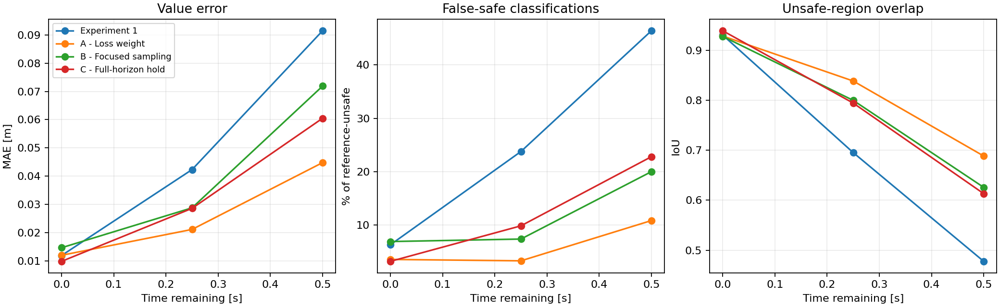

# MAE 494 — Project 3: DeepReach Air3D Reproduction

> Technical report updated October 26, 2026. Reorganized from Main at commit `ed8a645c080b8aaf0ac0c0625fc514da7c3cc7e9`. Experiments are unchanged. Outreach documentation and the recommendation memo are deferred in this revision.

## 1. Overview and main findings

We implemented a reduced DeepReach physics-informed neural network (PINN) for the Air3D collision-avoidance benchmark and compared it with an independent approximate grid solution. The objective is to learn as much as possible from a small model before scaling up or introducing reference supervision.

**Completed:** Experiment 1 established a reduced CPU baseline; Experiment 2 tested three separate changes to its training. At 0.5 s remaining, lowering the terminal-loss multiplier tenfold reduced value MAE by 51.1%, from 0.09150 m to 0.04477 m. False-safe among reference-unsafe states fell from 46.42% to 10.82%. The tradeoff was an increase in false-unsafe from 3.43% to 8.33% and full-box terminal MAE from 0.00891 m to 0.01457 m.

These single-seed comparisons support further investigation of training choices at reduced scale. They do not demonstrate paper-scale accuracy, gradient reliability, or closed-loop collision avoidance. Full paper-scale training, reference-supervised training and control evaluation remain unexecuted.

**Reading guide:** problem → shared method and metrics → baseline → controlled comparisons → limitations and next questions → reproducibility and technical appendices.

## 2. Problem and minimal case

### Objective and researcher context

Reproduce a minimal DeepReach physics-informed neural network (PINN) for Hamilton–Jacobi (HJ) reachability as an ASU Design Optimization Project 3 experiment.

According to the project interview notes, Professor Yi (Max) Ren explicitly approved reproducing DeepReach as sufficient for the assignment. He suggested HJ safe control and DeepReach and raised a question about whether learned safety value-function gradients provide useful, reliable control directions.

The immediate priority is reproducing the PINN. A separate investigation of gradient reliability is optional future work. DeepReach **does compute gradients**: automatic differentiation supplies the derivatives used in training and in deriving control from the value function. The open question concerns their accuracy and usefulness in an approximation.

### Air3D and the retained difficulty

The evader chooses a turn rate to avoid collision; a worst-case pursuer chooses its turn rate to force collision. The model uses relative position and heading in the evader's rotating coordinate frame. It does not include altitude, thrust or full quadrotor dynamics.

| Parameter | Value |
| --- | --- |
| Both drone speeds | 0.75 m/s |
| Evader and pursuer turn bounds | ±3 rad/s |
| Collision radius | 0.25 m |
| Reduced experiment horizon | 0.5 s |
| Full experiment horizon | 1 s |
| State | Relative x, y, heading psi |
| Network input | Time remaining tau and the three states |

The minimal case retains the nonlinear max–min reachability equation, the collision boundary, and the need to learn useful state derivatives. It simplifies the application to planar relative motion with three state variables. It cannot establish performance for full quadrotor flight.

**Difficulty variable:** time remaining, evaluated at 0, 0.25 and 0.5 s. This probes how approximation error changes away from the known terminal condition in a single trained model. It is not a sweep of independently trained maximum horizons, and the report does not claim to locate a collapse threshold.

**Study framing:** a diagnosis study with an exploratory remedy comparison (closest to Path B, with evidence relevant to Path C). The baseline reproduces a limitation and the candidates test loss weighting, sampling and additional optimization. The evidence implicates sensitivity to training choices; it does not uniquely identify the root cause or establish complete Path B/C rubric coverage.

The numerical formulation and candidate-control equations appear in Appendix A.

## 3. Shared method and evaluation

### Implementation

1. **Problem:** dynamics, collision target, control/disturbance bounds and max-min Hamiltonian.
2. **Neural solver:** a sine network predicts the scalar value from time and state. Terminal pretraining learns the known zero-time function; physics training then expands the sampled time interval. Autodiff supplies the derivatives in the HJI loss.
3. **Independent grid solver:** NumPy local Lax–Friedrichs differences, periodic heading, explicit CFL and target-obstacle projection provide an approximate reference. Spatial boundaries use constant extension and are checked from an interior region against a larger domain.
4. **Comparison:** after training, measure held-out terminal and physics errors, value errors, unsafe-region overlap, false-safe fractions, and value/zero-contour slices. Reference labels never enter PINN training.

### Reduced configuration

| Setting | Completed reduced runs |
|---|---|
| Network | Three sine hidden layers, width 64; 8,705 trainable parameters |
| Samples per step | 2,048; 256 terminal samples during baseline physics training |
| Optimizer | Adam, learning rate 0.0001 |
| Baseline/A/B schedule | 2,000 terminal-pretraining + 10,000 expanding-time physics steps |
| Candidate C schedule | Baseline checkpoint + 10,000 full-horizon steps; 22,000 cumulative |
| Horizon | 0.5 s |
| Spatial training domain | Relative x and y each in [-2, 2] m |
| Interior comparison region | Relative x and y each in [-0.6, 0.6] m |
| Comparison heading | [-π, π), with periodic reference interpolation |
| Seed and hardware | Seed 7; Intel Core Ultra 7 165U, two CPU threads, CPU PyTorch 2.5.1 |

### Reference and evaluation distributions

The finest approximate reference uses 129 × 129 spatial nodes and 96 headings. Every run is compared on the same 24,000 interior states at 0, 0.25 and 0.5 s remaining. Separate full-box diagnostic samples measure terminal error and the variational-inequality (VI) residual. No reference values or gradients enter training.

The baseline reference checks used 65/97/129 spatial-node grids with 48/72/96 headings. At 0.5 s, successive refinement MAEs decreased from 0.004420 m to 0.002206 m; the matched-spacing expanded-domain maximum change was 1.11e-16 m. These checks support using the grid for comparison but do not provide a rigorous error bound. Its first-order discretization retains numerical diffusion and nonsmooth-target error.

### Metric definitions

| Metric | Meaning and direction |
|---|---|
| Value MAE [m] | Mean absolute difference between PINN and reference values; lower is better |
| Unsafe-region IoU | Intersection divided by union of predicted/reference unsafe regions; higher is better |
| False-safe / reference-unsafe | Count(PINN > 0 and reference ≤ 0) / count(reference ≤ 0); lower is better |
| False-unsafe / reference-safe | Count(PINN ≤ 0 and reference > 0) / count(reference > 0); lower is better |
| Full-box terminal MAE [m] | Error against the known zero-time function on separate full-box samples |
| Full-box VI MAE | Mean absolute implemented equation/obstacle residual; a diagnostic, not a value-error or safety bound |

The baseline's **0.01184 m time-zero interior value MAE** and **0.00891 m full-box terminal MAE** use different evaluation distributions. They are not conflicting estimates of the same sample statistic.

After using these held-out comparisons to choose promising settings, they should be treated as validation results. A final generalization claim would require independent testing.

## 4. Experiment 1 — establishing the baseline

### Question and motivation

Can a reduced CPU implementation learn the time-dependent Air3D reachability solution, and how does its error change with time remaining?

### Design and evaluation

The reduced model uses three sine hidden layers of width 64, 2,048 samples per iteration, 2,000 terminal-pretraining steps and 10,000 physics-curriculum steps. Training took 206.4 seconds on two CPU threads, with a 0.5 s horizon.

The shared evaluation protocol is defined above. These are time slices of one trained model, not separately trained horizon experiments.

### Results

| Time remaining | Value MAE | Unsafe-region IoU | False-safe among reference-unsafe |
|---|---|---|---|
| 0 s | 0.01184 m | 0.930 | 6.28% |
| 0.25 s | 0.04230 m | 0.695 | 23.77% |
| 0.5 s | 0.09150 m | 0.478 | 46.42% |

False-safe here means PINN>0 while the approximate grid reference is <=0, divided by the reference-unsafe sample count. The comparison uses 24,000 held-out interior states. At 0.5 s, 5,276 are reference-unsafe; false-safe among all states is 10.20%. These are reference-relative classifications, not certified ground truth.

### Interpretation, tradeoffs and limits

The network learned the terminal condition considerably better than the time-dependent reachability solution. Checkpoint reload and optimizer restart checks passed. Reference refinement improved, and the larger-domain test showed negligible interior sensitivity. The reduced PINN nevertheless misses substantial unsafe regions, so successful reproduction of the paper's reported accuracy is not claimed.


*Figure 1. Baseline value slices and zero contours. White contours show the approximate reference; dashed red contours show the PINN.*

**Conclusion:** the baseline provides a working implementation and a reproducible approximation failure to investigate. Its growing error with time motivates testing training choices before enlarging the model.

### Existing diagnostic figures


*Figure 2. Saved baseline training history. Training losses and held-out value errors measure different quantities.*


*Figure 3. Saved PINN-minus-reference slices show where the baseline approximation differs from the numerical solution. These slices are not a complete space–time error field or an error spectrum.*

## 5. Experiment 2 — comparing training changes

### Question and motivation

Experiment 1 learned the known time-zero collision-distance function more accurately than the time-dependent reachability solution. At 0.5 s it missed 46.42% of reference-unsafe states. We tested whether loss balance, the spatial distribution of physics samples, or insufficient training at the full horizon contributed to this error. The aim was to improve the reduced model before committing to a larger network or paper-scale computation.

### Design

We ran three separate candidates against the unchanged Experiment 1 baseline:

| Candidate | Change | Reason for testing it |
|---|---|---|
| **A — Lower terminal-loss weight** | Divide the initially calibrated terminal multiplier by 10, from about 106.43 to 10.64; keep it fixed afterward | Give the physics equation more influence relative to matching the zero-time condition |
| **B — Focused physics sampling** | Draw 50% of nonterminal physics samples uniformly by area inside a radius-1 m disk; retain uniform-box sampling for the other 50% | Spend more of the same sample budget near the region where collision can occur within the modeled horizon |
| **C — Additional full-horizon training** | Continue Experiment 1's exact model, Adam optimizer and random state for 10,000 additional updates, with time sampled over the full [0,0.5] s interval | Test whether more optimization at the final horizon helps after the original expanding-time curriculum |

A and B each started fresh with the original 2,000 terminal-pretraining + 10,000 physics-curriculum steps. C inherited the original 12,000 steps and finished at 22,000 cumulative steps; it therefore has a larger training budget. The radius in B follows the physical bound R+2*v*T=1 m. Terminal/pretraining coordinate samples remain uniform. B retains the original automatic loss-calibration rule, whose changed first physics batch produces a terminal multiplier of about 125.35.

All candidates retain the same three sine hidden layers of width 64, 2,048 samples per step, Air3D dynamics, 0.5 s horizon, spatial domain, Adam learning rate of 1e-4, seed 7 and two CPU threads. Each run saved its own configuration, checkpoint, optimizer state, training history, runtime, metrics and plots in the local project. Experiment 1's checkpoint and numerical-reference arrays were preserved and their hashes checked.

We reproduced the baseline measurements, then reused the checked numerical grid and the same 24,000 held-out interior states at 0, 0.25 and 0.5 s for every comparison. Separate full-box samples measured terminal and physics errors. **No numerical-reference values or gradients entered training**: Experiment 2 remains physics-informed training, not hybrid supervised training.

### Results

Results at **0.5 seconds remaining**:

| Run | Value MAE [m] | Unsafe-region IoU | False-safe / reference-unsafe | False-unsafe / reference-safe | Full-box terminal MAE [m] |
|---|---|---|---|---|---|
| Experiment 1 baseline | 0.09150 | 0.478 | 46.42% | 3.43% | 0.00891 |
| **A — Lower terminal weight** | **0.04477** | **0.688** | **10.82%** | 8.33% | 0.01457 |
| B — Focused sampling | 0.07189 | 0.626 | 20.00% | 7.86% | 0.01045 |
| C — Additional full-horizon training | 0.06048 | 0.613 | 22.80% | 7.31% | **0.00708** |



*Figure 4. Saved comparison from the completed Experiment 2 runs. C uses more cumulative training than A/B. Metric definitions and evaluation domains are given in Section 3.*

### Interpretation and tradeoffs

- **A produced the strongest final-horizon improvement:** value MAE decreased 51.1%, false-safe decreased 35.60 percentage points, and IoU increased from 0.478 to 0.688. However, terminal error increased and more reference-safe states were labeled unsafe. Lower weighting improved the balance for this run, rather than improving every metric.
- **B improved value MAE by 21.4%** and reduced false-safe to 20.00%. It outperformed the baseline on the final-horizon classification metrics, but its full-box physics residual increased from 0.09033 to 0.09979. Better regional predictions did not imply better physics residual everywhere.
- **C improved value MAE by 33.9%** and reduced false-safe to 22.80%. It also improved terminal error. Its value MAE was lower than B's, while B had fewer missed reference-unsafe states and higher IoU.

A and B recorded 326.5 s and 341.5 s of training, respectively. C added 230.6 s to the baseline's 206.4 s, for 436.9 s cumulative training. These exclude evaluation/setup time; debugger overhead and machine workload prevent interpreting the runtime differences as optimizer-efficiency results.

**Finding:** the tested training changes improved final-horizon value MAE for this small PINN without enlarging the network. A had the lowest measured final-horizon value MAE and false-safe rate and the highest IoU among the tested candidates; its higher false-unsafe rate and terminal error remain costs of that improvement. Extra training helped C but was not the strongest result.

### Conclusion and limits

These are exploratory results for one seed and selected settings. A and B are separate experiments; no combined candidate was run. Because the same held-out results were used to select improvements, they now serve as validation comparisons; a new untouched test set and repeated seeds would strengthen a final performance claim. The study measured values, residuals and unsafe-region classifications. It did **not** establish reference-gradient accuracy, closed-loop collision-avoidance performance, or certified safety. Improving those requires further evaluation, not an inference from lower value error alone.

## 6. Conclusions and limitations

The reduced model learned the terminal function more accurately than the time-dependent solution. All three tested training changes improved final-horizon value MAE; A produced the lowest value MAE and false-safe rate among them. Its higher false-unsafe rate and terminal error prevent describing it as an improvement on every criterion.

A changes loss weighting within the original step budget. B changes sampling and, through the unchanged calibration rule, the resulting terminal multiplier. C continues the exact baseline but spends additional steps. These distinctions matter when attributing improvements. The tests do not isolate every possible mechanism or show that any change is universally superior.

The reference is approximate, comparisons cover selected interior states, and only seed 7 was used. The existing reference checks reduce specific numerical concerns without certifying exact values. Derived controls remain candidates: value agreement alone does not establish accurate gradients or collision avoidance. The planar benchmark also omits altitude and full vehicle dynamics.

### Technical reporting coverage

The [assignment diagnostic requirements](https://designinformaticslab.github.io/DesignOptimization2025/project3.html#pinn-pino-diagnostic-kit-required) guide the following status check. Missing evidence remains explicit; this revision adds no computation.

| Item | Evidence currently available | Reporting gap |
|---|---|---|
| P1 — Conventional baseline | Grid refinement, analytic and boundary checks | The recorded 696.7 s covers solver checks, not an isolated production-solve timing |
| P2 — Loss components | Saved baseline history; local per-run histories | Verify separate component curves on log axes for each comparison |
| P3 — Error versus difficulty | Three time slices with MAE/classification metrics | Requested relative L2 plot is not supplied; time slices are not a horizon-training sweep |
| P4 — Error location and frequencies | Saved spatial error slices at selected times | Full space–time coverage and Fourier error spectrum are not supplied |
| P5 — Computational cost | Training times, CPU and thread count | Inference timing and a defensible break-even analysis are not supplied |

The current evidence supports a measured improvement at reduced scale. It does not establish all diagnostic requirements or a unique causal explanation. Manual verification of a reference result and a PINN error value is not documented in the reviewed report.

## 7. Proposed next work — not executed

| Question | Possible next investigation | Status |
|---|---|---|
| Does A's improvement repeat? | Repeated seeds and an untouched evaluation set | Proposed |
| Do learned derivatives give useful control directions? | Gradient/control comparisons, then closed-loop encounters | Proposed |
| Can the small model improve further? | Exact terminal enforcement, periodic heading inputs, optimization, loss balancing, sampling or schedule changes within fixed budgets | Proposed |
| Can additional consistency help? | Trajectory/costate consistency | Discussed proposal |
| When should scope expand? | Larger models or reference supervision/bounds after further reduced-model diagnosis | Later option |

These are proposed research questions; no additional experiments are reported here. A/B were tested separately; no combined candidate was run. Alternative optimizers and local predictive safety filters have been discussed but not implemented or tested. Scaling alone is not a demonstrated remedy.

## 8. Reproducibility and supporting evidence

- [Experiment 1 report](https://github.com/evl-jack/MAE_494_2026/blob/Main/outputs/deepreach/experiments/experiment_1/README.md)
- [Experiment 1 measured metrics](https://github.com/evl-jack/MAE_494_2026/blob/Main/outputs/deepreach/experiments/experiment_1/metrics.json)
- [Experiment index](https://github.com/evl-jack/MAE_494_2026/blob/Main/outputs/deepreach/experiments/README.md)
- [Implementation and setup](https://github.com/evl-jack/MAE_494_2026/blob/Main/outputs/deepreach/README.md)
- [Experiment 2 comparison data](outputs/deepreach/experiments/experiment_2/comparison.csv)

Experiments 1 and 2 completed on October 22, 2026. Experiment 2 candidates ran through VS Code Run and Debug. Experiment 1 training used a managed process with the selected interpreter; it was not launched by the debugger. Checkpoint reload and optimizer restart checks passed.

Public repository materials include Experiment 1 reports, plots, diagnostics, configuration and runnable implementation code. Experiment 2's comparison CSV and figure are included in its repository artifact directory; its detailed local results were used to prepare this report. Raw checkpoints, optimizer state, source snapshots, training logs and numerical-reference arrays remain local.

From the repository root with Python 3.12:

```powershell
python -m venv .venv
.\.venv\Scripts\python.exe -m pip install -r outputs/deepreach/requirements.txt
.\.venv\Scripts\python.exe outputs/deepreach/preflight.py --config outputs/deepreach/configs/cpu.json --out outputs/deepreach/checks/preflight_cpu.json
```

Preflight never trains. [The implementation README](https://github.com/evl-jack/MAE_494_2026/blob/Main/outputs/deepreach/README.md) contains training, resuming and comparison commands. Training requires an explicit --train flag, and existing checkpoints are protected against accidental overwriting. The smoke and reduced CPU runs and optimizer/checkpoint restart tests have completed.

## Appendix A. Governing equation and candidate controls

With evader turn u and pursuer turn d:

```text
xdot   = v*(cos(psi)-1) + u*y
ydot   = v*sin(psi) - u*x
psidot = d-u
l(s)   = sqrt(x*x+y*y)-R
```

For p=grad_s(V), the avoid Hamiltonian is max_u min_d p.f:

```text
H  = v*((cos(psi)-1)*p_x + sin(psi)*p_y)
     + omega*abs(y*p_x-x*p_y-p_psi) - omega*abs(p_psi)
u* =  omega*sign(y*p_x-x*p_y-p_psi)
d* = -omega*sign(p_psi)
```

Using time remaining tau=T-t:

```text
max(V_tau-H, V-l) = 0
V(0,s) = l(s)
```

For the ideal solution, V<=0 identifies states from which collision can be forced despite optimal evasion. Controls derived from a learned approximation are candidates and are not certified safe.

## Appendix B. Reproduction choices and configuration scope

The implementation is grounded in the [paper](https://arxiv.org/abs/2011.02082) and [official source pinned at a8127aa](https://github.com/smlbansal/deepreach/tree/a8127aa7825d58623e9646211644876c83dd71d0).

The baseline uses original **soft terminal loss**, distinct from the modern repository's exact-boundary default. Inputs and output have explicit normalization and autodiff chain rules. Hidden activations use sin(30*z) and SIREN initialization. The terminal/PDE weight is calibrated at curriculum start and then fixed; mean losses and this balancing choice are documented departures from modern adaptive/sum-loss options.

| Configuration | Actual sine hidden layers | Samples/step | Pretrain + curriculum iterations | Horizon |
| --- | --- | --- | --- | --- |
| Smoke | 3 × 32 | 256 | 20 + 40 | 0.5 s |
| Reduced CPU | 3 × 64 | 2048 | 2,000 + 10,000 | 0.5 s |
| Full paper-scale | 3 × 512 | 65,000 | 10,000 + 100,000 | 1 s |

All use Adam at 1e-4 and currently select CPU. The modern repository's num_hl=3 creates four sine hidden layers; actual layer counts are explicit here. Spatial boxes are widened to [-2,2] m for reduced runs and [-3,3] m for full, departing from upstream scaling to permit interior reference comparisons. See the implementation README for the dependency-region bound and numerical limitations. Full is a paper-scale configuration, not a claim of exact paper replication.

## Appendix C. Initial implementation verification

The [saved check data](https://github.com/evl-jack/MAE_494_2026/blob/Main/outputs/deepreach/checks/preflight_cpu.json) record **zero optimizer steps**.

| Check | Result |
| --- | --- |
| Dynamics/Hamiltonian against pinned official Air3D | Differences below 1e-15 |
| Candidate controls/disturbance against official source | Exact agreement on sampled cases |
| Hamiltonian against direct bounded max-min search | Maximum difference 1.78e-15 |
| Autodiff against float64 finite differences | Maximum difference 4.13e-7 |
| Explicit normalization chain rule | Maximum difference 1.42e-14 |
| Analytic time-to-go sign check | Zero residual |
| Physics-loss parameter derivatives | Finite; weights unchanged |
| Three configs and interior-domain bounds | Passed |
| Launcher without explicit --train | Refuses training |
| Syntax checks | Passed |

A small **0.1 s** grid test showed refinement differences decreasing from 0.00519 m to 0.00250 m in mean absolute value. In the no-turn analytic case, mean error decreased from 0.00691 m to 0.00265 m; fine-grid maximum error remained 0.0515 m. Matching grid spacing and time steps, expanded-domain values agreed at the sampled interior points for this short test. Frozen dynamics, obstacle projection and periodic heading checks also passed.

These initial results are implementation checks. The later Experiment 1 report records the trained comparison and reference refinement at its actual 0.5 s horizon. The full 1 s paper-scale experiment remains unexecuted.
