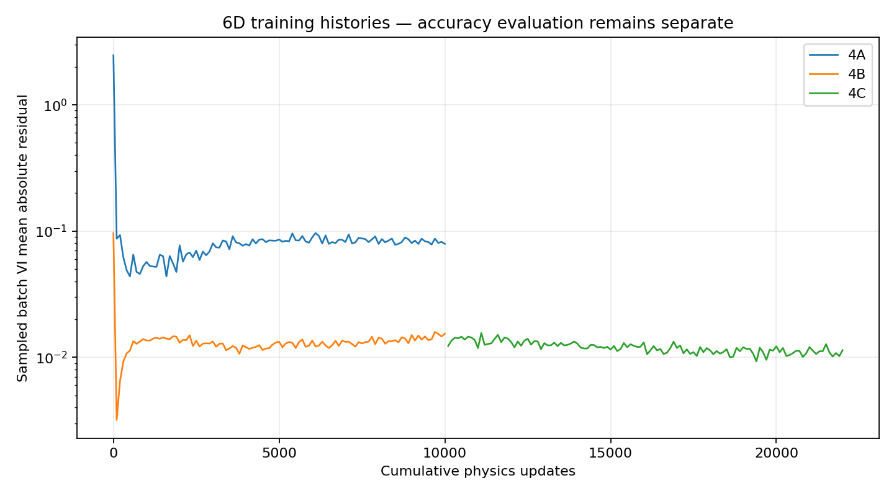
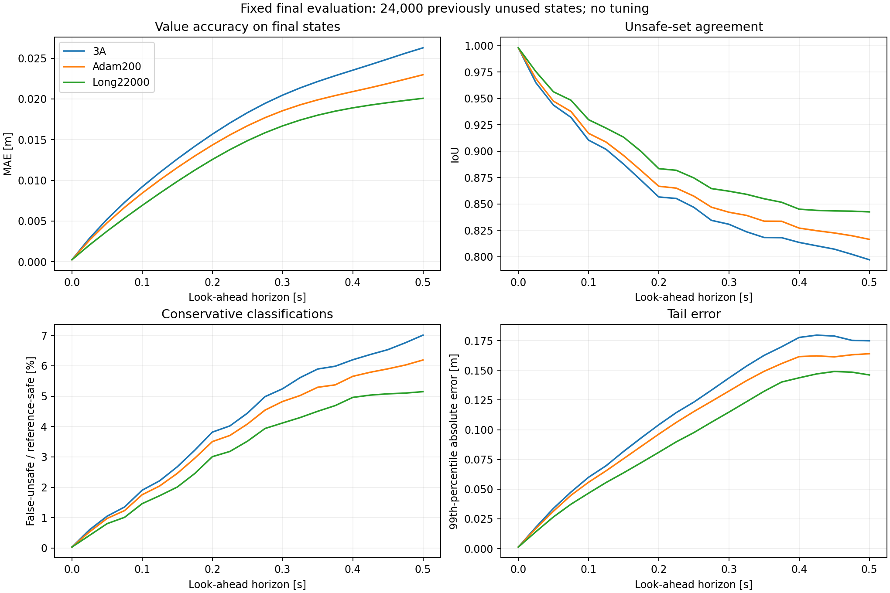
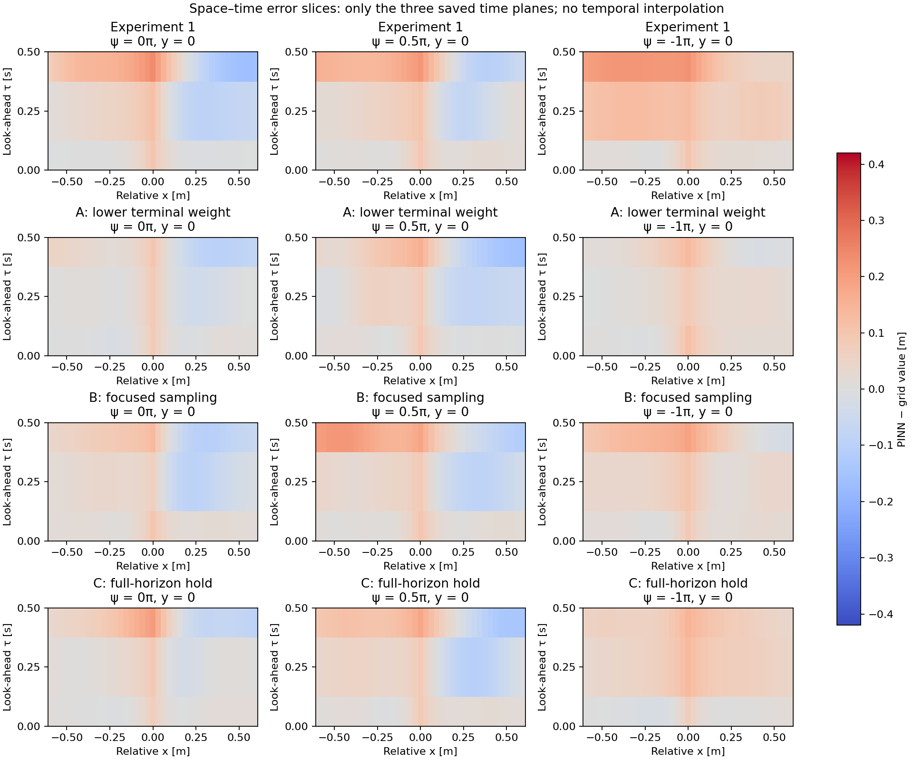

# Learning reachability on a laptop: accuracy, gradients and control in Air3D

MAE 494 Project 3 — final technical analysis, 28 October 2026.  
Experiments 1–5 are complete. The 3D final evaluation is complete; 6D results remain development evidence. The outreach and interview are summarized below; the memo remains an unsent draft.

## 1. Outreach and interview

After contacting several ASU researchers whose work involves partial differential equations, I contacted Professor Yi Ren on Monday, October 19, 2026. His work includes differential games, optimal control and physics-informed neural networks.

In our initial email exchange, he suggested exploring Hamilton–Jacobi equations for safe control and DeepReach. I expressed interest in the limitations of PINNs for safety-critical control and how researchers assess the safety of their results. He then suggested a meeting to discuss the topic further.

The interview raised concerns about statistical evidence for safety and the reliability of control directions derived from learned value functions. DeepReach estimates a reachability value function and derives candidate controls from its gradients; the research question is how accurately those gradients support control decisions. Professor Ren also indicated that reproducing DeepReach would be a viable small-scale experiment.

## 2. Problem brief — DeepReach Air3D replication

**Can formulation, optimization and sampling improve a small reachability model, and do better value predictions lead to better control?**

I reproduced the core [DeepReach](https://arxiv.org/abs/2011.02082) workflow on a CPU laptop using the Air3D collision-avoidance benchmark. A physics-informed neural network (PINN) estimates a value function that describes whether an adversarial pursuer can force a collision. Its sign classifies states; its derivatives determine candidate controls.

Loss balancing, analytic constraints and additional training improved value accuracy. However, better values and lower physics loss did not consistently improve control. This is a reduced replication and diagnostic study, not a demonstration of paper-scale accuracy or certified safety.

## 3. Minimal case formulation and replication

Two planar vehicles travel at $v=.75$ m/s. The evader chooses turn rate $u$, and the pursuer chooses $d$, with $|u|,|d|\le3$ rad/s. Collision occurs at separation $R=.25$ m; the horizon is $T=.5$ s.

Relative position and heading in the evader's frame are $s=(x,y,\psi)$:

$$
\dot x=v(\cos\psi-1)+uy,\qquad
\dot y=v\sin\psi-ux,\qquad
\dot\psi=d-u.
$$

With collision function $l(s)=\sqrt{x^2+y^2}-R$ and time remaining $\tau$:

$$
\max\{V_\tau-H(s,\nabla_sV),\ V-l\}=0,
\qquad V(0,s)=l(s).
$$

For $p=\nabla_sV$, the evader maximizes and the pursuer minimizes the Hamiltonian:

$$
H=v[(\cos\psi-1)p_x+\sin\psi\,p_y]
+\omega|yp_x-xp_y-p_\psi|-\omega|p_\psi|.
$$

For the ideal solution, $V\le0$ identifies states where collision can be forced. Candidate feedback is

$$
u^{\ast}=\omega\mathrm{sign}(yp_x-xp_y-p_\psi),\qquad
d^{\ast}=-\omega\mathrm{sign}(p_\psi).
$$

Value accuracy and the reliability of these gradient-derived controls are evaluated separately.

### Network and training

The main networks use three sine hidden layers of width 64, Adam at $10^{-4}$, and 2,048 samples per step, including 256 zero-time points during physics training. Autodiff supplies the derivatives. **Numerical-reference values, gradients and bounds never enter training.**

The original baseline uses 2,000 terminal-pretraining steps followed by 10,000 expanding-time physics steps. The constrained alternative is

$$
V_\theta(\tau,s)=l(s)-.25(\tau/T)g_\theta(\tau,s)^2.
$$

This enforces $V(0,s)=l(s)$ and $V\le l$, making terminal-only pretraining unnecessary. It does not enforce heading periodicity, horizon monotonicity or the lower bound $V\ge-R$.

The relative network has four inputs and 8,705 parameters. The joint-coordinate extension has seven inputs—time and both vehicles' planar poses—and 8,897 parameters. Its six states reduce exactly to the original three-state game. It tests redundant representation and coordinate consistency, not altitude, full quadrotor flight or a genuinely new six-dimensional interaction.

## 4. Baseline and diagnostics — P1–P5

The [assignment diagnostic kit](https://designinformaticslab.github.io/DesignOptimization2025/project3.html#pinn-pino-diagnostic-kit-required) organizes the evaluation. The conventional baseline is the numerical solver; the original PINN baseline is Experiment 1.

### P1 — Conventional baseline

An independent first-order local Lax–Friedrichs solver uses CFL-controlled explicit stepping, target projection, periodic heading and constant spatial boundary extension. Its domain is $[-2,2]^2\times[-\pi,\pi)$; value comparisons use the interior square $[-.6,.6]^2$.

Refinement, expanded-domain, analytic no-turn and frozen-dynamics checks support the reference:

| Look-ahead | MAE between 65- and 97-node references [m] | MAE between 97- and 129-node references [m] | Expanded-domain maximum change [m] |
|---|---:|---:|---:|
| 0.25 s | 0.003914 | 0.001955 | 0 |
| 0.5 s | 0.004420 | 0.002206 | 1.11e-16 |

The spatial grids above use 48, 72 and 96 heading nodes. A standalone fine-grid solve took **136.73 s**. The older 696.7 s measurement covers a multi-solve verification suite, not one solve. Reference checks measure numerical sensitivity; they do not certify exact values or derivatives.

### Metrics and evaluation groups

- **Value MAE:** mean absolute difference from the numerical reference.
- **Relative L² [%]:**

$$
100\sqrt{\frac{\sum_i(V_\theta(\tau,s_i)-V_{\mathrm{ref}}(\tau,s_i))^2}
{\sum_i V_{\mathrm{ref}}(\tau,s_i)^2}}\ \%.
$$

- **IoU:** intersection/union of predicted and reference unsafe regions.
- **False-safe:** PINN > 0 and reference ≤ 0, divided by the reference-unsafe count.
- **False-unsafe:** PINN ≤ 0 and reference > 0, divided by the reference-safe count.

The original 24,000 development states, 24,000 final states, and later 6D development groups are distinct datasets. Four equivalent joint poses share one relative encounter and stay together in bootstrap resampling. Full-box terminal diagnostics also use different samples from interior value comparisons.

### P2 — Training-loss components

Terminal and physics losses are logged separately. The soft baseline calibrates its terminal multiplier once and then fixes it. Loss reduction is checked against held-out value error rather than treated as proof of accuracy.

*Original baseline training history.*

*Joint-coordinate histories. 4C continues 4B.*

For the constrained models, analytic terminal loss is zero, but zero-time points still contribute to the physics residual. A log plot must handle zero explicitly. Experiment 5's training losses use different sampling distributions, so its models are compared on a common physics audit. Complete component-plot coverage across every candidate remains a reporting task.

### P3 — Difficulty knob and relative L²

The **difficulty knob is evaluation look-ahead $\tau$**, varied from 0 to 0.5 s at 21 points spaced 0.025 s apart, with each model fixed. This tests error growth within the trained horizon, not separately trained horizons or extrapolation.

*Original development models: relative L² is on the left; MAE and false-safe rate are alongside it.*

The solver stores direct snapshots without temporal interpolation. Output-aligned time steps change shared reference snapshots by at most 0.00001375 m relative to the original three-time solve.

*Separate 3D final evaluation. Long22000 reaches 15.48% relative L² and 0.02008032 m MAE at 0.5 s. These final states are now consumed.*

### P4 — Error location and spectra

*Selected space–time error slices, not drone trajectories.*

*Spatial and heading spectra for the initial models.*

Spatial spectra use centered, windowed fields; heading spectra remove the mean before a periodic transform. These measures differ from held-out RMSE. Most centered error energy is at lower frequencies, but the spectra alone do not establish spectral bias or a unique cause. Windowing, heading seams and reference diffusion also matter. Three snapshots do not support a time Fourier spectrum, and these plots do not characterize every later network.

### P5 — Computational cost

Runs used an Intel Core Ultra 7 165U laptop, about 31.45 GiB RAM, CPU-only PyTorch 2.5.1 and two Torch threads.

| Measurement | Original PINN | Cached numerical grid |
|---|---:|---:|
| Training/build time [s] | 206.38 | 136.73 |
| Warm single-state value query [µs] | 351.14 | 352.38 |
| Batch of 1,024: per-state query [µs] | 2.69 | 0.89 |

Queries exclude loading, conversion and gradient/control calculations. Timings are not accuracy-matched. Both models can be cached, so repeated-query cost is

$$
T_{\rm train}+Nt_{\rm NN}\quad\text{versus}\quad
T_{\rm grid\ build}+Nt_{\rm interpolation}.
$$

The batched grid queries were faster. Near-equal single-state timings produced large, workload-sensitive crossover estimates, not a demonstrated speed advantage. Later models were not all benchmarked under this protocol.

Experiment 5 matched **2,000 updates per arm**, not total compute: 5R scored 327,680 additional candidates. Recorded run times were 49.138 s for 5U and 49.090 s for 5R; scoring is included. Similar wall times do not imply equal work. Value/reference and rollout evaluation took 157.44 s and 145.96 s respectively, excluding startup and later verification.

## 5. Experiments, research and conclusions

### Experiments 1–3 — relative-state models

These are development results; final and 6D results are reported separately.

| Experiment | Change | MAE at .5 s (m) | Interpretation |
|---|---|---:|---|
| 1 | Reduced soft-terminal baseline | .09150 | Core workflow ran, accuracy inadequate |
| 2A | Terminal multiplier divided by ten | .04477 | Loss balance materially affected this run |
| 2B | Spatially focused sampling | .07189 | Helped baseline; induced loss calibration also changed |
| 2C | Extra 10,000 full-horizon physics steps | .06048 | More updates helped, at extra cost |
| 3A | Exact terminal/obstacle output | .02602 | Large gain without more physics updates |
| 3B | Periodic heading features | .03517 | Fixed heading aliases, worsened overall MAE |
| 3C | Mixed curriculum/full-horizon times | .02996 | More late-time exposure alone did not fix error |
| 3D | Adam continuation, +200 updates | .02282 | Short refinement helped; longer was not uniformly better |
| 3E | Width-64 model continued to 22,000 updates | .01985 | Best value result in that development comparison |
| 3E | Fresh width-96 model, 10,000 updates | .02127 | Capacity helped, but not a controlled equal-runtime win |

The original baseline labeled 46.42% of reference-unsafe states safe at 0.5 s. Lower terminal weighting cut MAE by 51.1%; constrained 3A improved it another 41.87%. The constraint comparison also changes initialization and removes pretraining, so it tests a formulation package rather than the output equation alone.

Periodic inputs and time mixtures improved selected outliers but worsened overall accuracy. Parameter-gradient probes also reduced physics loss without reliably reducing value error. These findings apply to the tested settings; they do not rule out other encodings, sampling rules or optimizers.

### Completed 3D final evaluation

After I froze the models and protocol, evaluation on 24,000 previously unused states confirmed the development improvement:

| Fixed checkpoint | Final-set MAE at .5 s (m) | Unsafe-set IoU |
|---|---:|---:|
| Original 3A | .02628533 | .79701 |
| Adam +200 | .02297716 | .81636 |
| Long22000 | **.02008032** | **.84239** |

Long22000 reduced MAE **12.61%** versus Adam +200, with a paired 95% sampling interval of **11.93–13.25%**, and improved it at all 20 nonzero horizons. Maximum final-time error remained .26455 m. No false-safe classifications were observed at those horizons, but that does not certify controls or bound error everywhere.

This final set is consumed and was not reused as untouched evidence for later 6D work.

### Experiment 4 — joint coordinates and control

On the same grouped 6D development encounters, MAE was .08695 m for soft-output 4A, .02631 m for exact-output 4B, and .02573 m for its longer continuation, 4C. Formulation improved MAE **69.75%**; additional training improved it **2.19%**. The fixed 3D Long model was more accurate on these encounters at .01943 m.

Equivalent rotations and translations could still change joint-model predictions. Gradient and rollout tests found local turning failures despite strong aggregate agreement. Reference refinement supported a displaced learned switching transition, while also exposing uncertainty in numerical derivatives. Large local residuals flagged the difficult region but did not reliably distinguish correct from incorrect turns, motivating Experiment 5.

### Experiment 5 — uniform versus residual-guided sampling

Both branches inherited 4C's weights, Adam state and base sampling state, adding 2,000 updates to reach 24,000. Uniform 5U retained random sampling. Mixed 5R replaced 25% of nonterminal points with residual-bank samples; 40 refreshes scored 327,680 candidates.

Evaluation used **6,000 new development groups**, four poses each, at 21 horizons:

| Model | MAE at .5 s (m) | Improvement over 4C | Contacts vs reference pursuer on 628 reference-safe poses |
|---|---:|---:|---:|
| Parent 4C | .02543785 | — | 8 |
| 5U: uniform | .02284501 | 10.19% | 8 |
| 5R: residual-guided | .02277261 | 10.48% | 8 |

5R's MAE advantage was **0.3169%**, with a paired 95% group-sampling interval of **−0.2478% to +0.8802%**. This establishes neither superiority nor equivalence. Both continuations helped values, but the residual-bank rule offered no clear overall advantage.

5R improved late residuals and some residual tails, but was worse than 5U on average common-domain residual, evader turn-sign agreement, pose consistency and heading aliases. Neither repaired the known initial-turn error.

The seven-policy rollout matrix covered **78,400 trajectories** at two time steps. All learned models had eight contacts on the same 628 reference-safe poses against the reference pursuer; halving the time step changed none of these outcomes. The learned models initially labeled those failed states unsafe.

The approximate reference controller also collided in **four poses**, reaching .24521 m separation despite positive initial values from both grids. This exposes reference-feedback uncertainty rather than proving an exact winning strategy fails. Saved controls reproduced the rollout results on replay.

### Conclusions

The main finding is that **better values, lower physics loss and reliable control are different goals**.

- Loss balancing and analytic constraints improved accuracy before increasing physics updates.
- Additional training helped selected models, including the completed 3D final evaluation.
- Residual-guided sampling showed no clear advantage over uniform sampling and did not reduce primary collisions.

I would conclude this study and retain **5U as the simpler 6D baseline**. **Long22000 remains the best confirmed 3D value result.** Neither is a universal winner across datasets and metrics.

Future work should first resolve the reference-feedback collision, then test targeted control/representation changes across seeds. The **reserved 6D final set remains unused**. Genuinely higher-dimensional games, reference-supervised training and real-world flight require separate studies.

## 6. Reproducibility and evidence

The [evidence register](report_assets/project3_final_20261028/source_packet/evidence.json) records source paths, hashes and headline metrics. The [archived analysis](report_assets/project3_final_20261028/source_packet/REPORT.md) and [reproduction guide](report_assets/project3_final_20261028/source_packet/REPRODUCIBILITY.md) retain full methods. Register paths refer to the original project root.

Experiment 5 [training records](report_assets/project3_final_20261028/evidence/experiments_6d/experiment_5_sampling/TRAINING_RESULTS.md), [evaluation](report_assets/project3_final_20261028/evidence/experiments_6d/experiment_5_sampling/evaluation/README.md), and [methodology](report_assets/project3_final_20261028/evidence/experiments_6d/experiment_5_sampling/evaluation/METHODOLOGY.md) include protocols and verification. Checks recomputed saved metrics and replayed 5.88 million control updates; they do not independently certify scientific conclusions.

Large arrays, checkpoints and complete source snapshots remain local. A portable runnable archive still needs assembly. [Earlier detailed reports](https://github.com/evl-jack/MAE_494_2026/blob/5461fdf9d07c7a170a6b1803a585fc2a1b1994b3/Project_3.md) remain available; their next-step statements are historical.

## 7. Assumptions and limitations

### Assumptions

- **Idealized motion:** both vehicles move in a plane at equal constant speed with bounded turn rates and a fixed collision threshold. Positions and headings are known; sensing noise, delays, wind, altitude and full vehicle dynamics are not modeled.
- **Fixed game:** results concern the specified parameters and 0.5 s horizon. The six joint coordinates describe the same three-state relative game; they do not establish scaling to a genuinely higher-dimensional interaction.
- **Physics-only training:** the governing equations and analytic collision target are assumed correct. Numerical-reference values and gradients are used only for evaluation.

### Limitations

- **Approximate reference:** grid resolution, interpolation and feedback discretization affect values and controls. The reference controller also collided in one tested encounter, so it is not a safety guarantee.
- **Limited generalization:** most configurations use one training seed. Bootstrap intervals cover sampled-state variation, not training-seed or solver uncertainty. Development groups informed the research; the 3D final set is consumed, and the 6D final set remains unused.
- **Incomplete causal isolation:** some comparisons change initialization, pretraining or compute alongside the intended modification. They do not identify a universal cause of error.
- **Control and constraints:** exact terminal/obstacle conditions do not enforce periodicity, horizon monotonicity or the lower value bound. Finite-policy rollouts leave unresolved failures and cannot establish safety against every allowed pursuer action.
- **Scope of claims:** no uniform error bound, paper-scale accuracy, real-world flight validation or accuracy-matched speed advantage is established.

## References

1. Bansal, S., and Tomlin, C. *DeepReach: A Deep Learning Approach to High-Dimensional Reachability*. [arXiv:2011.02082](https://arxiv.org/abs/2011.02082).
2. [Official DeepReach source at the pinned revision](https://github.com/smlbansal/deepreach/tree/a8127aa7825d58623e9646211644876c83dd71d0).
3. [Project 3 description and rubric](https://designinformaticslab.github.io/DesignOptimization2025/project3.html).
