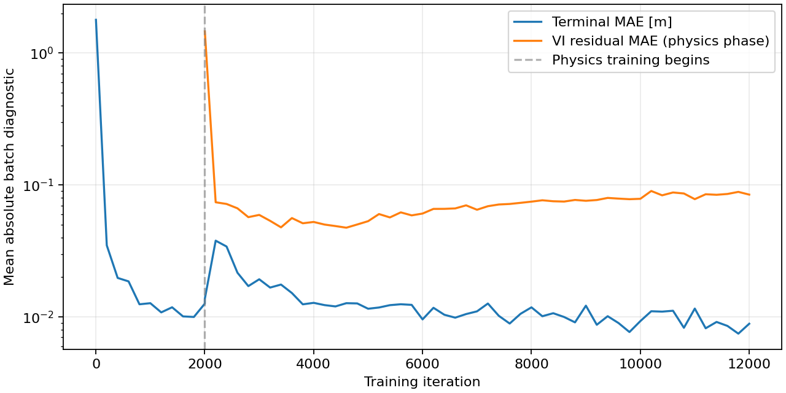
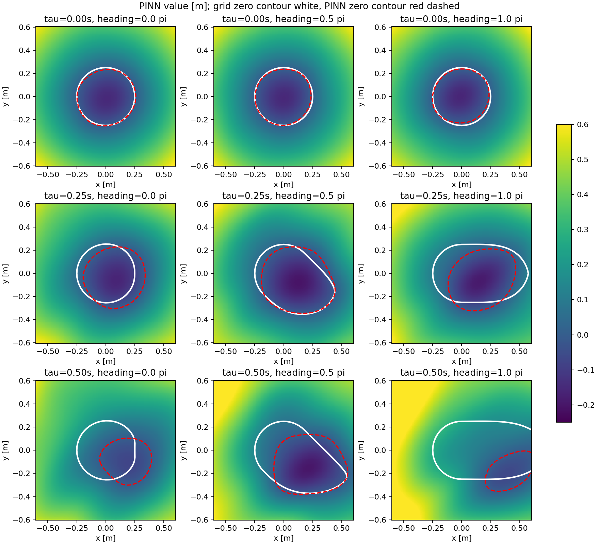
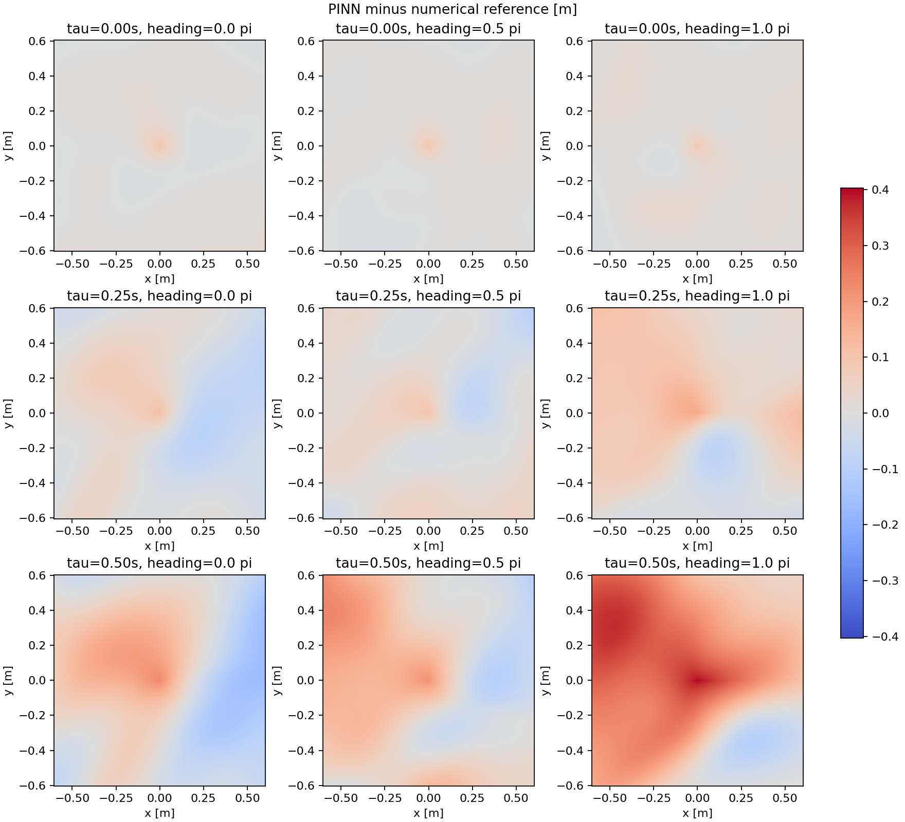

# Experiment 1 — Reduced CPU DeepReach Air3D

Date: 22 October 2026. Experiment ID: experiment_1. This is the first trained baseline; the preceding 60-step smoke run is a setup check, not a separate experiment.

The smoke run and reduced CPU PINN run completed. The independent numerical comparison and checkpoint tests below describe the actual computation. This is a reduced experiment, not a published-quality reproduction or a safety certificate.

**Outcome: execution and checkpoint tests passed, but the learned physics solution is not accurate enough.** At .5 s the value MAE is .0915 m and the model labels 46.4% of reference-unsafe held-out states safe. The baseline is saved for further experiments; successful accuracy reproduction is not claimed.

## Computation

- Device: Intel Core Ultra 7 165U, CPU PyTorch 2.5.1, two threads. Laptop memory: about 32 GiB; over 16 GiB free at sampled checks. Integrated Intel graphics was not used for training.
- Network: 3 sine hidden layers of width 64; 8,705 trainable parameters.
- Completed: 2,000 terminal-only steps + 10,000 expanding-time physics steps; 2,048 freshly sampled inputs per step, including 256 terminal samples during physics training.
- Recorded training-loop time: 206.38 s. This excludes Python import/setup time and the independent grid comparison (696.7 s for the solver checks).
- Horizon 0.5 s; spatial training box [-2.0,2.0] m in both relative coordinates; comparison region [-0.6,0.6] m; heading [-pi,pi).
- Speed .75 m/s for both drones, turn bound 3 rad/s for both, collision radius .25 m. Adam lr=0.0001; seed=7; fixed terminal-loss multiplier=106.425156 after initial calibration.
- Smoke checkpoint: 60 steps, approximately .82 s of recorded training time; reload and finite-weight checks passed. Smoke is a workflow check, not an accuracy experiment.
- The VS Code project was configured and its live CSV opened. Training ran through a managed process using that selected interpreter because the user was interacting with the VS Code window. It was not launched by the VS Code debugger. The local project contains VS Code launch configurations.

## Held-out value and collision-region comparison

24,000 uniformly sampled interior states were evaluated at each time. Values are compared against the finest approximate grid (129 x 129 x 96), with periodic heading interpolation.

| Time remaining | Value MAE [m] | RMSE [m] | Max error [m] | Unsafe-region IoU | False-safe among reference-unsafe | Disagreement among all states |
|---|---|---|---|---|---|---|
| 0.00 s | 0.01184 | 0.01482 | 0.10232 | 0.930 | 6.28% | 0.97% |
| 0.25 s | 0.04230 | 0.05206 | 0.17415 | 0.695 | 23.77% | 6.69% |
| 0.50 s | 0.09150 | 0.11689 | 0.41249 | 0.478 | 46.42% | 12.88% |

Unsafe means V<=0. IoU is intersection/union of predicted and reference unsafe sets. False-safe among reference-unsafe is count(PINN>0 and grid<=0)/count(grid<=0); it is not divided by all evaluation states. These labels are relative to an approximate grid, not known exact truth.
At the final horizon, the reference labels 5,276 of 24,000 sampled states unsafe. The false-safe fraction among all sampled states is 10.20%.
Excluding states with |grid value|<=.02 m, final-horizon false-safe among reference-unsafe is 43.83%. This exclusion is a diagnostic, not a certified error bound.

## Held-out physics and terminal diagnostics

Fresh diagnostic points span the full training box and the extended heading range, rather than just the smaller comparison region. Training-batch losses and held-out losses should not be treated as the same measurement.

- Terminal MAE: 0.008913 m; maximum terminal error: 0.096349 m.
- Mean absolute VI residual: 0.090331; 95th percentile: 0.318618. This combines a time-derivative term and an obstacle term as in the implemented loss; it is not itself a value-error or safety bound.
- Mean positive obstacle violation: 0.013117 m.
- Heading seam value mismatch MAE: 0.040608 m. The baseline does not impose an exactly periodic network representation.

## Independent reference checks

The reference uses local Lax-Friedrichs viscosity, explicit Euler, obstacle projection, periodic heading, and constant spatial ghost cells. Grids are 65/97/129 spatial nodes and 48/72/96 headings. The larger-domain check matches both spacing and time-step schedule.

Finest reference dt limit: 0.00149921 s; CFL coefficient 0.8. The comparison dependency-radius bound is 1.5985 m, inside the 2 m half-width box.

| Horizon | MAE, 65 to 97 grid | MAE, 97 to 129 grid | Expanded-domain maximum change |
|---|---|---|---|
| 0.25 s | 0.003914 m | 0.001955 m | 0 m |
| 0.5 s | 0.004420 m | 0.002206 m | 1.11e-16 m |

Frozen dynamics preserved the terminal function exactly. No-turn analytic closest-approach tests improved with refinement. The first-order reference retains numerical diffusion and nonsmooth-target errors. The refinement differences are not a rigorous upper bound on the reference error.

At .5 s the 97-node and 129-node references disagree on .454% of all sampled states, with 2.03% false-safe among the finest grid's unsafe states. The PINN disagreements are 12.88% of all states and 46.42% of reference-unsafe states. The measured grid sensitivity is much smaller than the network discrepancy here, though this is not a rigorous reference error bound. In the no-turn analytic test at .5 s, fine-grid MAE is .00263 m and maximum error is .0959 m.

## Derivatives and checkpoints

- autodiff_fd_max_abs: 9.57e-10.
- chain_rule_max_abs: 7.77e-16.
- hamiltonian_brute_max_abs: 1.78e-15.
- optimal_control_max_abs: 1.78e-15.
- reload_prediction_max_abs: 0.
- Split-versus-continuous optimizer restart: maximum parameter difference 0, over 6 tiny optimizer steps. This test is separate from the 12,000-step model.
- The actual checkpoint includes model weights, Adam state, configuration, random states and curriculum iteration. Source hashes and the exact training command are preserved with the local run artifacts.

## Plots and artifacts

- [Training history](figures/training_history.png)
- [PINN values and both zero contours](figures/value_and_brt_slices.png)
- [PINN minus reference values](figures/error_slices.png)
- [Independent reference values](figures/reference_slices.png)
- [All measured metrics](metrics.json)

## Visual comparison

The white contours are the independent grid reference; dashed red contours are the PINN. Near zero time they are close, but at .5 s the PINN misses substantial parts of the reference unsafe region.

Public materials are the report, four figures, aggregate metrics and configuration. Raw checkpoints, training logs, source snapshots and numerical-reference arrays remain in the local project copies and are not included in this publication.

- [Experiment 1 configuration](config.json)

## Limits and next experiment

This run reduces width, samples, iterations and horizon relative to the paper-scale config. It also uses widened domains and fixed initial loss balancing. The comparison covers an interior square, not the entire training box or every possible initial state. Measured false-safe classifications prevent treating the learned boundary as a reliable safety certificate. A larger or better-trained network may improve agreement, but that has not been demonstrated here.

Full 1 s, width-512 training has not run. Its command from the project root is:

    python outputs/deepreach/deepreach.py --train --config outputs/deepreach/configs/full.json --out outputs/deepreach/runs/air3d_full

Install requirements.txt in a separate Python environment, or use the selected environment in the local VS Code project. No gradient-reliability study or full quadrotor extension was added. Experiment 1 records the computation performed on 22 October; the paper-scale configuration remains unexecuted.

## Comparison with the paper-scale configuration

| Setting | Experiment 1 | Paper-scale configuration, not run |
|---|---|---|
| Sine hidden layers | 3 x 64 | 3 x 512 |
| Samples per iteration | 2,048 | 65,000 |
| Terminal pretraining | 2,000 steps | 10,000 steps |
| Physics curriculum | 10,000 steps | 100,000 steps |
| Horizon | .5 s | 1 s |
| Spatial box | [-2,2] m | [-3,3] m |

Both configurations are adaptations with explicit domain normalization and fixed initial loss balancing. The broader box departs from upstream scaling; the full configuration is not an exact recreation of every paper choice. See the main [implementation README](../../README.md) for the soft terminal-loss formulation, source pin and layer-count interpretation.

Smaller capacity, fewer iterations/samples, broad uniform spatial sampling, strong terminal weighting and imperfect heading periodicity are plausible contributors to the observed error. Experiment 1 does not isolate their individual effects; improving any single setting has not yet been shown to recover the paper's accuracy.
