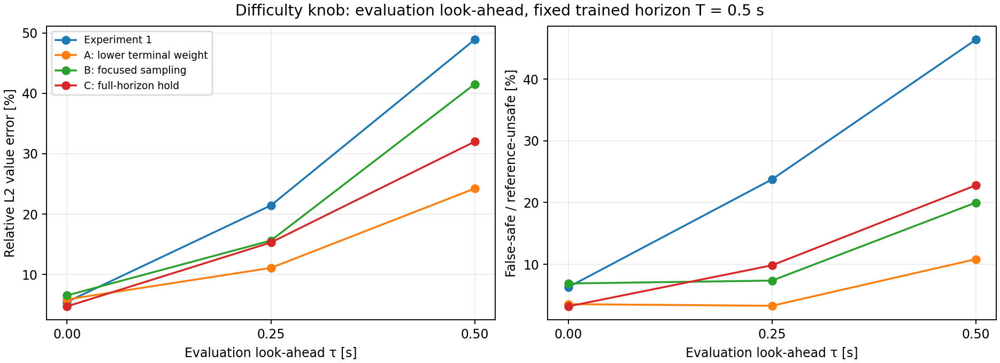
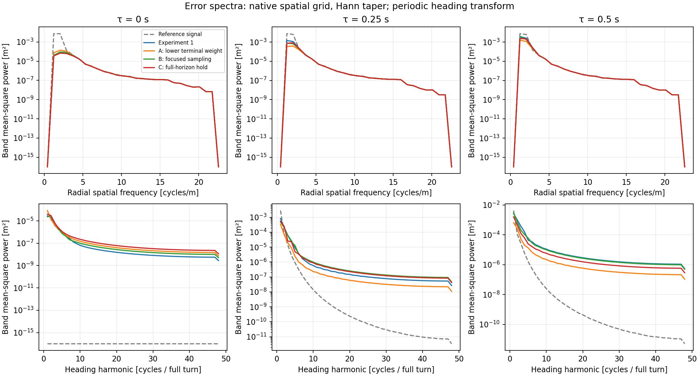
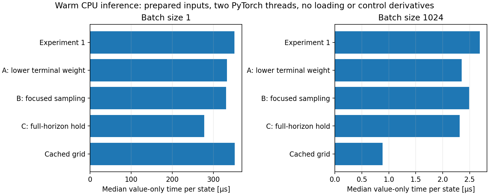

# Air3D — Missing diagnostic measurements

Evaluation date: 27 October 2026. No training or optimizer updates were performed. The existing Experiment 1 and Experiment 2 A/B/C checkpoints are unchanged.

## Scope and difficulty knob

The knob is evaluation look-ahead τ at 0, .25 and .5 s. Every network was already trained through T=.5 s. This tests error growth within the learned time interval; it is not a sweep of independently trained maximum horizons, and three planes do not locate a precise collapse threshold. The same 24,000 interior states (x,y in [−.6,.6] m, heading in [−π,π), seed 20261019) and saved approximate reference are reused. These comparisons are validation diagnostics; they are not an untouched final test set.

Relative L2 is sqrt(sum((PINN−reference)^2) / sum(reference^2)), using the same states at each time. MAE/RMSE and classification values were checked against the previously saved metrics.

## P3 — Error versus look-ahead

| Model | τ [s] | Relative L2 | Value MAE [m] | False-safe / reference-unsafe |
|---|---|---|---|---|
| Experiment 1 | 0 | 5.49% | 0.01184 | 6.28% |
| Experiment 1 | 0.25 | 21.45% | 0.04230 | 23.77% |
| Experiment 1 | 0.5 | 48.88% | 0.09150 | 46.42% |
| A: lower terminal weight | 0 | 5.90% | 0.01193 | 3.53% |
| A: lower terminal weight | 0.25 | 11.11% | 0.02109 | 3.27% |
| A: lower terminal weight | 0.5 | 24.24% | 0.04477 | 10.82% |
| B: focused sampling | 0 | 6.56% | 0.01461 | 6.88% |
| B: focused sampling | 0.25 | 15.63% | 0.02874 | 7.35% |
| B: focused sampling | 0.5 | 41.52% | 0.07189 | 20.00% |
| C: full-horizon hold | 0 | 4.74% | 0.00978 | 3.17% |
| C: full-horizon hold | 0.25 | 15.31% | 0.02856 | 9.83% |
| C: full-horizon hold | 0.5 | 32.00% | 0.06048 | 22.80% |



## P4 — Error fields and spectra

Fields use the finest reference’s native spatial nodes inside the comparison square (39×39, spacing .03125 m), all 96 periodic heading nodes, and all three saved times. The plotted space–time slices have y=0 and headings 0, π/2 and −π. No intermediate-time values are invented. Original x–y error figures remain in each run’s validation folder.

Spatial spectra subtract each heading plane’s Hann-weighted mean, apply a 2D Hann window normalized by its RMS, and sum FFT power into radial frequency bands; powers are averaged over heading. This reduces edge leakage from the nonperiodic spatial crop. Heading spectra subtract the mean over heading and use a one-sided periodic transform, averaged over x/y. Nonzero harmonic power can include the PINN’s heading seam mismatch. Spectra omit DC (mean error), so the field and value metrics must be considered alongside them. Parseval energy identities and a known third-harmonic field were checked.

The dashed reference-signal spectrum provides context; it is not a reference-error bound. A high-frequency tail alone does not prove spectral bias: solution nonsmoothness, numerical diffusion, seams and sampling can also affect it. Frequency units differ between the two rows.




| Model at .5 s | Spatial centered/tapered RMS [m] | Heading-centered RMS [m] |
|---|---|---|
| Experiment 1 | 0.08154 | 0.06622 |
| A: lower terminal weight | 0.05488 | 0.03211 |
| B: focused sampling | 0.07473 | 0.06494 |
| C: full-horizon hold | 0.06931 | 0.04865 |

These RMS values describe different centered/windowed fields; neither is the held-out value RMSE.

## P1/P5 — Construction cost and inference

The finest grid (129×129×96) was solved once through .5 s for timing: **136.73 s**. Maximum difference from the saved grid was **0 m**. This is the standalone fine-grid construction time. Experiment 1’s previously recorded 696.7 s was a multi-solve verification suite, not this single solve. Original reference refinement, boundary and analytic checks remain in the Experiment 1 report.

Hardware: Intel64 Family 6 Model 170 Stepping 4, GenuineIntel; 14 logical processors; PyTorch 2.5.1+cpu, CPU, two PyTorch threads. Timings are current-machine measurements and may vary with workload.

Inference benchmarks use warm calls with prepared inputs at τ=.5 s; seven timed blocks follow warmup. Batch 1 uses 100 calls/block; batch 1024 uses 10 calls/block. Network loading, input conversion, UI rendering, gradients and control calculations are excluded. The grid interpolator is constructed once and reused, with heading periodicity. All per-block timings and setup costs are retained in timing.json.

| Model | Historical training [s] | Batch-1 value query [µs] | Batch-1024 per state [µs] |
|---|---|---|---|
| Experiment 1 | 206.38 | 351.14 | 2.69 |
| A: lower terminal weight | 326.54 | 333.40 | 2.36 |
| B: focused sampling | 341.51 | 330.83 | 2.49 |
| C: full-horizon hold | 436.94 | 277.61 | 2.31 |
| Cached grid | Build: 136.73 | 352.38 | 0.89 |



### Repeated-query break-even

Both the PINN and the numerical grid can be built once and queried repeatedly for this fixed game. We compare T_train + N·t_PINN with T_grid-build + N·t_grid-interpolation. Charging a new full PDE solve for every state query would unfairly favor the PINN. The historical training runs used different machine conditions and debugger settings; these are illustrative measured-cost comparisons, not controlled speedup claims. No accuracy-matched performance claim is made: the grid is substantially more accurate than these networks in our reference checks.

- Experiment 1: PINN cheaper above crossover; crossover ≈ 56,079,646 state queries.
- A: lower terminal weight: PINN cheaper above crossover; crossover ≈ 9,999,287 state queries.
- B: focused sampling: PINN cheaper above crossover; crossover ≈ 9,499,555 state queries.
- C: full-horizon hold: PINN cheaper above crossover; crossover ≈ 4,014,964 state queries.

Batch-1024 crossover calculations are also saved. These apply to repeated states for one fixed model, not new PDE instances or a neural operator trained over a parameter family.

## Interpretation and limits

The new diagnostics supplement, rather than replace, the controlled Experiment 2 comparisons. A lower loss weight helped this seed; the spectra are descriptive evidence and do not by themselves isolate a unique cause. No new activation, optimizer, periodic encoding, hybrid trainer, gradient-accuracy study or closed-loop controller experiment was run.

A formal sweep beyond .5 s or of independently trained maximum horizons would require new reference snapshots and possibly new training. A time Fourier spectrum cannot be reliably inferred from only three snapshots; the supplied spectra are spatial and heading spectra.

## Reproduce and inspect

From the project root, with the existing environment/dependencies:

```powershell
python outputs/deepreach/diagnostics.py --out outputs/deepreach/diagnostics_20261027
```

No --train flag exists. The timed reference-build record is reused on reruns only when its source/cache/config hashes match. Use --retime-reference to measure it again. Fresh inference timings are collected on each run.

- metrics.csv / metrics.json: complete look-ahead comparisons.
- spectra.csv / spectral_summary.json: all spectral bands and energy checks.
- heldout_values.npz / error_fields.npz: evaluation inputs, predictions and reference values.
- timing.json / reference_build.json: repeat timings and construction cost.
- checks.json / integrity.json / manifest.json: mathematical checks, provenance and unchanged-file checks.
- Existing reference accuracy checks: ../experiments/experiment_1/README.md.
- Existing controlled comparison: ../experiments/experiment_2/README.md.
- Run inputs remain original validation data; an untouched final test remains future work.
