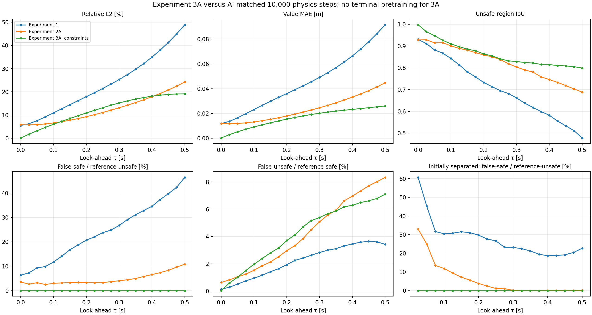

# Experiment 3A — Measured comparison with Experiment 2A

Training completed after explicit user authorization. The run was launched through VS Code Run and Debug in the Homework project, using the existing CPU interpreter and two threads. No reference labels entered training.

Completed physics updates: 10,000. Candidate training time: 220.28 s. A used 2,000 terminal + 10,000 physics updates and 326.54 s. The physics schedule/update budget matches; total updates, initialization and wall-clock cost differ. The comparison is single-seed validation, not an accuracy-matched timing benchmark or an untouched test.

The same 24,000 states and 21 direct reference snapshots are reused. No new numerical PDE solve was needed. The three-point legacy validation is also retained under the run folder.

| Metric at .5 s | Experiment 2A | Experiment 3A |
|---|---|---|
| Relative L2 [%] | 24.24008 | 19.12231 |
| Value MAE [m] | 0.04477 | 0.02602 |
| Value RMSE [m] | 0.05797 | 0.04573 |
| IoU | 0.68827 | 0.79879 |
| False-safe / reference-unsafe [%] | 10.82259 | 0.00000 |
| False-unsafe / reference-safe [%] | 8.33155 | 7.09784 |
| Initially separated false-safe / reference-unsafe [%] | 0.20387 | 0.00000 |
| Initially separated false-unsafe / reference-safe [%] | 8.32844 | 7.07303 |
| Already-collided states predicted safe [count] | 571.00000 | 0.00000 |
| Obstacle violation fraction [%] | 46.55833 | 0.00000 |
| Below physical minimum -R [%] | 0.00000 | 1.78333 |
| Value rises from .475 to .5 s [% of states] | 63.68750 | 25.04167 |
| Interior VI residual MAE (training convention) | 0.06984 | 0.03365 |
| Equivalent-heading value gap MAE [m] | 0.05558 | 0.03151 |

The exact terminal and obstacle conditions passed after training, and no initially collided validation state was labeled safe. This is guaranteed by the output construction and is not independent evidence of better predictions for initially separated states. False-unsafe rate, IoU and value error must also be considered. The square construction does not enforce the separate lower bound V>=-R; violations are reported above. Small nonzero terminal error versus the interpolated reference can remain even with an exact analytic terminal condition. The VI residual is a training-convention diagnostic, not an error bound. The initially-separated rate is omitted from the plot when its reference-unsafe denominator is zero; CSV counts are retained (the helper returns zero in that case). Small conditional denominators at early times can produce large rate swings.

Final-horizon MAE changed by -41.87% relative to A. No second seed, combined periodic encoding, revised time sampler, control rollout or 6D test was run.

## Files

- comparison.csv/json: all 63 model/time comparisons, denominators and conditional metrics.
- candidate_values.npz: candidate predictions and times; state/reference inputs are identified by hash in manifest.json.
- equation_checks.csv/json and equation_samples.npz: derivatives/residuals on the same 6,000 interior states.
- manifest.json: model/input/source hashes and integrity checks.
- The run folder retains checkpoint.pt, history.csv, config.json, environment.json, source snapshots and three-point validation.

[Implementation and hypothesis](README.md)
