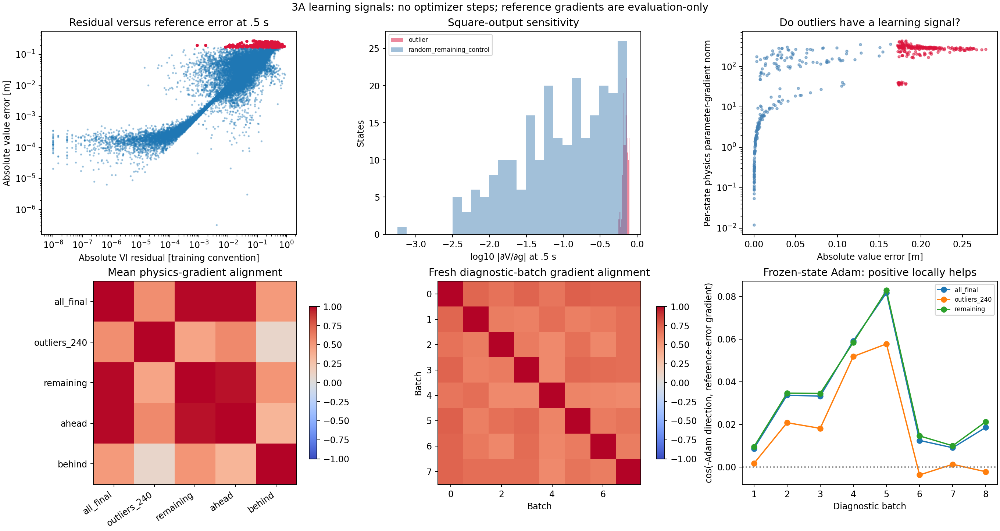

# 3A parameter-learning signals — strong gradients, imperfect objective alignment

Analysis date: 27 October 2026. **No optimizer was created, no parameter update was applied, and no training was performed.** The 3A checkpoint and earlier runs are unchanged. This studies gradients with respect to network parameters, not whether value gradients give reliable drone controls.

## Main findings

The worst states have a strong learning signal; they are not near the squared output's flat point. Their physics-loss gradients can nevertheless point away from lower reference error at the current parameters. The actual training distribution and Adam's stored state give different directions from a final-time-only gradient. Consequently neither vanishing gradients nor a generally broken optimizer is established by these measurements.

The next justified step is a fixed-batch direction/step-size probe before choosing an optimizer trial. In particular, lower sampled physics loss should not be assumed to imply lower value error. No such optimizer trial or finite training step was executed here.

## What was measured

At tau=.5 s, use the existing 24,000 interior validation states and the fixed 240-state 3A outlier cohort. Compute mean physics gradients for all states, outliers, their complement, ahead states and behind states. Compare with evaluation-only reference-error gradients. Separately inspect per-state gradients on the 240 outliers and 240 randomly selected remaining states (seed 991732; controls are not geometrically matched).

For stochastic training directions, use eight fresh diagnostic batches (seed 991733), each with 2,048 states over the original [-2,2] m training box and extended heading interval. Time is uniform over [0,.5] s for 1,792 states; 256 have tau=0. This matches the distribution at the end of 3A's curriculum, not its entire training history. All batches are evaluated at the same frozen final checkpoint.

Reference labels are used only for this diagnosis. They were not supplied to an optimizer or used to change the model. They remain the approximate numerical reference already used for validation.

## 1. The squared output is not hiding the worst errors

The output is V=l-a*g^2, with a=beta*tau/T. At tau=.5 s, a=.25 m and

    dV/dg = -2*a*g = -.5*g.

| Measurement | Worst 240 states | Remaining 23,760 states |
|---|---|---|
| Median absolute g | 1.39525 | .23240 |
| Fraction with absolute g<.05 | 0% | 20.15% |
| Median absolute dV/dg [m] | .69762 | .11620 |
| Norm of mean physics-loss parameter gradient | 115.90 | 7.68 |

Across individual states, median physics parameter-gradient norm is 288.32 for outliers versus 6.29 for the 240 random remaining controls. Absolute norms depend on parameterization and the loss convention; they are not physical error bounds. The evidence does not support a vanishing-output-gradient explanation for these outliers.

The square's flat point remains a real property at g=0. It does not automatically imply a zero physics-loss gradient: the PDE also depends on input derivatives of g. Conversely, small g can be appropriate where the true solution stays on the obstacle V=l. Do not redesign the output merely because some easy states have a small correction.

## 2. Gradient direction matters as well as magnitude

Define the actual physics objective and two evaluation objectives:

    L = mean(abs(max(V_tau-H, V-l)))
    E2 = .5*mean((V-reference)^2)
    E1 = mean(abs(V-reference)).

Let gL=grad_parameters(L), and similarly gE. A hypothetical plain descent direction d=-eta*gL has first-order error change

    delta_E approximately gE dot d = -eta*(gE dot gL).

Positive cosine alignment between gL and gE therefore locally favors decreasing both objectives. Negative cosine means reducing this physics objective by an infinitesimal plain gradient step would increase the measured reference error.

| Final-time group | Physics/E2 gradient cosine | Physics/MAE gradient cosine |
|---|---|---|
| All 24,000 states | -.46739 | -.43355 |
| Worst 240 | -.35789 | -.36444 |
| Remaining states | -.44398 | -.43017 |
| Pursuer ahead | -.46059 | -.44042 |
| Pursuer behind | -.05183 | -.02461 |

At the per-state level, 181/240 outliers have negative physics/reference-error alignment. This is not evidence that the governing equation is incorrect: parameter changes alter the value, its time derivative and its spatial derivatives together, and a sampled local residual is not the globally solved PDE. These objectives need not descend together at an approximate checkpoint. MAE and half-MSE agree on the sign of the reported group effect.

These final-time-only gradients are **not** the actual training gradient: training samples the wider box, all times and zero-time coordinates. Do not infer that a real Adam step necessarily moves the wrong way from the first table alone.

## 3. The main groups are not strongly opposing each other's physics descent

The mean physics-gradient cosine is +.438 between outliers and the remaining states, and +.351 between ahead and behind groups. Gradients differ but are not globally pointing in opposite directions at this checkpoint. The final-time whole-set gradient is highly aligned with the remaining-state mean (+.992).

Accounting for the outliers' 1% frequency, their weighted gradient-vector norm is 1.159 versus 7.606 for the remaining 99%. These norms do not add like loss fractions because directions can reinforce or cancel. The outliers are diluted by their frequency but not devoid of a gradient. This alone does not justify increasing their sampling weight.

Across the eight full-training-distribution batches, pairwise physics-gradient cosine has median .667 and minimum .572: there is stochastic variability, but these sampled directions are broadly aligned. This is a small diagnostic sample, not a noise model or confidence interval over training.

## 4. Saved Adam momentum changes the answer

For each diagnostic batch, compute a hypothetical next Adam direction using the saved step-10,000 first/second moments, beta1=.9, beta2=.999, epsilon=1e-8 and lr=1e-4. No optimizer is instantiated, and no direction is applied. In symbols:

    m_next = beta1*m + (1-beta1)*gL
    v_next = beta2*v + (1-beta2)*gL^2
    d = -lr*mhat_next/(sqrt(vhat_next)+epsilon).

The current full-training-distribution physics gradients have positive E2 alignment with the final validation error (cosines .212–.409), unlike the final-time-only gradients above. The saved Adam state transforms those gradients into directions with weak positive overall E2 alignment (.00865–.08167).

First-order projections predict reduced overall final-time MAE and half-MSE on **8/8 diagnostic batches**, and reduced outlier MAE and half-MSE on **6/8**. All eight hypothetical directions also locally descend the physics loss of their own sampled batch. This does not show Adam is broken, nor prove that SGD, L-BFGS or a trust-region method would be better.

Small positive alignment is not strong evidence of an effective finite step. These are local linear projections at one checkpoint, using copied stored moments, not executed updates or a line search. Curvature, nonsmooth absolute/max terms, step size and later stochastic batches can change the realized outcome.

## 5. Exact terminal values do not remove terminal physics gradients

The analytic terminal value loss is identically zero in 3A. However, its 256 zero-time samples remain in the HJI physics residual. At tau=0, V_tau still depends on g, even though V itself equals l.

Terminal and nonterminal physics-gradient cosines are mildly negative (about -.219 to -.075) on these eight batches. Their frequency-weighted terminal gradient norms are only about 2–4.5% of the nonterminal norms. This indicates some local competition but does not support terminal physics dominating the remaining learning signal.

## 6. Low residual and accurate values are related, but not interchangeable

Across the 24,000 final-time states, absolute residual and absolute value error have Spearman rank correlation .903. Residuals generally identify harder states. Nevertheless **320 states** have value error at least .05 m with absolute VI residual at most .01 in the implementation convention; their mean value error is .07992 m. All 320 use the differential max branch, so obstacle-branch masking does not explain this particular subset.

The cutoffs are descriptive, not universal tolerances or safety margins. Correlation across different states does not guarantee that changing parameters to reduce residual at a state also reduces value error there; that is what the parameter-gradient probes test. The reference remains approximate and the VI expression combines differential and obstacle terms without a single physical unit.

## Verification and reserved evaluation

Checks include the disjoint group-gradient decomposition, terminal/nonterminal gradient decomposition, the square-output parameter chain rule and a hand-calculated scalar Adam update. Double-precision functional-parameter finite differences verify directional derivatives of physics loss, reference half-MSE and reference MAE. Those probes evaluate tiny parameter overrides on a separate model copy; no stored/model parameter is updated. Source details and numeric discrepancies are in summary.json and manifest.json.

Checkpoint/model hashes and every parameter/buffer are unchanged, and no parameter .grad values were accumulated. Stored parameter vectors were checked finite. No reference gradient was used to update weights or choose an applied control.

Separately, **24,000 fresh final-evaluation states** (seed 991731) are reserved under evaluation/reserved_final_states. No model predictions or reference labels were generated for them. They are not used in any of these gradient, residual or direction comparisons. Keep them outside development comparisons until a method/protocol is selected; they are a future evaluation resource, not an additional result.

## What to do next

Keep 3A as the current baseline. Before a full optimizer retraining experiment, compare finite direction/step-size probes on fixed physics batches, without using reference gradients to construct updates. Measure whether a proposed physics-loss improvement also improves validation value error and constraints. Include the cost of extra loss/gradient evaluations in any eventual budget; an L-BFGS iteration need not cost the same as one Adam update. No particular optimizer has been selected by these diagnostics alone.



## Files and reproduction

```powershell
python outputs/deepreach/diagnose_learning_signals.py
```

- group_gradients.csv/json: mean physics and evaluation-gradient norms/alignments by group.
- layer_gradients.csv: physics and half-MSE gradient norms/alignments per parameter tensor.
- per_state_gradients.csv: the 240 outliers and 240 random remaining controls, including squared-output sensitivity and parameter-gradient norms.
- point_summary.json / final_point_fields.npz: full final-time fields, active branch and low-residual/high-error cases.
- batch_directions.csv/json: all eight physics, terminal/nonterminal and frozen-Adam measurements, for MAE and half-MSE.
- parameter_vectors.npz: group/batch gradients and hypothetical directions, without updated weights.
- summary.json / manifest.json: numeric checks, source/input hashes, zero-update status and reserved-state hash.
- interpretation_metrics.json: separately derived medians/counts and ranges quoted in this interpretation. The script regenerates the main measurements/figure; this README and derived interpretation metrics are maintained separately.

This is a frozen-checkpoint, single-seed diagnosis on reused validation data. It does not establish a unique root cause, optimizer superiority, statistical generalization or controller safety.
