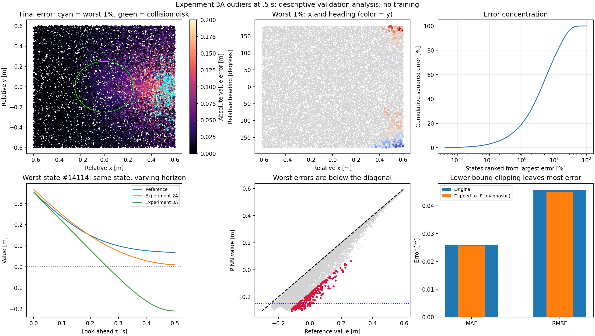

# Experiment 3A — Remaining outliers

Analysis date: 27 October 2026. No training or optimizer updates. The saved model/predictions are unchanged. This examines the same 24,000 validation states at .5 seconds, with their existing 21-point histories. Outliers are defined retrospectively as the 240 states (1%) with the largest absolute value error; this is descriptive validation, not a fresh test or causal allocation of error.

## The remaining error has a strong geometric pattern

The worst 1% account for **19.67% of total squared error** and have mean absolute error **.20121 m**. Across all states, median absolute error is .00914 m, the 95th percentile is .10676 m, the 99th percentile is .17196 m, and the maximum is .27790 m.

- **240/240** worst states have x>0: the pursuer is ahead in the evader's heading frame.
- **240/240** underestimate V: the error is conservative in sign, predicting less separation margin than the reference.
- **240/240** are initially separated; their separations range from .375 to .751 m, outside the .25 m collision disk.
- **173/240** have opposing headings within 45 degrees of a 180-degree difference.
- Across the full validation set, x>0 contains 11,961 states and **96.96% of squared error**. Mean absolute error is .04574 m ahead versus .00643 m behind. These conditional distributions also differ in game difficulty; the split does not isolate x as an independent cause.

All quantities are relative to the evader frame, not a global forward direction. The evaluation square is [-.6,.6] m, inside the training box [-2,2] m: points near the plot's right edge are not near the numerical solver's outer boundary.

## One worked outlier

State index 14114 (zero-based in heldout_values.npz): x=.54252 m, y=-.26578 m, heading=-175.37667 degrees. Initial separation is .60413 m, so l=.35413 m. At .5 seconds:

| Evaluation | V [m] |
|---|---|
| Reference | +.06787 |
| Experiment 2A | +.00912 |
| Experiment 3A | -.21003 |
| 3A with the identical heading represented as +184.62333 degrees | -.00058 |
| 3A on the physically mirrored encounter | -.14156 |

The two heading representations differ by a full turn and describe the same physical state. Both are inside the existing training input interval [-216,216] degrees. The reference gives the same value under this relabeling. The large prediction change therefore demonstrates a representation inconsistency without requiring an out-of-training-range input. The alternate representation still gives a slightly negative prediction here; it is not a validated correction.

The reflected encounter maps (x,y,psi) to (x,-y,-psi). With symmetric turn limits and the radial collision target, the game value should be unchanged. The reference matches to floating-point precision; the network does not. Experiment 3A improved overall accuracy but became substantially worse than A at this particular state. An aggregate improvement does not mean every state improved.

The time-history plot holds this initial state fixed and varies look-ahead. It is not a drone trajectory. At this state 3A's value falls too far as the horizon grows and predicts an unsafe encounter while the reference remains positive.

## Heading and equation diagnostics

Across 4,863 states near the heading seam, changing psi to its equivalent psi±2*pi within the extended training range produces an average value gap of **.03270 m**, with a 95th-percentile gap of **.15890 m**. Reflection mismatch averages .00623 m across all states, with larger localized discrepancies.

The mean absolute HJI VI residual on the worst 240 states is **.22652**, versus **.03169** on the remaining states (about 7.1 times larger). This associates the outliers with poorer local equation satisfaction. It does not prove a unique cause, measure controller performance or turn the residual into a value-error bound. The residual uses the existing mixed differential/obstacle training convention.

Temporal nonmonotonicity is not uniform in severity. Among the 6,010 states whose value rises by more than 1e-5 m from .475 to .5 seconds, the median rise is .00104 m, the 95th percentile is .01154 m, and the maximum is .01818 m. The worst state's main defect is a large downward bias, so making the value nonincreasing alone would not correct it.

## The lower-bound defect is real but explains little of the total error reduction available

428 final predictions fall below the physical minimum V=-R=-.25 m by more than 1e-4 m. As an offline diagnostic, clipping predictions upward to -.25 changes MAE from .02602 to .02571 m: only a **1.18% reduction**. RMSE changes from .04573 to .04498 m. It does not change any sign classification, and the worst error remains .27790 m because that prediction already lies above -.25 m.

Clipping was not applied to the saved model or operational predictions, and no modified controller was evaluated. This check shows why removing lower-bound violations alone would leave the main tail problem unresolved.

## Could the reference be responsible?

One 97×97×72 grid solve was compared with the saved 129×129×96 grid at these exact states. Among the worst 240 states, mean absolute grid disagreement is **.00787 m** and the maximum is **.01852 m**, versus the network's .20121 m mean absolute error there. Overall grid disagreement averages .00221 m. The dense-output fine reference and original fine reference agree to within 8.1e-6 m on these validation states.

The reference satisfies the reflection and equivalent-heading checks to below 3e-16 m. These results make ordinary observed grid sensitivity an inadequate explanation for the large network discrepancies. Grid-to-grid agreement is still not a certified bound on the reference's true error.

## Implication for the next controlled test

Periodic heading encoding has direct supporting evidence and is a sensible next candidate while retaining 3A's terminal/obstacle construction and physics budget. This does not establish that it will eliminate the geometry-dependent underestimation: the model also misses dynamics in difficult ahead encounters. Compare the same outlier cohort, the full 21-point metrics, both sign-error rates and physical constraints after any future change. Do not select an angle representation using reference labels to make a post hoc improvement claim.

Hard lower-bound enforcement remains a separate possible change; this diagnostic suggests it should not be presented as a sufficient fix. No new architecture, sampling distribution, optimizer or trained model was introduced here.



The x-y scatter pools different headings; it is a projection of the sampled states, not a fixed-heading value slice. Cyan circles identify the worst 1%. The cumulative curve ranks states from largest to smallest squared error.

## Reproduce and inspect

```powershell
python outputs/deepreach/analyze_outliers.py
```

The script regenerates the measurements/figure and reuses the coarse query cache only when solver, fine reference, state input and physical-config signatures match. This interpretation document is maintained separately. Execution used two CPU threads in a managed process, not the VS Code debugger.

- worst_240_states.csv: state coordinates, predictions, reference, A's error, equivalent-heading/mirror predictions, residuals and local reference comparison.
- groups.csv/json: counts, MAE, squared-error shares and residuals for geometric/failure groups. Groups overlap; their error shares should not be added.
- by_time.csv: all 21 times, error quantiles, physical-bound counts and the fixed final-outlier cohort's error history.
- point_diagnostics.npz: statewise value derivatives/residuals and symmetry probes; no control rollout.
- summary.json: error quantiles, geometric counts, equivalent-angle gaps, clipping diagnostic and upward increments.
- reference_check.json / coarse_query_values.npz: grid sensitivity and invariance checks at the same states.
- manifest.json: source/input hashes, exact reproduction of saved predictions and unchanged-model checks.

[Experiment 3A results](../RESULTS.md)
