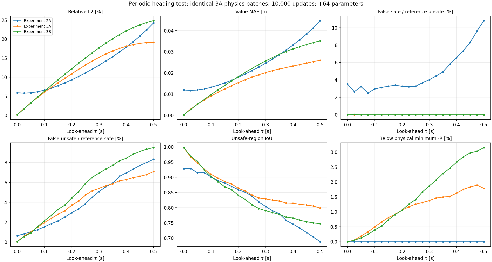
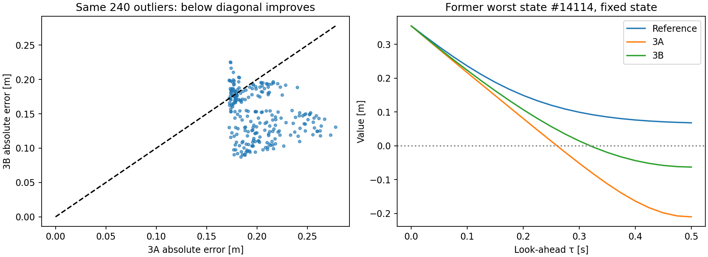

# Experiment 3B — Periodic heading: improved old outliers, worse overall accuracy

Completed 27 October 2026 through VS Code Run and Debug in the Homework workspace. Training took **339.46 s (5 min 39 s)** for 10,000 physics updates, CPU, two threads. The same 24,000 validation states and all 21 saved reference snapshots were used afterward; no new reference solve or reference-supervised training was performed.

**Outcome: retain 3A as the stronger overall baseline.** Periodic encoding removes a known representation inconsistency and improves the preselected outlier cohort, but this single trial worsens overall value error, false-unsafe classification, physical lower-bound violations and time monotonicity.

## Full validation at .5 seconds

| Measurement | 3A: raw heading | 3B: sin/cos heading |
|---|---|---|
| Value MAE [m] | .02602 | .03517 |
| Relative L2 | 19.12% | 24.86% |
| Value RMSE [m] | .04573 | .05944 |
| Maximum absolute error [m] | .27790 | .23893 |
| Unsafe-region IoU | .799 | .748 |
| False-safe / reference-unsafe | 0% observed | 0% observed |
| False-unsafe / reference-safe | 7.10% | 9.52% |
| Initially separated false-unsafe / reference-safe | 7.07% | 9.49% |
| Below physical minimum -R | 1.78% | 3.15% |
| Value increases from .475 to .5 s | 25.04% | 29.93% |
| Interior VI residual MAE (training convention) | .03365 | .04338 |
| Mean equivalent-heading endpoint gap [m] | .03151 | 4.06e-8 |

False-safe uses reference-unsafe states as denominator (5,276 at .5 s); false-unsafe uses reference-safe states (18,724). Zero observed false-safe cases does not establish a safety guarantee. Terminal/obstacle checks pass in both constrained models. The .25 m physical lower bound and monotonicity in look-ahead remain unenforced. The VI residual is not a value-error bound.

Overall final-horizon MAE rose **35.14%** relative to 3A. The observed training time was longer than 3A's 220.28 s despite the same update count. These runs had different current workloads; this is not a controlled timing benchmark or an isolated measurement of encoding overhead.

## The exact outliers selected before this test

The cohort is the same 240 states identified by the 3A analysis, not a new subset selected after seeing 3B.

| Measurement | 3A | 3B |
|---|---|---|
| Mean absolute error on the fixed cohort [m] | .20121 | .14885 |
| Cohort members improved | — | 206/240 |
| Mean absolute error of each model's own worst 240 states [m] | .20121 | .19740 |
| Former worst state #14114: predicted V [m] | -.21003 | -.06298 |

The fixed-cohort mean error improved **26.02%**. At the former worst state the reference is +.06787 m, so 3B reduces the discrepancy but still predicts an unsafe condition. Both the fixed cohort and the new model's own tail are retained in the saved data.

Equivalent-angle pairs near the heading seam now differ by only 4.13e-8 m on average (maximum 5.66e-7 m in float32), compared with .03270 m for 3A on the same 4,863 pairs. This supports the mathematical-periodicity hypothesis. Reflection symmetry was not enforced and its mean mismatch increased from .00623 to .00885 m.

## Why an outlier improvement can accompany an overall regression

Errors became more broadly pessimistic. Mean signed error shifted from -.02601 to -.03514 m. Median absolute error increased from .00914 to .01105 m; the 95th percentile rose from .10676 to .14767 m, even as the maximum decreased. For initially ahead encounters, MAE rose from .04574 to .06311 m; behind encounters rose from .00643 to .00740 m. See error_distribution.json for the full quantiles and definitions (ahead means x>0 in the evader frame).

Consequently, improved old extremes do not imply a better overall approximation. Enforcing periodicity removes one defect but does not ensure the optimizer learns the correct periodic value function at this budget. These measurements do not isolate whether initialization, feature scaling, optimization or another interaction produced the regression.

## Controls, checks and limits

3B retains 3A's square output, Adam settings, hidden layers/width, correction scale, sample count, horizon schedule and 10,000 physics updates. It adds 64 first-layer parameters (8,769 vs 8,705) and necessarily changes initialization. CPU sampling RNG was aligned to the original raw-input initialization; sampler-only replay matched 3A, and the **completed 3B and 3A checkpoints have identical final sampling RNG states**. Sine/cosine operations and Adam updates do not draw random numbers in this network. This matches the physical sample sequence, not the initial weights or wall-clock cost.

Before training, analytic feature-chain, finite-difference, periodic value/derivative and exact-constraint checks passed. The original five checkpoint predictions stayed bitwise identical to their archived implementations. Post-training terminal/obstacle, derivative/reload, sampler-state and unchanged-input checks passed. The independent grid solver was unchanged and its existing refinement checks were reused.

This remains a single-seed architecture trial on reused validation data. It does not show periodic features are generally inferior, establish a unique root cause, or justify discarding the earlier 3A improvement. No further training, hyperparameter search, new untouched test, control rollout or 6D experiment was run. Any attempt to recover global accuracy with periodic features should be a separately defined test.

## Saved artifacts

- comparison.csv/json: all 63 model/time comparisons (2A, 3A, 3B), including conditional denominators.
- candidate_values.npz: 3B predictions and times, paired with the original state/reference inputs identified in manifest.json.
- fixed_3a_outliers.csv: the same 240 states, predictions and errors before/after.
- outlier_summary.json: fixed-cohort metrics, 3B's own worst-state indices and equivalent-heading/reflection checks.
- error_distribution.json: bias, quantiles and ahead/behind error groups at .5 s.
- equation_checks.csv/json: all 21 interior residual, derivative-sign and heading-seam checks.
- implementation_checks.json: checks completed without optimizer updates before training.
- manifest.json: model/input/source hashes, sampling-state equality and constraint checks.
- runs/experiment_3_b_periodic retains the checkpoint, config, training history, environment, execution record, exact source snapshots and original three-point validation plots/metrics.

The test ran in VS Code; evaluation used a managed process. Reproduce evaluation with `python outputs/deepreach/compare_periodic.py`. RESULTS.md and the separately derived error_distribution.json interpretation are maintained with the saved report; the evaluation script regenerates the main comparison data and figures.

[Design and implementation](README.md) · [3A results](../experiment_3_a/RESULTS.md)
