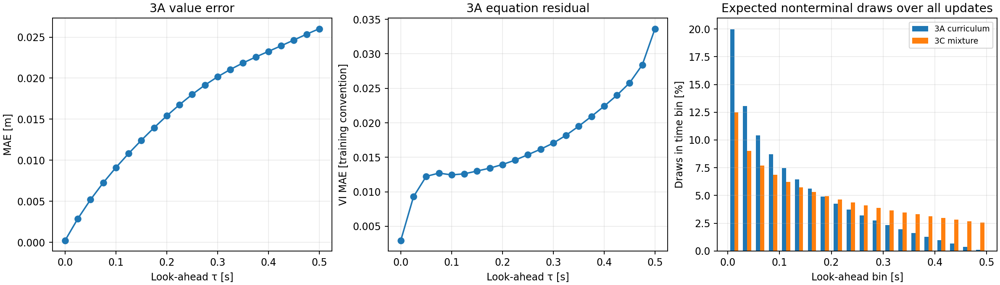

# Experiment 3C — Mixed time sampling from the 3A baseline

**Status: training and evaluation completed.** See [measured results](RESULTS.md). Training took 203.98 s. The fixed old outlier cohort improves 10.35%, but overall final MAE worsens 15.14% and false-unsafe rate rises to 8.68%. Retain 3A as the stronger overall baseline. This separate seed-7 run uses 3A's raw heading, exact terminal/obstacle square output and 8,705 parameters; it does not combine 3B's periodic encoding with the time change.

## Pre-run rationale and hypothesis

3A's value error and equation residual both increase with look-ahead. Under its expanding-horizon curriculum, later times receive a small fraction of nonterminal samples. This test asks whether redistributing the same draws improves late-time accuracy without materially degrading earlier times. No improvement is assumed.

The figure and expected_time_distribution.csv were generated before candidate training. The histogram integrates the exact discrete 10,000-step schedule, not a log of observed random draws. It excludes the fixed zero-time coordinates. The VI residual is an implementation-convention diagnostic, not a value-error bound.

## Only deliberate training change

At physics update j=1,...,10000, let tmax=.5*j/10000. Each batch has 2,048 states:

- First 896 nonterminal states: tau uniform in [0,.5] s.
- Next 896 nonterminal states: tau uniform in [0,tmax] s.
- Last 256 states: tau=0, still included in the physics loss as in 3A.

The existing uniform random draw for each time coordinate is reused, multiplying it by .5 for the first group and tmax for the second. No additional random numbers or samples are drawn. Spatial coordinates, heading coordinates, zero-time coordinates, initialization, optimizer, architecture, training-step count and RNG consumption match 3A. The final batch has tmax=.5, so even its time coordinates are identical to 3A's final batch.

Over the discrete curriculum, expected nonterminal draws in [.4,.5] s increase from **2.1495% to 11.0748%**. This deliberately changes the distribution of the physics loss; no importance weighting restores the old time distribution. The mixture parameter is fixed at .5 before training and is not selected using candidate validation results.

All other 3A settings are unchanged: Adam 1e-4; 10,000 physics updates; seed 7; three sine hidden layers of width 64; .5 s maximum horizon; domain [-2,2] m; heading range [-1.2*pi,1.2*pi]; beta=.25 m. No pretraining, extra hold steps, periodic encoding, reference supervision, new loss penalty or lower-bound enforcement is added. Update/sample budgets match; wall-clock timing is recorded separately and not assumed equal.

## Checks before training

See implementation_checks.json. These checks created no optimizer:

- Initial parameters/buffers match a freshly initialized 3A model bitwise.
- Spatial, heading and terminal coordinates match the original sampler; the curriculum half's times match unchanged.
- The full-horizon half follows the prescribed rescaling and remains within the physical horizon.
- RNG consumption is identical, including a sampler-only replay matching 3A's final saved RNG state after 10,000 calls.
- No terminal-only pretraining points are changed to nonzero times.
- Value derivatives, chain rule, Hamiltonian mechanics and finite/nonzero physics parameter gradients pass.
- All six earlier checkpoint predictions remain bitwise identical to their archived implementations; protected hashes remain unchanged.

## Execution

The VS Code launch configuration **Air3D: Experiment 3C - Train mixed time sampling** is available. During the attempted UI launch, the computer-use API reported concurrent user input and unavailable input geometry. No training was launched through that UI. The authorized run instead uses a managed process with the **same existing VS Code interpreter**, CPU and two threads. Logs and checkpoint are saved to the project and copied to Homework for inspection in VS Code. Do not describe this run as executed by the VS Code debugger.

Before launch: 17.12 GiB free RAM of 31.45 GiB, 53% CPU-load snapshot, 14 logical processors. No system settings were changed. Execution metadata and exact source snapshots are saved in runs/experiment_3_c_time_sampling. The existing overwrite guard protects completed checkpoints. History retains the original curriculum tmax and adds full_horizon_fraction and sampled_time_max so the mixed coverage is explicit.

## Evaluation plan

Compare with 3A and 2A on the same 24,000 validation states and all 21 saved reference times. Primary interest: final-horizon MAE and relative L2. Inspect early/intermediate value errors, both sign-error rates, IoU, initially separated states, lower-bound violations, temporal monotonicity and equation residuals. Keep the original 240-state 3A outlier cohort fixed and also inspect 3C's own worst 1%. Recheck the final RNG state against 3A and retain the original three-point validation.

A lower training loss by itself does not establish improvement, particularly because the time distribution changed. Reused validation data and a single seed cannot establish statistical generalization; a fresh final test, additional seeds, controllers and 6D transfer remain outside this run. Retain 3A unless the measured result warrants replacing it; report regressions explicitly.

Reproduce checks with `python outputs/deepreach/check_time_sampling.py`; evaluate the completed run with `python outputs/deepreach/compare_time_sampling.py`. The report interpretation is maintained separately from generated measurements.
