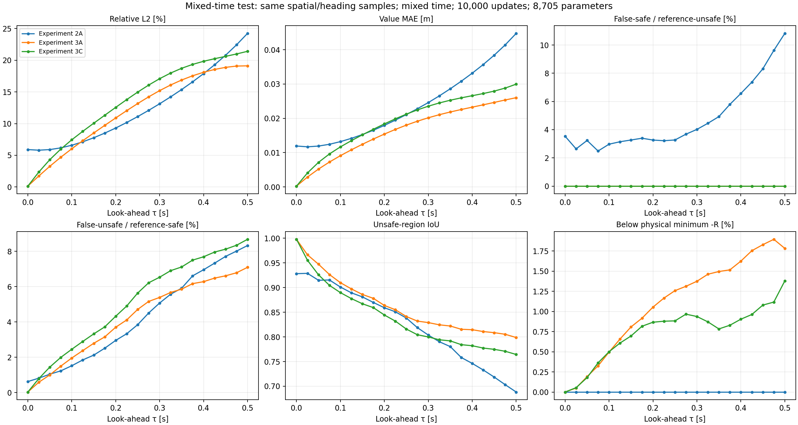
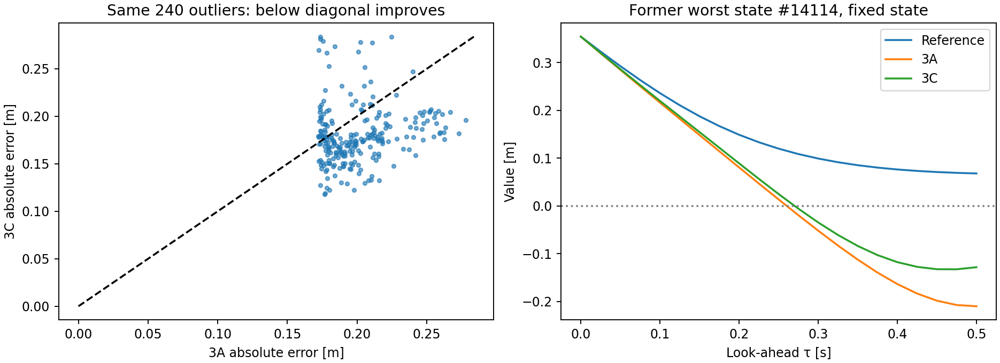

# Experiment 3C — More late-time exposure did not improve overall accuracy

Completed 27 October 2026. Training used the existing VS Code interpreter through a managed process, CPU and two threads, after the Windows UI reported concurrent user input. This run was not launched by the VS Code debugger. It completed 10,000 physics updates in **203.98 s (3 min 24 s)**. Existing checkpoints were preserved.

**Outcome: retain 3A as the stronger overall baseline.** The chosen 50/50 time mixture improves the fixed old outlier cohort and reduces physical lower-bound violations, but worsens overall value error, false-unsafe classification, overlap and temporal monotonicity. No additional candidate or parameter sweep was started.

## Same-budget, tightly paired test

3C has the same raw-angle network, 8,705 parameters, exact terminal/obstacle output, initialization, optimizer settings, 10,000 updates and batch size as 3A. Each batch contains 896 full-horizon nonterminal samples, 896 curriculum nonterminal samples and the original 256 zero-time samples. Spatial/heading coordinates and random uniform draws match 3A; only time scaling for the first group changes. Completed checkpoint RNG states match, consistent with the sampler replay and unchanged RNG consumption.

The expected fraction of nonterminal draws in [.4,.5] s increased from 2.1495% to 11.0748%, without adding samples or updates. The mixture was fixed before candidate training. No periodic encoding or reference labels were used. The unchanged exact terminal construction makes terminal-only pretraining unnecessary.

Before running, 3A's rising value error and equation residual were plotted beside the planned distribution:

## Measured results at .5 s

| Measurement | 3A: original curriculum | 3C: 50/50 mixture |
|---|---|---|
| Value MAE [m] | .02602 | .02996 |
| Relative L2 | 19.12% | 21.41% |
| Value RMSE [m] | .04573 | .05121 |
| Maximum absolute error [m] | .27790 | .28400 |
| Unsafe-region IoU | .799 | .764 |
| False-safe / reference-unsafe | 0% observed | 0% observed |
| False-unsafe / reference-safe | 7.10% | 8.68% |
| Initially separated false-unsafe / reference-safe | 7.07% | 8.66% |
| Below physical minimum -R | 1.78% | 1.38% |
| Value increases from .475 to .5 s | 25.04% | 27.56% |
| Interior VI residual MAE (training convention) | .03365 | .03416 |
| Mean equivalent-heading endpoint gap [m] | .03151 | .03631 |

Final MAE is **15.14% worse** than 3A. False-safe uses 5,276 reference-unsafe states as denominator; false-unsafe uses 18,724 reference-safe states. Zero observed false-safe classifications are validation evidence, not a safety guarantee. Both models satisfy the imposed terminal/obstacle constraints; lower bounds, periodicity and time monotonicity are not enforced.

The same 24,000 validation states and 21 direct reference snapshots were reused. MAE worsened at every nonzero evaluated look-ahead point (20/20); see decision_summary.json and comparison.csv for early/intermediate times. There was no improvement in overall late-horizon value accuracy to trade against the early-time deterioration.

## Fixed and new outliers

The original 240-state 3A cohort was retained rather than reselected after observing the candidate. Its MAE improved from **.20121 to .18038 m**, a **10.35% reduction**, with 182/240 states improving. However, 3C's own worst 240 states average **.21482 m** absolute error, worse than 3A's original .20121 m tail. A selected-cohort improvement therefore does not imply an overall or worst-tail improvement.

Raw heading inconsistencies remain: equivalent-angle inputs differ by .03550 m on average on the same 4,863 pairs near the seam, and reflection mismatch averages .00946 m. These are diagnostics, not control evaluations. The new maximum error is .28400 m.

## What this test establishes

Increasing late-time exposure by this particular 50/50 mixture was **not sufficient** to improve this network at the fixed budget. The observed horizon-dependent error cannot simply be equated with a need for more late-time samples. Reweighting the time distribution also changes which residuals the optimizer prioritizes and the order in which it learns the solution.

This does not prove time sampling is unimportant or that all mixtures would fail. It does not isolate whether the mixture strength, early presentation of long horizons, residual formulation or another optimization interaction caused the regression. Those would require separately defined tests. The present result should be retained as evidence against assuming this specific fix will help.

No claim of statistical significance or unseen-state safety is made: this is one seed on reused validation data. No second seed, combined architecture, optimizer change, controller rollout or 6D transfer was run. The reference remains approximate; its prior refinement checks were reused, and no new reference solve was necessary.

## Verification and timing

Pre-run checks verified identical initial parameters, correct time rescaling, unchanged spatial/heading/terminal coordinates, identical RNG consumption, derivative/chain-rule mechanics, finite/nonzero physics gradients and unchanged predictions for all six older checkpoints. Post-run checks verified completed sampler RNG equality, exact terminal/obstacle conditions, checkpoint reload/derivative mechanics and unchanged protected inputs.

The log includes the curriculum cap, mixture fraction and actual sampled maximum separately. Training losses across different time distributions are not directly comparable without evaluating on a common sample distribution. Runtime was lower than 3A's 220.28 s, but execution conditions/debugger use differ; this is not an isolated speedup measurement or equal wall-clock benchmark.

## Files and reproduction

- comparison.csv/json: all 63 model/time comparisons (2A, 3A, 3C), including conditional counts.
- candidate_values.npz: 3C predictions and time coordinates, paired with original state/reference inputs by manifest hash.
- fixed_3a_outliers.csv / outlier_summary.json: the original cohort and the new model's own worst-state indices.
- equation_checks.csv/json: residuals, heading seam and derivative signs at all 21 times.
- implementation_checks.json: checks without optimizer updates; expected_time_distribution.csv records discrete-schedule expectations, not actual draw counts.
- decision_summary.json: final MAE change, all-time regression count and selected early/intermediate metrics.
- manifest.json: source/input hashes, sampling-state equality and constraint checks.
- runs/experiment_3_c_time_sampling: checkpoint, config, complete history, environment, execution record, exact source snapshots and original three-point validation.

Use `python outputs/deepreach/check_time_sampling.py` to reproduce checks and the rationale figure. Use `python outputs/deepreach/compare_time_sampling.py` to evaluate the saved checkpoint without training. RESULTS.md and the separately derived decision_summary.json are maintained with this interpretation; the evaluation script regenerates the main comparison data and plots.

[Design and controls](README.md) · [3A baseline](../experiment_3_a/RESULTS.md)
