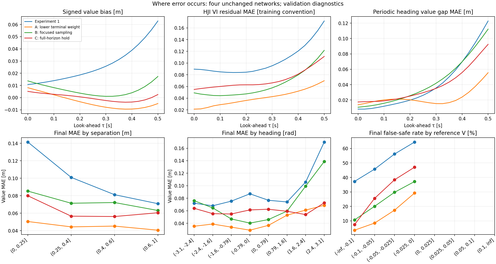

# Where the Air3D PINN fails

This analysis reuses the four saved networks and the 21-time, 24,000-state validation sweep. No training, optimizer updates or control experiments were performed. Equation derivatives and heading-seam checks use the first 6,000 validation states; a separate 6,000-state sample checks the wider training box. These are descriptive diagnostics, not a causal allocation of error or a safety certificate.

## 1. Longer look-ahead exposes failures in the learned function

The network predicts V directly from (tau,x,y,psi). It does not advance a numerical solution through successive time steps at inference. Rising error with tau therefore is not numerical integration error accumulating inside the PINN. It means the fitted function becomes less accurate deeper into the trained interval. The governing equation couples its time and state derivatives, but the training only enforces that equation approximately.

## 2. The learned value violates exact game properties

For this minimum-separation reachability game, increasing look-ahead cannot improve the ideal value: the longer interval still includes every earlier possible collision. Also V(tau,s) <= l(s), because the interval includes the current state. Finally psi=-pi and psi=+pi describe the same orientation and must give the same value.

| Measurement | Experiment 1 | Experiment 2A |
|---|---|---|
| Fraction of 24,000 states whose predicted V rises from .475 to .5 s by >1e-5 m | 77.38% | 63.69% |
| Fraction with V(.5,s)>l(s)+1e-4 m | 58.29% | 46.56% |
| Mean absolute V(.5,x,y,+pi)-V(.5,x,y,-pi), 6,000 positions | .12281 m | .05558 m |
| Interior HJI VI residual MAE at .5 s, 6,000 states | .17181 | .06984 |

The monotonicity and obstacle percentages count violations, not their severity; a small violation counts. These counts do not measure control-direction accuracy. The saved reference had zero upward increments at all 20 sampled intervals at the stated 1e-10 m tolerance. The HJI VI residual uses the implementation's max(V_tau-H,V-l) convention, combining a differential and obstacle term; it has no single physical unit without additional normalization. It must not be interpreted as a value-error bound. Free-PDE residuals are also saved but need not vanish on the active obstacle.

The heading mismatch is a concrete structural defect: the existing input is a scaled raw angle, without enforced periodicity. It supports testing a periodic encoding, but its numerical size is not the fraction of overall error caused by that encoding.

## 3. The most important safety failures are concentrated in the collision disk

Among the 3,319 validation states already within the .25 m collision radius, Experiment 2A labels **571 (17.20%)** safe at .5 s. Experiment 1 labels **2,009 (60.53%)** safe. This check uses the analytic collision geometry, not reference labels.

Of A's **571 reference-relative false-safe cases** at .5 s, **567 (99.30%)** occur in the initial collision disk. The two 571 totals describe different sets: the reference-relative count includes four outside-disk cases, while the analytic count includes four additional inside-disk cases. These are already-collided initial states, so this concentration does not establish poor avoidance control for an initially separated pair. It does show that the learned value can contradict a known unsafe condition.

For initially separated states alone, A has 4 false-safe classifications among 1,962 reference-unsafe states (0.20%) at .5 s. That conditional result is useful context but does not replace the full-domain metrics, address false-unsafe conservatism, establish controller performance, or guarantee safety on new states.

There is a small reference-label caveat: interpolation on the finite grid labels five inside-disk states positive near the boundary. This does not explain hundreds of network violations. The analysis retains the original reference-based metrics and reports the exact geometry check separately rather than silently changing the reference.

For A, the false-safe rate rises from 3.57% among samples with reference V<=-.1 m to 29.22% among those with -.025<V<=0 m (239/818). Sign errors are more likely near zero, where modest value error changes the classification. These value bins describe reference minimum separation margin, not initial drone separation.

## 4. A fixed offset does not explain A's remaining error

At .5 s, Experiment 1's mean signed error is +.06286 m; it systematically overestimates the value. A's mean signed error is -.00485 m with value MAE .04477 m. For A, squared mean bias accounts for only .70% of mean squared error, so shifting every prediction by one constant would leave most squared error.

A's initial-time RMSE is .01593 m versus .05797 m at .5 s. We saved the exact identity E[e(t)^2]=E[e(0)^2]+2E[e(0)(e(t)-e(0))]+E[(e(t)-e(0))^2]. Its cross term can be negative. This demonstrates that the final error is not simply the unchanged initial approximation error; it does not isolate a causal contribution from terminal loss or physics loss.

## 5. The curriculum underrepresents later times

During the linear horizon ramp, nonterminal time samples are uniform between zero and the current maximum. In the continuous-ramp approximation, the fraction at tau>=a*T is 1-a+a*log(a). Consequently only **2.15%** fall in [.4,.5] s and **.127%** in [.475,.5] s, compared with 20% and 5% if the full interval were sampled uniformly throughout. Terminal samples are excluded from these percentages. These are expected sampling fractions, not reconstructed logs of actual random draws.

At .5 s, A's interior VI residual is about 3.3 times its initial-time value, consistent with poorer equation satisfaction later in the interval. This and the known sampling schedule make temporal coverage a plausible contributor. They do not establish it as the unique cause. C's extra full-horizon steps already provided more exposure and helped over Experiment 1, but C still loses to A, and its additional compute prevents treating it as a fixed-budget test of temporal sampling alone.

## What is established, and what remains a hypothesis

Established: later-time value error, nonzero equation residuals, violations of V<=l and temporal monotonicity, heading-periodicity mismatch, and concentrated false-safe failures in the collision disk. A substantially improves the original baseline but does not remove these defects.

Plausible contributors: loss weighting, unequal temporal exposure, soft enforcement of known constraints and raw-angle encoding. Network capacity, optimizer choice and sine frequencies remain possible contributors; the present evidence does not isolate them. The earlier spectra do not establish high-frequency representation as the dominant bottleneck. Reference error remains a limitation, although the exact-property checks above do not require reference labels.

Prioritize one-change, equal-budget tests against A: (1) enforce or explicitly penalize the known obstacle/terminal constraints, checking them separately because an exact terminal condition alone does not enforce V<=l at later times; (2) encode heading periodically; (3) redistribute the existing time samples toward later times. Recheck all original metrics and these diagnostics, since fixing one property can worsen another. No such training was started here.

## Files and reproduction



- error_groups.csv/json: every time, model, initial-separation bin, heading sector and reference-value bin, including counts and false-safe denominators. Conditional bins are descriptive and not controlled causal comparisons.
- exact_properties.csv/json: analytic collision checks, obstacle violations and reference monotonicity.
- equation_checks.csv/json: interior and wider-box residuals, derivative signs and obstacle statistics. The wider box uses the training distribution's angle extension; it is not the same distribution as the comparison square.
- heading_seam.csv/json: disagreement between equivalent endpoint headings.
- time_decomposition.csv/json: signed bias, finite-time increase counts and the exact error identity.
- curriculum_exposure.csv/json: expected temporal sampling fractions.
- equation_samples.npz: 6,000 interior states, model values, derivatives and residual components at all 21 times; no controller is evaluated.
- manifest.json: protected-file and source hashes; unchanged-input and decomposition checks.

From the project root:

```powershell
python outputs/deepreach/failure_analysis.py
```

The script regenerates data and the figure; this interpretation document is maintained separately. The initial analysis ran in a managed process with two CPU threads. All selected validation data have already informed development; a fresh final test remains future work.

[21-point sweep](../lookahead_21points_20261027/README.md) · [Original diagnostic supplement](../diagnostics_20261027/README.md)
