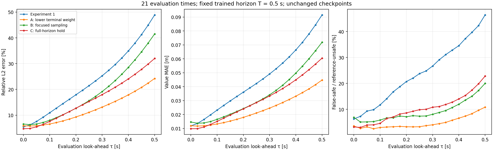

# Denser look-ahead diagnostic

21 points from 0 to .5 seconds, spacing 0.025 s, using the four unchanged Experiment 1/2 checkpoints and the same 24,000 validation states. No training.



The independent 129×129×96 grid solver computed each requested snapshot directly. No reference values were interpolated in time. Additional output times shorten some Euler steps, so this reference can differ slightly from the original three-snapshot solve. Maximum shared-snapshot difference: 0.00001375 m; reference construction: 132.99 s. See reference_check.json.

This varies evaluation look-ahead inside a fixed trained horizon. It is not a sweep of independently trained horizons, an untouched final test, a new training experiment, or a safety guarantee. The original three-point report, spectra and timing measurements are preserved.

| Model | Relative L2 at .5 s | MAE at .5 s [m] | False-safe / reference-unsafe at .5 s |
|---|---|---|---|
| Experiment 1 | 48.88% | 0.09150 | 46.42% |
| A: lower terminal weight | 24.24% | 0.04477 | 10.82% |
| B: focused sampling | 41.52% | 0.07189 | 20.00% |
| C: full-horizon hold | 32.00% | 0.06048 | 22.80% |

Files: metrics.csv/json contain all model/time comparisons; heldout_values.npz retains the exact query states, reference values and predictions; manifest.json records source/input hashes; checks.json records verification. Full grid snapshots are not duplicated; rerunning the solver reconstructs them.

Reproduce from the project root:

```powershell
python outputs/deepreach/lookahead_sweep.py --points 21 --out outputs/deepreach/lookahead_21points_20261027
```

[Original diagnostics](../diagnostics_20261027/README.md)
