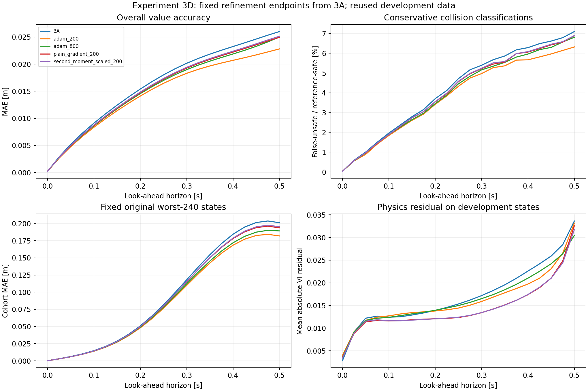

# Experiment 3D results

[Follow-up diagnosis](followup_diagnostics/README.md): about 94% of controlled audit-loss reduction comes from outside the comparison square. Adam +200 has the lowest MAE at all 20 nonzero horizons, and 97.3% of its final-time MAE reduction occurs without changing safe/unsafe classification. This study used frozen checkpoints and no reserved final states.

**Continued Adam at the fixed 200-step endpoint gives the best development value accuracy.** Step-controlled directions lower physics loss more, but deliver smaller improvements in value predictions. The frozen one-step results therefore did not establish a better sequential optimizer.

| Endpoint | MAE at .5 s [m] | MAE improvement vs 3A | Audit physics loss | Audit loss reduction vs 3A |
|---|---:|---:|---:|---:|
| Original 3A | .02602121 | — | .00841644 | — |
| Adam +200 | **.02281836** | **12.31%** | .00817238 | 2.90% |
| Adam +800 | .02501950 | 3.85% | .00734407 | 12.74% |
| Plain direction +200, step selection | .02496357 | 4.06% | .00576398 | 31.52% |
| Scaled direction +200, step selection | .02515615 | 3.32% | **.00566352** | **32.71%** |

All four endpoints improve overall MAE at every one of the 20 nonzero inspected horizons. None has an observed false-safe classification on the development states at those horizons. These empirical results do not certify safety.

## What Adam +200 improved

- Final-time relative L2: 19.12% to **17.23%**.
- Unsafe-set IoU: .79879 to **.81684**.
- False-unsafe fraction of reference-safe states: 7.098% to **6.318%**.
- Fixed original worst-240 MAE: .20121 to **.18195 m**, a **9.57%** reduction.
- Its own worst-240 MAE: **.18444 m**, so the improvement is not solely a consequence of holding the old cohort fixed.
- Maximum absolute error: .27790 to **.25042 m**.
- Predictions below -R-.0001: 1.783% to **1.229%**.

The large conservative tail is still present. Overall final-time bias remains negative, moving from -.02601 to -.02277 m. Heading inconsistency and temporal increases also remain. The terminal/obstacle construction passes for every endpoint; it does not enforce the separate -R bound or monotonicity over horizon.

## What the loss comparison teaches us

At 200 controlled steps, physics audit loss falls about 32% while final-time reference MAE falls only 3–4%. Ordinary Adam +200 improves value accuracy more despite a much smaller audit-loss reduction. Continuing the same Adam trajectory to 800 steps lowers audit loss further but worsens reference accuracy relative to the 200-step endpoint.

This supports tracking physics loss and value/classification metrics separately. It does not show that physics is incorrect, that minimizing the PDE is inherently harmful, that Adam always wins, or that 200 is an optimal stopping time. We only inspected two fixed Adam endpoints from one trained seed and one sampling continuation. The endpoint difference could reflect stochastic trajectory variation as well as imperfect correspondence between the training residual and value error. It does not establish overfitting as a unique cause.

The distributions differ: audit physics samples use the full training square x,y in [-2,2] and a mixture of horizons/zero-time samples, whereas reference-value error uses the comparison square [-.6,.6] at fixed horizons. At .5 s on those same comparison states, VI residual is .033641 for 3A, .033176 for Adam +200, .030470 for Adam +800, .032600 for plain +200 and .031751 for scaled +200. Thus the large full-region audit improvement is not a 32% improvement in final-time interior physics loss. Spatial/time coverage is a plausible contributor to the difference and requires diagnosis before attributing it solely to optimization alignment. The lower final-time interior residual at Adam +800 still coincides with worse value accuracy than Adam +200.

At the equal count of 800 physics batch assessments, plain direction +200 and Adam +800 have very similar final-time MAE (.024964 and .025019 m). The difference is too small for a broad optimizer claim from this single continuation. The controlled methods use fewer expensive parameter-gradient batches and ran faster than Adam +800 here, while Adam +200 was both faster and more accurate than either controlled method. See the [budget details](README.md).

## Decision

Preserve original 3A as the reproducible parent. Keep **Adam +200 as the strongest development candidate from this trial**, with its own saved checkpoint; do not silently replace previous results. Neither controlled direction earns promotion as an optimizer improvement from these data.

The next useful investigation is why residual reduction and value improvement separate across these saved endpoints. This can begin with the saved predictions, physics fields and error groups, without another training run. A claim that a method improves the original fixed training budget would require a separate budget-controlled test; this refinement adds computation. A broader claim about stopping or optimizer choice would require repeat continuations/seeds and then the reserved final evaluation after the protocol is fixed. No additional training or final-test evaluation is scheduled by this report.
