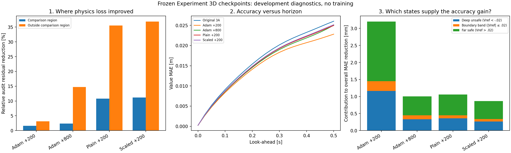
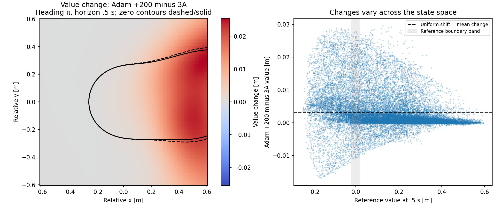

# Three follow-up diagnostics of Experiment 3D

The proposed [geometry/horizon weighting probe is now completed](../geometry_horizon_probe/README.md). It improves local probes at original 3A but does not improve Adam +200; lower focused residual again fails to ensure lower reference-value error. No weighted training run was started.

28 October 2026. We examined **location, horizon and the nature of the value correction**, using the five saved checkpoints. No optimizer was created, no parameter was updated, and no reference labels were added to training. The reserved final-evaluation states remain unused. All comparisons use development data and one training seed/continuation.

## 1. Where did physics loss improve?

The original 8,192-point physics audit contains 696 points inside the comparison square |x|,|y|<=.6, and 7,496 outside it but inside the original training square [-2,2]. Thus **91.5% of audit points are outside** the comparison region. They supply 83.7% of the original audit loss. The same physical points and times are paired across models.

The audit retains the training heading range [-1.2pi,1.2pi] and mixed times/zero-time points. Reference-value evaluation uses canonical headings [-pi,pi] at fixed horizons. Calling audit points core refers to their spatial coordinates; it does not make that sample distribution identical to the reference comparison. Section 2 also measures residual and value changes on exactly the same comparison states/times.

| Model | Residual reduction inside comparison square | Reduction outside | Share of total audit-loss reduction from outside |
|---|---:|---:|---:|
| Adam +200 | 1.58% | 3.16% | 91.1% |
| Adam +800 | 2.36% | 14.76% | 97.0% |
| Plain +200 | 10.78% | 35.55% | **94.4%** |
| Scaled +200 | 11.19% | 36.90% | **94.4%** |

The controlled methods improve physics inside the comparison region, too. Their large overall 32% reduction is nevertheless dominated by the broader region and overstates their improvement where our reference-value accuracy is measured. Outside contributions are larger than their 83.7% share of baseline loss; this is not solely a consequence of having more outside points. These are finite-sample decompositions, not evidence that outer-domain physics is unnecessary.

The location/time split adds detail. For the scaled method, core residual falls 26.6% in (.3,.4] s but only **5.95% in (.4,.5] s**. Core zero-time physics residual increases in absolute mean from .001337 to .001999; the analytic terminal value condition remains enforced. Zero-time physics residual and terminal value error are different quantities. Each core time bin has only 97–133 audit points, so these bin results are descriptive; the full 24,000-state fixed-horizon fields provide a denser complementary view.

The loss improvement in a region is decomposed as its point fraction times its paired mean residual reduction. Signed contributions across the two spatial regions, and across the spatial/time cells, reproduce the original total audit-loss change. No numerical-reference values are needed for this decomposition.

## 2. When do the methods separate?

**Adam +200 has the lowest value MAE at every one of the 20 nonzero evaluated horizons**, compared with original 3A and all three other refinement endpoints. There is no isolated late-time crossover that alone explains its advantage.

Using a descriptive gap of .0001 m, it separates from both controlled methods by the first nonzero snapshot, .025 s, and from Adam +800 by .05 s. At .5 s its MAE advantage is .00215 m over plain +200, .00234 m over scaled +200 and .00220 m over Adam +800. These thresholds are reporting choices, not accuracy bounds or statistical significance tests.

| Horizon | Adam +200 MAE [m] | MAE reduction vs 3A | Physics residual reduction on the same comparison states |
|---|---:|---:|---:|
| .10 s | .00835503 | 8.36% | **-2.33%** (residual worsens) |
| .25 s | .01646106 | 8.66% | 5.87% |
| .50 s | .02281836 | 12.31% | 1.38% |

At .1 s the same states have better values despite a higher residual. Therefore the full-domain versus core distribution difference explains part of the aggregate-loss contrast, but cannot explain all of it. Pointwise residual size is not a direct measure of value error, and its derivative with respect to parameters need not align with the value-error derivative. This agrees with the earlier learning-signal study; it does not identify a unique cause or invalidate the governing equation.

All models' errors grow as the queried horizon gets longer. The PINN evaluates each horizon directly; these curves do not measure numerical integration error accumulating inside the network. The snapshots do not establish behavior between evaluated horizons.

## 3. Broad correction or mainly a boundary shift?

At .5 s, comparing Adam +200 against original 3A:

- **79.62%** of states have lower absolute value error, 20.10% worsen, and the rest change by at most .000001 m.
- Predictions rise at 80.17% of states. Mean change is +.003233 m, but its standard deviation is .006136 m: the correction varies substantially with state.
- Only **182/24,000 states (0.758%) change safe/unsafe classification**. Adam corrects 164 false-unsafe cases and introduces 18 new false-unsafe cases, reducing the count from 1,329 to 1,183. Both endpoints have zero observed false-safe cases in this comparison.
- **97.30% of the net MAE reduction occurs at states whose classification stays unchanged.** The improvement therefore extends well beyond changing a binary label.
- Ahead encounters (x>0) supply **86.4% of the total MAE reduction**. Their MAE falls .045736 to .040183 m; behind encounters also improve, .006434 to .005566 m. Broad improvement is uneven across geometry.
- Of the fixed original 240 outliers, **233 improve and seven worsen**. Their mean error falls .201206 to .181952 m; substantial error remains.

Using disjoint groups defined by approximate reference value, the contributions to the total .003203 m MAE reduction are:

| Reference-value group | States | Contribution to total MAE gain |
|---|---:|---:|
| Vref < -.02 m | 4,618 | 36.3% |
| \|Vref\| <= .02 m | 1,347 | **8.9%** |
| Vref > .02 m | 18,035 | 54.8% |

The .02 m band is a descriptive band in value space, not a certified safety margin or a physical distance to the two drones' collision boundary. The overlapping ahead/behind and initial-collision groups are recorded separately; they are not added to this disjoint partition.

### Uniform-shift comparison

As an offline diagnostic only, we added the mean observed change (+.003233 m) uniformly to original 3A's final-time predictions. This shift is fitted from the two networks' predictions, without reference labels; references only assess its error afterward.

Uniform shifting reduces MAE to .024362 m, capturing **51.8% of Adam +200's actual MAE gain**. Adam's actual state-dependent change reaches .022818 m. The constant component accounts for 21.7% of the mean squared prediction-change magnitude; this is an energy fraction, not a regression R-squared.

There is a common upward correction of the conservative bias, but a single offset does not reproduce the full improvement. The uniform shift also introduces **five observed false-safe states** and 8,190 obstacle violations above a .000001 m tolerance. It is not saved or proposed as a replacement model. The actual Adam checkpoint preserves the exact terminal/obstacle construction and has no observed false-safe classifications on these states.





The second figure's slice is at heading pi and horizon .5 s. Dashed and solid contours are the predicted zero sets for original 3A and Adam +200. The color map is their value difference, without new reference labels on that slice. It illustrates varying corrections across x,y; a single slice cannot establish behavior for all headings.

## What to work on next

Keep Adam +200 as the strongest development candidate, with original 3A preserved. The evidence supports investigating **how physics loss is distributed across geometry and horizon**, rather than replacing Adam on the strength of aggregate residual reduction.

A reasonable next step is an offline probe of physics-only weighting that emphasizes difficult ahead encounters inside the comparison region and late horizons, while retaining a broad-domain term. Do not discard outside physics: reachable values in the comparison region depend on dynamics beyond it. The masks can use geometry/time without numerical-reference labels in the objective. Evaluation may use development references to judge a candidate, as before.

This is a hypothesis, not a demonstrated fix. Earlier broad spatial-focus and mixed-time candidates did not outperform their baselines, so this report does not justify simply repeating them. A new joint weighting would need its own direction/finite-step check before training. No further training, weighting change or reserved final-test evaluation was performed or scheduled here.

## Files and verification

```powershell
python outputs/deepreach/diagnose_refinement.py
```

- `physics_by_location.csv`: matched audit residuals, point/loss fractions and exact weighted contributions.
- `physics_by_location_and_time.csv`: the spatial/time decomposition.
- `horizon_diagnostics.csv`: value error, residual, paired improvements and prediction changes at 21 times.
- `value_error_groups.csv`: overlapping geometric/error groups and the disjoint reference-value partition.
- `error_partition_contributions.csv`: contributions from that disjoint partition alone.
- `uniform_shift_comparison.csv`: per-horizon offline constant-shift comparison.
- `physics_fields.npz`: signed VI residual fields on audit and comparison queries for all five checkpoints. Comparison coordinates and times are in the protected original development archive.
- `heading_pi_slice.npz`: slice axis and network values used in the contour figure.
- `summary.json`, `diagnostic_protocol.json`, `manifest.json`: findings, fixed diagnostic choices, source/input hashes, timing and checks.

Saved-prediction agreement, original audit-loss agreement, spatial/time loss decomposition and value-error partition decomposition all pass. Every model's parameters/buffers are unchanged and no parameter gradients accumulate. Protected checkpoint, reference, prediction and reserved-input hashes are unchanged. Physics fields use input derivatives only; this is not a control-gradient reliability study or a closed-loop safety evaluation.

Execution used the existing project interpreter through a managed process with two CPU threads. It was not a VS Code debugger run. Elapsed time is recorded in manifest.json.
