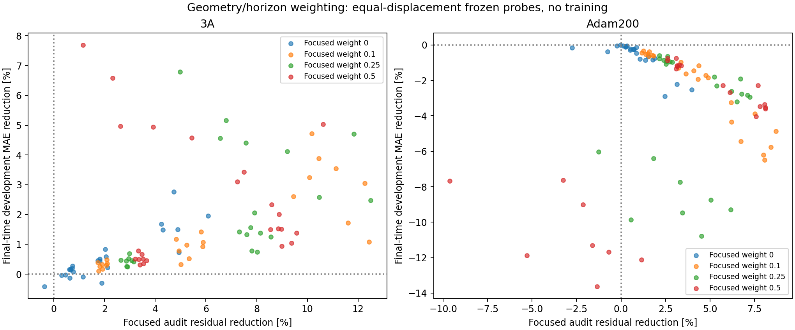

# Geometry-and-horizon weighting: frozen probes

The proposed [optimizer-history check is now completed](../optimizer_history_probe/README.md). At fixed Adam +200 parameters, suppressing momentum, restarting Adam and using plain gradients still worsen value error while lowering audit physics loss. No new training run was started.

28 October 2026. **The proposed weighting did not improve the current best development candidate, Adam +200.** It helped near the older 3A checkpoint, so the result depends on where refinement starts. We keep Adam +200 unchanged and do not start a weighted training run from these results.

This is a completed offline test of the weighting hypothesis proposed after the [three follow-up diagnostics](../followup_diagnostics/README.md). It is not a new trained model or evidence that every possible weighting fails.

## Fixed protocol

The protocol was saved before computing the probes. Each of two frozen checkpoints supplies eight matched construction batches: 2,048 global physics points (256 at zero time), plus 512 focused physics points. Both checkpoints and all weights use the same physical batches, seed 991738.

Global points retain the original full training distribution. Focused points are uniform over:

- Horizon tau in [.35,.5] seconds.
- Relative x in [0,.6] m: the pursuer is ahead in the evader frame.
- Relative y in [-.6,.6] m.
- Heading in the original extended range [-1.2pi,1.2pi].

This focuses on a geometric/time region, without selecting individual states by numerical-reference error. No empirical trajectory data, reference bounds or reference labels enter the objective.

The construction objective is

`L_lambda = (1-lambda) mean_global(|VI residual|) + lambda mean_focused(|VI residual|)`.

We test lambda = 0, .1, .25 and .5. Lambda = 0 is the unweighted control. Each mean is normalized by its own point count; the focused distribution is emphasized through its mixture weight, not simply through extra samples. Focused gradients are computed once and shared across the four weights.

For each weighted gradient, we compute the hypothetical next Adam direction using that checkpoint's saved moments and step count. All four directions are normalized to the unweighted Adam displacement norm for that batch, then tested at multipliers .1, .3 and 1. This holds displacement size equal across weights within each checkpoint/batch. It is a direction probe, not a test of standard weighted Adam with its natural step norm or of sequential weighted training.

There are **192 independent finite probes**: two checkpoints x eight batches x four weights x three step sizes. Every probe starts at its frozen checkpoint; none is applied persistently.

## Physics-only selection and independent audit

Separate selection and audit pools use seeds 991739 and 991740. Each contains 8,192 global points (1,024 zero-time), plus 2,048 focused points. Construction gradients use neither pool.

All candidates are scored using the **same** selection objective, .75 global loss + .25 focused loss, regardless of their construction weight. Candidates must also leave global selection physics loss no higher than the frozen baseline. Unchanged parameters remain an option. Comparing differently weighted losses directly would not provide a common ranking.

We select within the unweighted family, within the weighted family, and across all candidates. Audit results are exposed after selection. Reference values only evaluate outcomes on the reused 24,000 development states at .1, .25 and .5 s; they do not supply gradients or choose candidates. The reserved final states are only hashed for preservation, never loaded or evaluated.

## Main result: starting from Adam +200

| Candidate | Final-time value MAE [m] | Change from frozen Adam +200 | Global audit residual reduction | Focused audit residual reduction |
|---|---:|---:|---:|---:|
| Frozen Adam +200 | **.02281836** | — | — | — |
| Physics-selected unweighted probe | .02348117 | **2.90% worse** | 6.62% | 2.46% |
| Physics-selected weighted probe | .02392924 | **4.87% worse** | 5.31% | 8.71% |

The weighted winner uses lambda .1, multiplier 1, construction batch index 6. It also wins the common selection score across both families. Despite satisfying the full-domain guard and improving both audit losses, it has worse reference-value accuracy. Its fixed original worst-240 MAE rises from .181952 to .184198 m. False-unsafe/reference-safe rises from 6.318% to 6.590%; no false-safe case is observed for this selected probe at the three evaluated horizons.

This is not an isolated bad choice among otherwise promising candidates: **0/72 weighted probes improve final-time MAE from Adam +200**, and **0/24 unweighted controls improve it**. The smallest weighted MAE is .02289199 m, still above .02281836. The smallest unweighted MAE is .02282158 m. These minima are descriptive development measurements, not selection rules.

The unweighted controls also worsen value accuracy, so the evidence does not attribute every regression specifically to introducing focused weights. At this checkpoint, the tested saved-state Adam directions already tend to lower physics residual without lowering reference error. Increasing emphasis on the selected residual region does not resolve that mismatch in these probes.

## Secondary result: starting from original 3A

| Candidate | Final-time MAE [m] | MAE improvement vs 3A | Global audit residual reduction | Focused audit residual reduction |
|---|---:|---:|---:|---:|
| Frozen 3A | .02602121 | — | — | — |
| Physics-selected unweighted probe | .02586798 | .59% | .21% | 2.05% |
| Physics-selected weighted probe | .02566030 | 1.39% | 1.67% | 9.57% |

The weighted winner uses lambda .5, multiplier .3, batch index 6. All **72/72 weighted probes** improve final-time MAE from 3A, compared with 18/24 unweighted controls. However, even the smallest development MAE among these weighted probes, .02402134 m, does not beat the already saved Adam +200 checkpoint (.02281836 m).

The opposite outcomes at the two checkpoints are meaningful, but these checkpoints differ in both parameters and saved optimizer moments. This experiment does not isolate which difference causes the reversal. It does not prove that Adam +200 is optimal, that residual minimization is fundamentally wrong, or that weighting from an earlier stage could never help.



Each dot is an independent probe. Rightward means focused physics loss improved; upward means final-time reference MAE improved. All Adam +200 dots fall below zero value improvement, even though many move rightward. No updated model is saved from the dots.

## Decision and next question

Keep Adam +200 as the strongest development candidate and preserve 3A as its parent. Do not promote this weighting to training on the basis of physics loss alone.

The next useful diagnostic would separate the **current physics-gradient direction from saved Adam momentum/preconditioning**, keeping the same parameters, to test whether optimizer history contributes to the reversal. That can also be done without a full training run. Another possible contributor is unresolved structure in the value approximation, including heading consistency and late-horizon errors. Neither explanation has been established by this weighting probe. No additional experiment or training is scheduled here.

## Checks, cost and files

Checks verify the convex weighted-gradient identity against direct differentiation, the hypothetical raw Adam formula against a standard PyTorch Adam step on a disposable copy, equal displacement norms across weights, focused geometry bounds, unchanged protected hashes, and selected candidates' terminal condition within float32 tolerance. The baseline fallback is also checked. The disposable optimizer copies are verification fixtures; no checkpoint or working model is updated.

The actual frozen models retain identical parameters/buffers and no accumulated parameter gradients. The exact terminal/obstacle output construction is retained; the separate lower-value and horizon-monotonicity conditions remain unenforced. No control-gradient reliability or rollout evaluation was performed.

Substantive computation includes 32 physics-gradient batches (40,960 point assessments), 3,932,160 candidate physics-loss point assessments and 13,824,000 candidate reference-value point assessments. Baseline and small verification calculations are additional. This is diagnostic computation, not a cost-free improvement. Execution used the existing project interpreter through a managed process, two CPU threads; this was not a VS Code debugger run. Runtime is recorded in manifest.json.

```powershell
python outputs/deepreach/probe_geometry_horizon.py
```

- `protocol.json`: fixed masks, weights, sampling, selection and scope.
- `physics_queries.npz`: construction, selection and audit inputs.
- `gradient_directions.csv`, `matched_directions.npz`: directions, norms and first-order physics changes.
- `physics_trials.csv`: selection/audit results for all probes.
- `validation_trials.csv`: baseline and candidate value/classification outcomes at three horizons.
- `aggregate_by_weight_and_step.csv`: counts and medians across eight batches.
- `physics_selected_winners.json`: physics-selected winners and their development outcomes.
- `baseline_physics.csv`, `interpretation_metrics.json`, `manifest.json`: baselines, derived comparisons, constraints checks, hashes and timing.
- `sources/probe_geometry_horizon.py`: exact source snapshot.

The states and reference values already inform development; the sample counts are not independent training seeds or statistical generalization guarantees. No numerical reference was recomputed, no new training run was started, and the reserved final-evaluation inputs remain unused.
