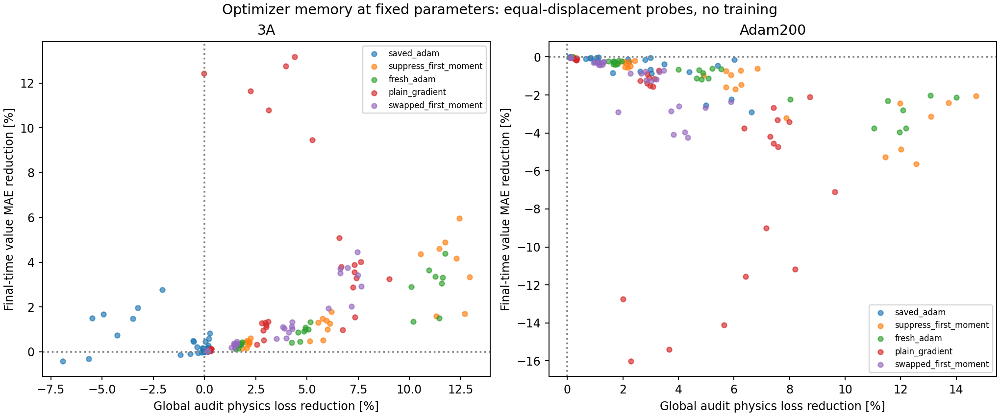

# Optimizer-history diagnostic at frozen parameters

28 October 2026. **Saved Adam momentum does not explain away the regression at Adam +200.** All 160 finite probes at that checkpoint lower global audit physics loss, but none lowers final-time development MAE. Suppressing momentum, restarting Adam's state, and using the plain current gradient all show the same qualitative mismatch.

This completes the optimizer-history check proposed after the [geometry/horizon weighting probe](../geometry_horizon_probe/README.md). No training was run, no optimizer was created, and all checkpoints and reserved final-evaluation inputs remain unchanged.

## Question and controls

We hold each network's parameters fixed and change the direction calculation. The main checkpoint is Adam +200; original 3A is a secondary comparison. At a given checkpoint and batch, every direction uses the same **unweighted global physics gradient** g. No focused loss or reference-label term enters g.

The five directions are:

| Direction | Incoming first moment | Incoming second moment | Clock |
|---|---|---|---|
| Saved Adam | Saved at current checkpoint | Saved at current checkpoint | Saved |
| Suppress first moment | Zero | Saved at current checkpoint | Saved |
| Fresh Adam | Zero | Zero | Restarted at zero |
| Plain gradient | Not used | Not used | Not used |
| Swapped first moment | Borrowed from other checkpoint | Saved at current checkpoint | Saved at current checkpoint |

The swapped direction changes only the numerator's historical first moment. It does not swap parameters, current gradients, second moments or clocks. It is a diagnostic counterfactual, not a claim that the borrowed state is a normal optimizer state for these parameters.

Adam directions use the ordinary beta updates, bias corrections, saved learning rate and epsilon. Suppressing the incoming first moment leaves a direction proportional to the current gradient divided by the next-step second-moment denominator. Fresh Adam's first-step direction is proportional to the signed current gradient, with epsilon retained. Plain gradient is -g.

All directions are normalized to the saved-Adam displacement norm for that checkpoint/batch. Multipliers .01, .1, .3 and 1 test equal-size finite displacements. **Natural step magnitudes after an optimizer restart are not tested**, nor are sequential restarted training trajectories.

Eight 2,048-point construction batches per checkpoint are reused from the weighting probe, including 256 zero-time physics points per batch. Both checkpoints use identical physical points. Selection and audit pools are also reused, with separate seeds 991739 and 991740. The focused audit region is reported for continuity but does not construct or select directions in this experiment.

## Selection and evaluation

The selection rule is minimum **global physics loss** on the selection pool, including the unchanged baseline. We select once per direction family and once across all families. This differs from the previous weighting probe's mixed global/focused score, although the raw saved-Adam directions replay that probe exactly.

Reference predictions are compared only afterward on the existing 24,000 development states at .1, .25 and .5 seconds. At each frozen checkpoint, reference MAE and half-MSE parameter gradients at .5 s are also calculated for interpretation. They enter only directional dot products; the direction-construction function accepts physics gradients and moments, not reference data or gradients.

There are 320 independent probes: two checkpoints x eight batches x five directions x four step sizes. Four step sizes on one direction are related observations, not four independent training runs. All results remain development diagnostics from one trained seed/continuation.

## Main finding at Adam +200

| Direction | Global audit loss improves | Final-time MAE improves | Local MAE descent directions |
|---|---:|---:|---:|
| Saved Adam | 32/32 | **0/32** | 0/8 |
| Suppress first moment | 32/32 | **0/32** | 0/8 |
| Fresh Adam | 32/32 | **0/32** | 0/8 |
| Plain gradient | 32/32 | **0/32** | 0/8 |
| Swapped first moment | 32/32 | **0/32** | 0/8 |

Local descent is assessed using the dot product of the reference-MAE gradient with the proposed parameter displacement. All 40 direction vectors at Adam +200 have the opposite sign: infinitesimal movement along them increases this reference error. Finite probes down to .01 times the saved-Adam displacement agree with that finding. Some changes at the smallest scale are tiny; the derivative check helps distinguish the local trend from a large-step effect.

The physics-selected candidates show the same contrast:

| Family | Selected final MAE [m] | MAE change vs frozen Adam +200 | Global audit loss reduction |
|---|---:|---:|---:|
| Frozen Adam +200 | **.02281836** | — | — |
| Saved Adam | .02348117 | 2.90% worse | 6.62% |
| Suppress first moment | .02328666 | 2.05% worse | **14.72%** |
| Fresh Adam | .02330262 | 2.12% worse | 14.00% |
| Plain gradient | .02329993 | 2.11% worse | 8.74% |
| Swapped first moment | .02335749 | 2.36% worse | 5.88% |

The minimum global selection loss across all families picks the suppressed-first-moment candidate. It reduces physics loss but still worsens value accuracy. The unchanged checkpoint remains the best development-value candidate **among the probes originating at Adam +200**.

## Comparison at original 3A

At 3A, suppressing the first moment, fresh Adam, plain gradient and swapped first moment each improve final MAE in all 32/32 probes. Saved Adam improves it in 24/32. Their infinitesimal MAE signs agree: 8/8 favorable for each alternative, versus 6/8 for saved Adam.

The global-physics-selected winner at 3A suppresses the first moment: final MAE .02515427 m, 3.33% below 3A, with 12.95% lower audit loss. It does not beat Adam +200.

There is a small descriptive lead outside the physics-selected winners: a 3A plain-gradient probe (batch 2, multiplier 1) achieves final MAE **.02259670 m**, slightly below Adam +200's .02281836 m. It also lowers audit physics loss, but has worse fixed-outlier MAE (.184906 versus Adam +200's .181952) and worse maximum error (.259126 versus .250422). It was not selected by the prespecified physics criterion. Selecting it after inspecting reference errors would be reference-guided step selection, so no checkpoint is created or promoted from it. This lead also means these diagnostics do **not** establish a universal accuracy ceiling at the current network size.



## Interpretation for the training-budget question

The reversal between 3A and Adam +200 persists when first-moment history is removed, when both moments and the clock are restarted, and when preconditioning is removed entirely through the plain gradient. Stale momentum alone is therefore not a sufficient explanation for the failed local refinements at Adam +200. Moment choices still change the magnitude of the accuracy/loss tradeoff; this does not show that optimizer history is irrelevant everywhere.

Our current unweighted sampled physics objective can favor local changes that worsen the approximate numerical-reference metric at Adam +200. More steps on that same objective are therefore not a demonstrated route to consistent improvement. These sampled direction families do not exhaust all possible descent directions, and a longer nonlocal training trajectory could behave differently. The approximate reference is an evaluation comparator, not exact ground truth or a controller certificate.

A larger network could represent a better solution, but this study does not test capacity. The next informative training experiment would explicitly compare **more steps at the current width** with **a wider network under a specified compute budget**, retaining the same physics-only formulation and reporting all added compute. That requires its own protocol, rather than claiming that resetting Adam solves the problem. No such training comparison or final-test evaluation was started here.

Keep original 3A and Adam +200 intact. Do not promote a restarted optimizer from these local probes alone.

## Verification, cost and reproduction

Checks cover replay of saved-Adam directions against the preceding probe, the suppressed-moment identity, an independent fresh-Adam scalar identity, equal displacement norms, the unchanged-baseline fallback, unchanged model parameters/buffers, no accumulated parameter gradients, and unchanged protected input/checkpoint hashes. The physics-selected candidates' terminal condition passes within float32 tolerance. The exact terminal/obstacle output construction remains intact; separate lower-value and temporal-monotonicity constraints remain unenforced.

Substantive cost includes 16 construction-gradient batches, two final-time reference-gradient sets (MAE and half-MSE at each checkpoint), 5,898,240 candidate physics-loss point assessments and 23,040,000 candidate value point assessments. Baseline and verification calculations are additional. This is additional diagnostic compute, not free training improvement. Execution used a managed process with the project interpreter and two CPU threads; it was not a VS Code debugger run. Measured runtime is in manifest.json.

```powershell
python outputs/deepreach/probe_optimizer_history.py
```

- `protocol.json`: fixed direction definitions, step sizes and selection rule.
- `direction_diagnostics.csv`: direction norms, saved-direction alignment and first-order physics/reference changes.
- `matched_directions.npz`: all 80 normalized direction vectors; no updated model.
- `physics_trials.csv`, `validation_trials.csv`: all finite-step physics and development metrics.
- `aggregate_by_direction_and_step.csv`: counts/medians across eight batches.
- `physics_selected_winners.json`, `baseline_physics.csv`: physics-selected endpoints and unchanged baselines.
- `interpretation_metrics.json`: derived comparisons and terminal/hash verification.
- `manifest.json`, `sources/probe_optimizer_history.py`: source/input hashes, checks, scope and source snapshot.

The fresh reserved final inputs were only hashed for preservation. They were never loaded for predictions, labels, gradients or selection. No numerical reference was recomputed and no control-gradient or rollout evaluation was performed.
