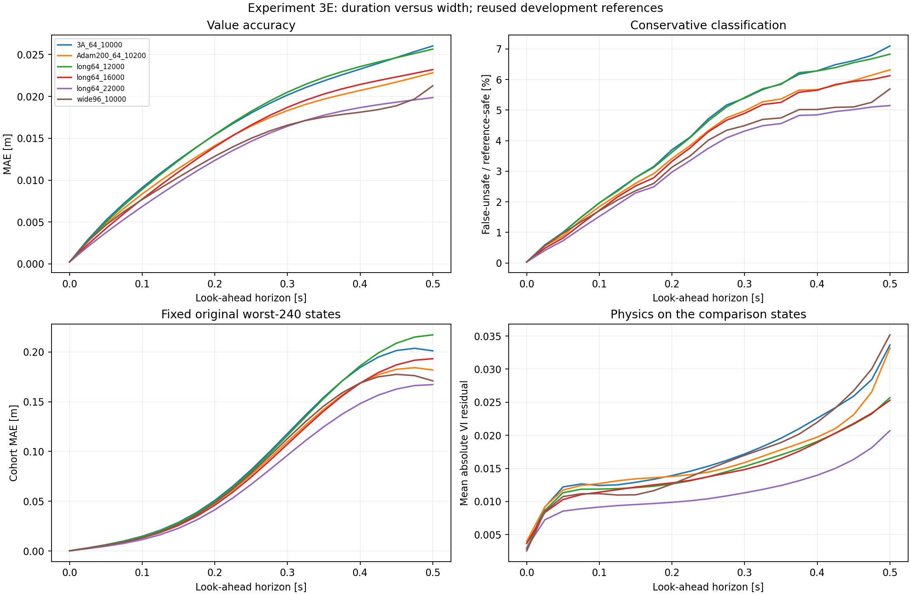
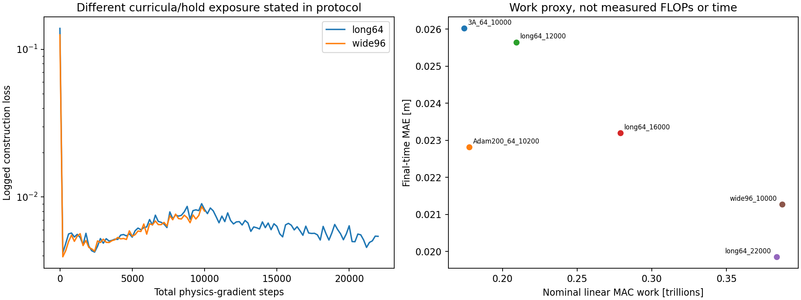

# Experiment 3E results — Extra budget helped

**Subsequent final evaluation is complete:** the [frozen final record](../../evaluation/final_evaluation_20261028/README.md) confirms a 12.61% MAE improvement over Adam +200 on the previously unused states, with paired 95% interval 11.93%–13.25%. This page retains the development results below. The final set was consumed after this experiment; it is no longer untouched.

Completed 28 October 2026. **Both additional full-horizon training and a wider network improve final-time development value accuracy beyond Adam +200.** The longer width-64 run gives the strongest overall value/classification result in this comparison. The protocol was fixed before training; the reserved final states remain unused.

## Primary comparison

| Model | Width / parameters | Total steps | Final MAE [m] | Improvement vs original 3A | Improvement vs Adam +200 |
|---|---|---:|---:|---:|---:|
| Original 3A | 64 / 8,705 | 10,000 | .02602121 | — | — |
| Previous best: Adam +200 | 64 / 8,705 | 10,200 | .02281836 | 12.31% | — |
| Longer training | 64 / 8,705 | **22,000** | **.01985405** | **23.70%** | **12.99%** |
| Wider network | 96 / 19,201 | **10,000** | .02126600 | 18.27% | 6.80% |

The wider model and original 3A use the same number of steps, curriculum and exact physical sampling sequence. The new network has more parameters and a different initialization. The longer/wider final endpoints have nominal linear-layer work proxies within 1%, but **were not matched in measured runtime or exact training FLOPs**.

Long64 at 22,000 improves overall MAE at **all 20 nonzero evaluated horizons** versus Adam +200. Wide96 improves it at **19/20**. These counts compare fixed snapshots on reused development data, not independent training trials.

## Other final-time outcomes

| Metric at .5 s | Adam +200 | Long64, 22k | Wide96, 10k |
|---|---:|---:|---:|
| Relative L2 error | 17.23% | **15.47%** | 15.96% |
| Unsafe-set IoU | .81684 | **.84551** | .83191 |
| False-unsafe / reference-safe | 6.318% | **5.148%** | 5.693% |
| False-safe / reference-unsafe | 0 observed | 0 observed | 0 observed |
| Fixed original worst-240 MAE [m] | .181952 | **.167232** | .170995 |
| Own worst-240 MAE [m] | .184441 | **.177251** | .181171 |
| Maximum absolute error [m] | .250422 | **.244953** | .256486 |
| Global audit VI loss | .00817238 | **.00487648** | .00783705 |
| VI loss on comparison states at .5 s | .0331763 | **.0206956** | .0351790 |

The longer model's fixed-outlier MAE improves **8.09%** versus Adam +200, and its global audit physics loss falls **40.33%**. The wider model's fixed-outlier MAE improves 6.02%, while its maximum error and final-time interior VI residual worsen slightly. A wider model is not uniformly better on every metric.

All endpoints have zero observed false-safe classifications across the 20 nonzero development horizons. This is empirical agreement with an approximate reference, not a safety guarantee. Conservative errors and a substantial worst-case tail remain.

The exact terminal/obstacle conditions pass for every model to approximately 9.39e-8 m float32 discrepancy. Other defects remain: predictions below -R-.0001 occur at 1.229% of final states for Adam +200, 1.471% for Long64 and 1.104% for Wide96. The heading seam mean is .02919, .03060 and .02769 m respectively. Time-increase fractions from .475 to .5 s, using tolerance .0001 m, are 20.10%, 19.25% and 12.36%. Long64 therefore earns the strongest overall value/classification result, not a claim that it dominates every constraint-related diagnostic.

## Why the earlier local probes were insufficient

The width-64 trajectory is not monotonic in reference error:

| Fixed endpoint | MAE at .5 s [m] | Fixed outlier MAE [m] |
|---|---:|---:|
| 10,200 steps | .02281836 | .181952 |
| 12,000 steps | .02564849 | .217253 |
| 16,000 steps | .02320025 | .193301 |
| 22,000 steps | **.01985405** | **.167232** |

At 12,000 steps, physics loss is lower but value/outlier accuracy is worse than at 10,200. By 22,000, both improve. The earlier optimizer-history probes correctly described local directions at Adam +200; they did not predict the outcome of thousands of subsequent updates that change the model, gradients, moments and samples. This run demonstrates why the local conflict should not be interpreted as an accuracy ceiling or proof that longer training cannot help.

No development metric was used to stop early or change this trajectory. The snapshots were specified before training.

## Actual compute and runtime

| Run | Cumulative sample points | Nominal linear MAC proxy | Recorded cumulative training time | Newly executed training |
|---|---:|---:|---:|---:|
| Original 3A | 20,480,000 | .1743 trillion | 220.28 s | Reused |
| Adam +200 | 20,889,600 | .1778 trillion | 224.62 s | Reused |
| Long64, 22k | 45,056,000 | .3835 trillion | **417.68 s** | **197.40 s** |
| Wide96, 10k | 20,480,000 | .3873 trillion | **604.37 s** | **604.37 s** |

The work-proxy ratio Wide96/Long64 is 1.0099. The actual cumulative time ratio is about 1.45, and Long64's cumulative time includes a historical original run. Runtime varied during the new experiment. This is not an exact equal-time, equal-FLOP or controlled machine-performance comparison; the forward linear MAC proxy excludes differentiation and other overheads. The initialization-time gradient microbenchmarks did not predict these complete training times.

Reusing the trained narrow model was practically cheaper in this task: 197 seconds of continuation versus 604 seconds for the fresh wider model, with better final MAE. This observation is specific to these runs and this laptop, not a universal hardware efficiency claim. Total new training orchestration was about 807 seconds including setup/checkpoint overhead; evaluation is separate.

## What this answers

The extra budget **helped**, through both tested routes. Longer full-horizon refinement won this particular comparison; widening at the original step count also helped. These findings support spending additional compute deliberately rather than assuming a better optimizer or smaller residual at one checkpoint will suffice.

They do not prove that a budget increase is strictly necessary, that 22,000 steps is optimal, or that every larger network will improve. This is one seed and one initialization per width; changing width changes initialization, and longer training changes full-horizon exposure. Further step counts, widths or seeds were not searched.

Preserve Long64 at 22,000 as the **strongest development candidate from this experiment**, alongside all previous models. It is saved separately in `runs/experiment_3_e_long64/checkpoint_22000.pt`. No old checkpoint is replaced. Reserved final-evaluation states remain untouched; no further training or 6D transfer was started.

## Verification and saved artifacts

The actual Long64 snapshots at 10,200 and 10,800 match the earlier 3D Adam models **bitwise**, with identical sampling RNG states. The actual Wide96 final sampling RNG matches original 3A after its 10,000-step stream, complementing the full preflight batch-hash replay. Derivative, normalized-chain and explicit Hamiltonian checks pass on every evaluated endpoint. All predictions are finite; evaluation leaves parameters unchanged. Original checkpoints, reference data and reserved inputs retain their hashes.

Training completed through **VS Code Run and Debug** from the Homework window using the main repo interpreter/output, CPU/two threads. Reference evaluation ran separately through a managed process. Protocol, hardware/preflight, configuration and source snapshots are retained. [Methods and reproduction](README.md).

`comparison.csv` contains 126 model/horizon rows. `final_comparison.csv/json`, `endpoint_values.npz`, `equation_checks.json`, `verification.json` and the manifests retain the measurements and provenance. The fixed original outlier cohort hash matches the earlier study; newly ranked worst-tail errors are reported separately.
