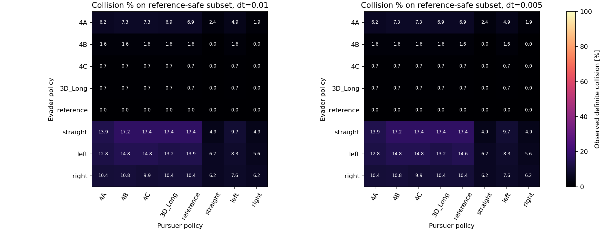
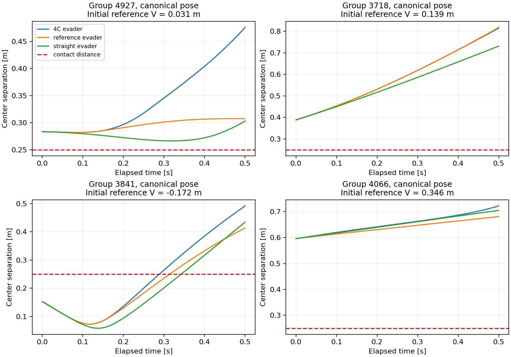

# Closed-loop development results

The formulation and duration improvements also helped in these closed-loop tests. Against the reference pursuer, 4A had 40 contacts, 4B had 9, and 4C had 4 on the reference-safe subset. The four 4C contacts are four poses of one encounter, also failed by 3D_Long. The reference evader avoided contact in every tested reference-safe state. These finite development results do not establish guaranteed safety.

The frozen 8×8 policy matrix completed at both time steps: 102,400 mathematical trajectories across 200 development groups and four equivalent poses per group. No training, controller tuning or final-test queries occurred. The primary reference-safe subset contains 576 joint states from 144 relative groups, with initial separation and both coarse/fine initial values above +0.01 m.

Results at a 0.005-second control interval, against the numerical-reference pursuer:

| Evader policy | Definite contacts | Relative groups with any contact | Possible contacts, including definite | Mean sampled minimum distance |
|---|---:|---:|---:|---:|
| 4A | 40/576 | 17/144 | 40/576 | 0.4596 m |
| 4B | 9/576 | 3/144 | 9/576 | 0.4840 m |
| 4C | 4/576 | 1/144 | 4/576 | 0.4859 m |
| 3D_Long | 4/576 | 1/144 | 4/576 | 0.4859 m |
| reference | 0/576 | 0/144 | 0/576 | 0.4868 m |
| straight | 100/576 | 25/144 | 100/576 | 0.4354 m |
| left | 84/576 | 21/144 | 84/576 | 0.4251 m |
| right | 60/576 | 15/144 | 60/576 | 0.4332 m |

Collision distance is 0.25 m. Possible contacts use the geometric lower distance bound and include definite contacts. These are finite-policy development results, not guarantees for every allowed pursuer action. The reference pursuer itself is approximate numerical feedback. States with reference values near zero are excluded only from this margin subset; all and initially separated subsets are retained in the raw metrics.

Across all eight tested pursuer policies, at dt=.005 on the same reference-safe subset:

| Evader policy | States with contact under at least one tested pursuer | States with possible contact under at least one tested pursuer |
|---|---:|---:|
| 4A | 42/576 | 42/576 |
| 4B | 9/576 | 9/576 |
| 4C | 4/576 | 4/576 |
| 3D_Long | 4/576 | 4/576 |
| reference | 0/576 | 0/576 |
| straight | 100/576 | 100/576 |
| left | 88/576 | 88/576 |
| right | 68/576 | 68/576 |

The tested set includes learned, reference, straight and constant maximum-turn policies. Taking the worst observed result across this set does not solve an exhaustive best-response problem. Rows should not be interpreted as independent samples: four poses share each underlying encounter.

Halving the control interval can change the feedback trajectory as well as its contact outcome:

| Evader vs reference pursuer | Definite-contact outcomes changed | Mean absolute change in minimum distance |
|---|---:|---:|
| 4A | 0/576 | 0.00025 m |
| 4B | 0/576 | 0.00001 m |
| 4C | 0/576 | 0.00001 m |
| 3D_Long | 0/576 | 0.00001 m |
| reference | 0/576 | 0.00001 m |
| straight | 0/576 | 0.00004 m |
| left | 4/576 | 0.00016 m |
| right | 0/576 | 0.00015 m |

The learned policies and reference evader have no definite-contact outcome changes on this subset when dt is halved. The 4C contacts are unambiguous at both time steps; their sampled minimum distance reaches about 0.20127 m, well below the 0.25 m threshold. Constant-left changes four outcomes, demonstrating that time-step sensitivity is still relevant for the policy matrix.

The remaining 4C failure is development group 603: relative state (0.43141, -0.23433, 0.89643). Its coarse/fine reference values are +0.04497/+0.03690 m. However, 4C initially predicts unsafe in all four poses (-0.07919 to -0.04049 m), and 3D_Long also predicts unsafe (-0.03911 m). This is not a case of either model initially declaring the state safe and then colliding.

In its canonical pose, 4C chooses +3 rad/s initially while the reference evader chooses -3 rad/s. With the reference pursuer, the learned rollout reaches contact at about 0.39375 s and a sampled minimum distance of 0.20127 m. The reference-evader rollout stays above 0.28724 m. The failure is shared across all four poses and by the 3D model, so it is not explained solely by 6D pose inconsistency or this time step. That does not isolate a causal training defect; a targeted first-action/gradient analysis is the next useful diagnostic. See [saved case details](primary_contact_cases.json).

The example plots show update-time distances for the first four selected groups and canonical poses; no example was selected for success or failure. Contact metrics also check within-step arc samples and retain geometric uncertainty bounds.

Controls are sample-and-hold, with decreasing time remaining and exact constant-turn arc integration. Nine exact arc samples per interval give sampled minimum distance; a relative-speed bound gives a lower estimate within 0.00046875 m at dt=.005 and 0.0009375 m at dt=.01. Ambiguous contact cases are flagged instead of being silently counted as safe. These bounds apply to fixed sampled policies, not an ideal continuously updated feedback law.

The all-state table includes initial overlaps. Mathematical trajectories continue after contact; their contact flag remains absorbing. Full-horizon switch counts can include post-contact behavior and should not be interpreted as drone behavior after a crash. Differences between poses and time steps are reported rather than smoothed away.

Raw controls for every rollout were replayed without model queries. Minimum-distance bounds, contact times, flags, final states, example paths and switch counts reproduced bit for bit, and all pair/subset contact counts were checked against raw arrays. The reference interpolator passed an analytic time/space/periodic-gradient fixture. Protected checkpoints and old final-state bytes remain unchanged.

See [methodology](METHODOLOGY.md), [fixed protocol](protocol.json), [all role/policy metrics](policy_pair_metrics.csv), [finite-policy worst outcomes](finite_policy_worst.csv), [time-step sensitivity](time_step_sensitivity.csv), and [execution manifest](manifest.json).
