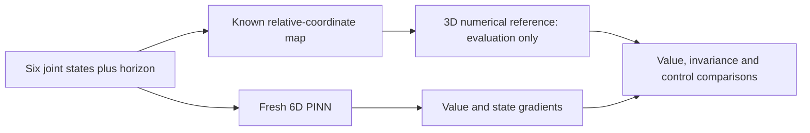

# Phase 4 — Joint-coordinate 6D Air3D: specification and experiment design

Prepared 28 October 2026. **Design and physics checks are complete; no network has been initialized or trained in this phase.** Proposed training budgets and evaluation counts below are a draft for the next implementation phase, not completed experiments or a frozen training protocol.

## 1. What changes from the 3D study?

The [DeepReach paper, Section VI-B](https://arxiv.org/html/2011.02082), presents the two-vehicle game in joint coordinates. We will follow that game: a pursuer tries to force collision and an evader tries to avoid it. Each vehicle moves in a plane at constant speed and controls its heading rate.

The 6D state stores both vehicles' absolute poses. The same physical interaction has a three-state relative description. Therefore this stage tests whether a network learns a larger, redundant coordinate representation, and whether the useful 3D methods transfer. It does not introduce altitude, acceleration, wind, additional vehicles or genuinely new game interactions.

We can map a 6D prediction to the existing 3D numerical problem for evaluation. We will train a fresh network on all six joint states; placing the exact reduction inside the neural forward pass would instead construct a reduced-coordinate model. The existing learned 3D network could be wrapped by that reduction as a useful engineering comparator, but its approximate values are not ground truth for a new 6D network.

## 2. State, inputs and dynamics

Use the explicit order

`z = (xp, yp, theta_p, xe, ye, theta_e)`.

| Symbol | Meaning | Units |
|---|---|---|
| xp, yp | Pursuer position in a common fixed frame | m |
| theta_p | Pursuer heading from the fixed x axis | rad |
| xe, ye | Evader position in that frame | m |
| theta_e | Evader heading | rad |
| u | Evader turn rate, maximizing avoidance value | rad/s |
| d | Pursuer turn rate, minimizing avoidance value | rad/s |
| tau | Remaining horizon, supplied separately to the network | s |

The proposed laptop parameters preserve our prior game: v=.75 m/s, |u|,|d|<=3 rad/s, collision threshold R=.25 m and horizon T=.5 s. R is the center-to-center collision threshold, not the radius of each of two bodies to be added again. The shorter horizon and small network are adaptations, not paper-scale settings.

For the pursuer:

\[
\dot x_p=v\cos\theta_p,\qquad \dot y_p=v\sin\theta_p,\qquad \dot\theta_p=d.
\]

For the evader:

\[
\dot x_e=v\cos\theta_e,\qquad \dot y_e=v\sin\theta_e,\qquad \dot\theta_e=u.
\]

The controls change turning, not speed or position directly. A state-value gradient is not an instruction to move freely in its six-component direction.

## 3. Collision target and reachability equation

\[
l_6(z)=\sqrt{(x_p-x_e)^2+(y_p-y_e)^2}-R.
\]

Collision is l6<=0. The value is the worst-case, best-avoidance minimum target margin over the horizon. Negative value means the pursuer can force entry into the collision set for the ideal game solution; learned signs remain approximate.

With p=gradient_z V, derive the Hamiltonian from **max_u min_d p dot f**:

\[
H_6=v(\cos\theta_p p_{x_p}+\sin\theta_p p_{y_p}
+\cos\theta_e p_{x_e}+\sin\theta_e p_{y_e})
+\Omega|p_{\theta_e}|-\Omega|p_{\theta_p}|.
\]

The evader and pursuer have different optimization roles. We validate the signs by explicit input maximization/minimization rather than copying a formula without checking its game convention.

In time-to-go coordinates the same VI convention as our 3D implementation is

\[
\max\{V_\tau-H_6,\;V-l_6\}=0,\qquad V(0,z)=l_6(z).
\]

The gradient-derived inputs are

\[
u^*=\Omega\operatorname{sign}(p_{\theta_e}),\qquad
d^*=-\Omega\operatorname{sign}(p_{\theta_p}).
\]

At a zero switching coefficient, multiple inputs are instantaneous optima; sign(0)=0 is a permitted tie choice. These formulas are optimal for an exact value gradient. Using them with an approximate neural gradient does not certify a safe controller.

## 4. Reduction to the existing 3D reference

Let delta_x=xp-xe and delta_y=yp-ye. Rotate the displacement into the evader's frame:

\[
r_x=\cos\theta_e\,\Delta x+\sin\theta_e\,\Delta y,
\quad r_y=-\sin\theta_e\,\Delta x+\cos\theta_e\,\Delta y,
\quad \psi=\theta_p-\theta_e.
\]

Use unwrapped psi when differentiating the map, and wrap angles only for periodic reference queries. Away from the wrapping cut this gives

\[
\dot r_x=v(\cos\psi-1)+u r_y,\quad
\dot r_y=v\sin\psi-u r_x,\quad \dot\psi=d-u,
\]

which are exactly our existing Air3D equations. Write this map as r=R(z). For the same unconstrained physical game,

`V6(tau,z) = V3(tau,R(z))`.

This equality describes the exact problem. Our 3D numerical solver is an approximate reference for it; our trained 3D PINN is another approximation. No six-dimensional grid is required for this particular benchmark. There are no walls or absolute-position objectives in the game; adding them would generally invalidate this reduction.

The existing 129 x 129 x 96 numerical solver can label fresh evaluation relative configurations, then share those labels across equivalent joint poses. Training remains physics-only, without these values or numerical-reference bounds in its updates.

## 5. Why we can evaluate gradients and controls

For g=(g_x,g_y,g_psi)=gradient_r V3, the exact chain rule gives p=J_R(z)^T g:

\[
\begin{aligned}
p_{x_p}&=\cos\theta_e g_x-\sin\theta_e g_y,&
p_{y_p}&=\sin\theta_e g_x+\cos\theta_e g_y,\\
p_{\theta_p}&=g_\psi,&
p_{x_e}&=-p_{x_p},\quad p_{y_e}=-p_{y_p},\\
p_{\theta_e}&=r_y g_x-r_x g_y-g_\psi.
\end{aligned}
\]

For an invariant value this also gives H6(z,p)=H3(R(z),g), and the same evader/pursuer turning choices. The prototype checks these identities. A learned raw-6D network need not satisfy them exactly; measuring that discrepancy is part of the new evaluation.

We will distinguish:

- Input derivative mechanics: autodiff versus finite differences, testing implementation.
- Value-gradient accuracy: comparison with mapped numerical-reference derivatives, subject to reference-grid sensitivity and nonsmooth regions.
- Control quality: signs of the two switching coefficients and resulting finite-horizon rollouts.

Near zero switching coefficients, sign comparisons are sensitive. Proposed reports show margins .005, .01 and .02 m/rad and a subset where coarse/fine reference switching signs agree. This is a reference-stability diagnostic, not a certified derivative bound. We will not call grid derivatives exact or treat a large cosine over all six gradient components as sufficient controller evidence.

## 6. Proposed small-scale runs

The raw-joint network would take **seven inputs**: tau plus six states, outputting one scalar value (or its scalar correction). Three sine hidden layers of width 64 give **8,897 parameters**, versus 8,705 in our relative-state model. Use Adam lr=.0001, 2,048 samples per physics batch, 256 zero-time physics points and two CPU threads.

Proposed initial comparisons:

| Proposed ID | Output/training | Purpose |
|---|---|---|
| 4A: soft baseline | Soft terminal loss with 2A's .1 multiplier factor; 2,000 terminal-only + 10,000 physics steps | Establish a joint-input baseline carrying our best tested soft-loss balance |
| 4B: exact constraints | V=l6-.25*(tau/T)*g6^2; 10,000 physics steps, no terminal-only pretraining | Test transfer of the strongest formulation improvement |
| 4C: longer constrained | Extend completed 4B by 12,000 full-horizon steps | Test transfer of the successful additional-duration strategy |

These are planned runs, not results or a training launch. 4A/4B match physics-update count but differ in pretraining, output initialization and total updates. 4C intentionally spends extra compute. Pair physics collocation streams independently of model initialization/pretraining so the first 10,000 physics batches match between variants. New weights are initialized from scratch; the old 3D checkpoint cannot be loaded unchanged into a seven-input first layer.

For 4A, the proposed fixed terminal multiplier is .1 times the initial physics/terminal loss calibration, matching the successful 2A rule. This avoids comparing the exact-output method only against the weaker original soft-loss setting. A new numerical multiplier is calibrated for the new model; the old 3D numeric multiplier is not copied blindly.

Use absolute x/y training bounds [-2,2] for each vehicle and raw heading ranges [-1.2pi,1.2pi]. Full-box training can include relative configurations outside the 3D reference domain; evaluation-reference comparisons must be restricted to the checked relative region. No reference labels are required for those outside training points. Hardware/gradient-timing preflight and a reviewable fixed run protocol are needed before training; no duration estimate is claimed from dimension alone.

Do not automatically combine periodic inputs, reference bounds, hybrid supervised loss or a different optimizer into these baseline comparisons. Later changes need separate hypotheses and budgets.

## 7. New evaluation data and invariance tests

Proposed development data: 6,000 fresh relative configurations in the old comparison region, each lifted to four joint poses, giving 24,000 joint queries per horizon. Proposed future final data use a different seed and different relative configurations. **Neither set is generated in this design phase.** The consumed 3D final set is not reused for tuning or as a new 6D final test.

For a relative displacement r and global evader heading alpha, choose midpoint m and set

`pursuer_position = m + Rot(alpha)*r_xy/2`,

`evader_position = m - Rot(alpha)*r_xy/2`,

`theta_e = alpha`, `theta_p = wrap(alpha + psi)`.

Choose midpoint coordinates in [-.5,.5] and r_x,r_y in [-.6,.6]. Each vehicle's initial absolute coordinate is bounded by .924265 m, and adding its maximum .375 m displacement over the horizon still fits inside [-2,2]. This keeps evaluation trajectories away from the artificial training-box edge. All poses in a group represent the same intrinsic game state.

Evaluate values/classifications at 21 horizons and report terminal/obstacle, lower-bound and time-monotonicity checks. Report translation, common-rotation and valid angle-alias inconsistencies across paired poses. Split and reserve data by **relative configuration**, not by putting different poses of the same configuration into different evaluation splits. Any later confidence interval should resample entire relative-configuration groups; pose variants are correlated, not independent samples.

Proposed controller evaluation uses a fixed subset of 200 relative configurations and their poses. Compare learned controls against mapped-reference controls and simple fixed-turn/straight-line policies. Use a decreasing time-to-go during rollouts. Check temporal discretization at .01 and .005 s with within-step collision checks. Report observed collisions, minimum separation, switching behavior and disagreement in reference-stable regions. These are finite simulations, not exhaustive adversarial guarantees. No rollouts have run yet.

## 8. Source review and checks completed now

The paper's VI-B game is the intended benchmark. The pinned local `MultiVehicleCollision` class is a separate 9D implementation with three controls, no adversarial input and different speed/turn settings. We will not treat it as the requested 6D pursuit–evasion class.

`joint6d.py` implements only joint dynamics, collision target, Hamiltonian, coordinate maps, gradient chain rule and optimal instantaneous inputs. `check_joint6d.py` uses new synthetic double-precision states, not any saved final data. On 257 samples:

- Joint-to-relative dynamics, target and Hamiltonian identities pass to about 1e-15.
- Analytic gradient lifting agrees with autodiff to 3.33e-16.
- Max_u min_d over an explicit 9 x 9 input grid matches the closed Hamiltonian to 8.88e-16.
- Both control formulas agree with the existing Air3D formulas.
- Translation/rotation, angle wrapping and evaluation-lift checks pass.
- Existing checkpoints and final-state input hashes are unchanged.

These are mathematical/implementation checks, **not 6D PINN accuracy results**. There is no neural network, optimizer, trained checkpoint or new final-test dataset from this phase.

Reproduce the checks with `python outputs/deepreach/check_joint6d.py`. Details and exact source hashes are in `physics_checks.json`; proposed settings are in `protocol_draft.json`. The next implementation step is the separate joint-input network, sampler and pre-training checks. Training remains a later explicit action.
