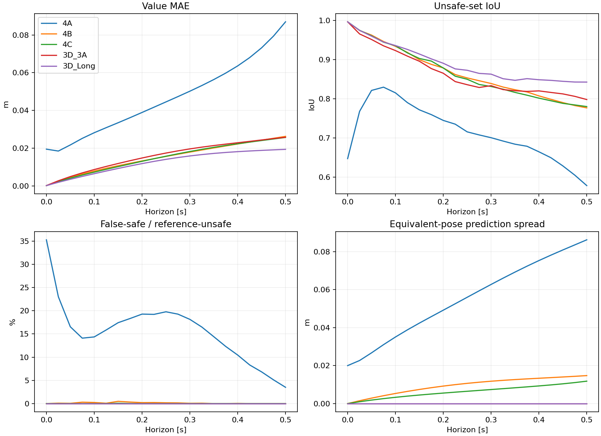

# Experiment 4 — grouped development results

The exact-output formulation transferred strongly to the joint-coordinate network. Extra training improved it modestly. The best saved 3D model still predicts values more accurately on these same encounters. Gradient-based turning signs are promising on reference-stable subsets, but closed-loop performance remains untested.

The fixed protocol used 6,000 fresh relative configurations with four equivalent joint poses each, at 21 horizons. This is development evidence: 24,000 joint queries per horizon represent 6,000 independent groups. All three 6D models and both fixed 3D comparisons were declared before data generation. No training or model selection occurred.

| Model | Value MAE at 0.5 s | Unsafe-set IoU | False-safe / reference-unsafe | False-unsafe / reference-safe |
|---|---:|---:|---:|---:|
| 4A | 0.08695 m | 0.578 | 3.51% | 17.90% |
| 4B | 0.02631 m | 0.777 | 0.00% | 7.70% |
| 4C | 0.02573 m | 0.780 | 0.00% | 7.55% |
| 3D_3A | 0.02582 m | 0.798 | 0.00% | 6.78% |
| 3D_Long | 0.01943 m | 0.842 | 0.00% | 5.01% |

4B reduces final MAE by **69.75%** versus 4A. The exact output, different output initialization and omission of terminal pretraining are bundled in this comparison; physics batches and physics update budgets match. It does not isolate the output formula alone.

4C reduces final MAE by **2.19%** versus 4B, with a group-paired 95% sampling interval of **0.98–3.41%**. The best 3D model has MAE 0.01943 m, whereas 4C has 0.02573 m (32.44% higher). 4C is approximately level with original 3D 3A in overall MAE, while remaining worse in unsafe-set IoU. These are single-training-seed comparisons; the intervals do not cover solver or training-seed uncertainty.

Zero false-safe predictions were observed for 4B/4C at the final horizon (5,068 reference-unsafe joint queries, representing 1,267 groups). This does not hold at every horizon: at 0.15 s, 4B had 20 false-safe joint queries and 4C had 3. No safety certificate follows from these counts.

Equivalent representations still matter to the raw-joint networks. At 0.5 s, mean within-group value range is 0.08621 m for 4A, 0.01473 m for 4B and 0.01180 m for 4C. For 4C, 2.27% of groups change predicted safety class across their four poses; the largest value range is 0.11981 m. Its translation-only mean gap is 0.00078 m, versus 0.00793 m for rotation alone. The 3D models are invariant by construction because their relative inputs are shared.

Heading aliases also remain imperfect: for 4C, shifting the evader heading by a full revolution within the sampled range changes value by 0.01882 m on average over 2,426 eligible joint queries; 3.67% change predicted class. The pursuer alias gap is 0.00360 m over 4,782 queries. These two subsets differ and are not directly interchangeable.

At 0.5 s, with a 0.01 m/rad margin, coarse/fine sign agreement and initial separation, the control-relevant turning-sign comparisons are:

| Model | Evader sign agreement | Pursuer sign agreement |
|---|---:|---:|
| 4A | 74.60% | 85.76% |
| 4B | 95.35% | 99.34% |
| 4C | 97.51% | 98.97% |
| 3D_3A | 95.48% | 98.57% |
| 3D_Long | 97.70% | 98.80% |

The evader subset contains 10,096 joint queries / 2,524 relative groups; the pursuer subset contains 8,968 queries / 2,242 groups. Extending 4B improves evader sign agreement from 95.35% to 97.51%, but slightly reduces pursuer agreement from 99.34% to 98.97%. The same qualitative trend appears at margins 0.005 and 0.02. 4C is close to 3D_Long on these sign comparisons despite its larger value error. High overall gradient cosine alone would miss these distinctions.

Mean absolute error per joint gradient component falls from 0.15649 (4A) to 0.05483 (4B) and 0.05194 (4C). The coarse/fine reference component difference is 0.00665. These gradient summaries mix spatial and angular derivatives; the switching-sign results above are the more direct control diagnostic. Reference derivatives are approximate central grid differences, and agreement does not establish rollout safety.

The exact-output models preserve terminal and obstacle constraints to float32 roundoff. Other defects remain: 4C violates the lower bound -R by more than 0.0001 m on 0.246% of final queries, and increases value by more than 0.0001 m between adjacent horizons on 13.77% of query/interval pairs. The output construction does not enforce those properties.

Reference resolution remains material. Final coarse/fine value MAE is 0.00215 m, exceeding the 0.00058 m 4B-to-4C improvement. A post-evaluation recomputation against the saved coarse values retains the ordering and yields a 1.96% improvement, versus 2.19% with fine values. That supports the observed trend but is not a bound on true solver error. Shared old fine-grid snapshots agree within 1.38e-5 m.

The evaluation took about 233 seconds in a managed process with the main project interpreter. No optimizer or parameter update occurred. All protected checkpoints and the consumed 3D final-state bytes are unchanged; no future final data were generated. All 105 saved value-metric rows and ten gradient-error summaries were recomputed from saved arrays.

Next, test whether the turning-sign agreement translates into useful closed-loop behavior using the separately specified fixed rollout comparison. Further work on rotational/heading consistency is motivated by the measured pose and alias gaps, but this evaluation does not yet establish which modification will improve them.

See [methodology](METHODOLOGY.md), [frozen protocol](protocol.json), [all metrics](metrics.csv), [switching margins](switching_signs.csv), [pose diagnostics](invariance.csv), [gradient summaries](gradients.csv), and [saved-array checks](saved_array_verification.json).
