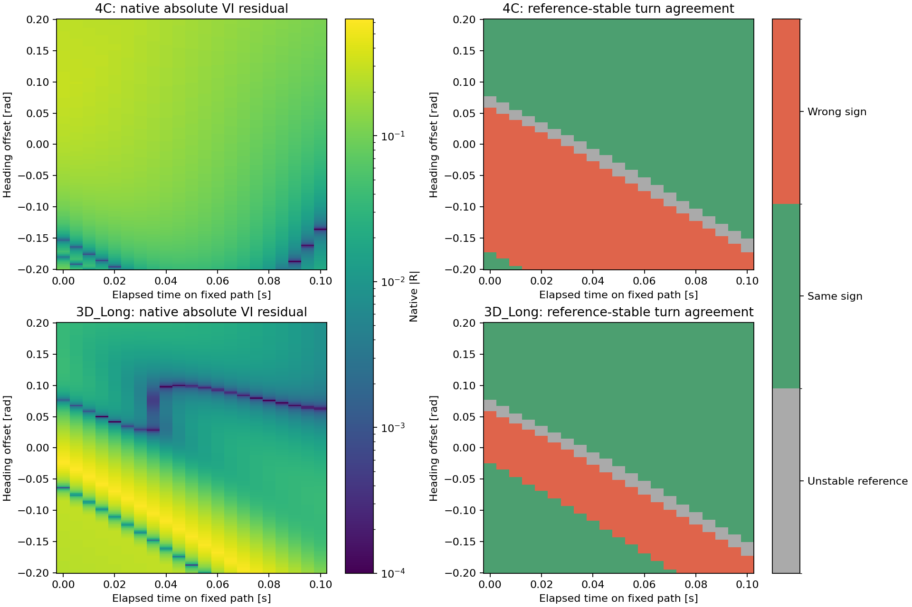
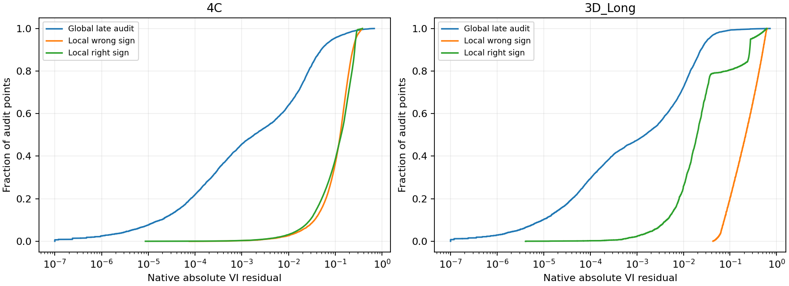
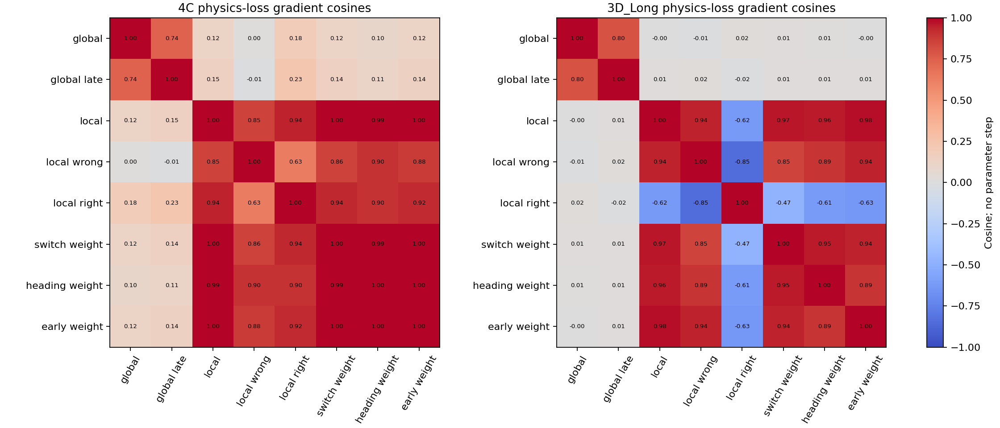

# Local physics-loss audit

The native physics loss exposes this failure region: its residuals and local parameter-gradient norms are large. In 4C, however, residual magnitude does not distinguish wrong from right turning signs within the local map. The broad-domain physics gradient is nearly orthogonal to the local wrong-region gradient. This motivates a controlled sampling/priority test, not a claim that the loss is satisfied or that reweighting is already a controller fix.

Both models remain unchanged. The fixed audit used 16,884 correlated local queries (21 times × 201 heading offsets × four poses) and 32,768 fresh global collocation points per model. Global distributions follow each model own training coordinates; they are not identical physical encounter distributions. Existing 161/193 reference queries identify diagnostic sign-agreement subsets. No reference solve, optimizer, parameter step, rollout or final-test query occurred.

| Model | Global native VI MAE | Global late-time VI MAE | Local wrong-sign VI MAE | Local right-sign VI MAE | Wrong-sign AUC from residual |
|---|---:|---:|---:|---:|---:|
| 4C | 0.010992 | 0.020851 | 0.133236 | 0.138714 | 0.482 |
| 3D_Long | 0.005252 | 0.009511 | 0.256264 | 0.070654 | 0.881 |

For 4C the wrong-sign region residual is about 12.1 times its global mean, or 6.4 times its global late-time mean. The four initial failure poses have absolute residuals from 0.11659 to 0.25783, placing them around the 96th–99th percentiles of its global late-time audit. The 3D initial residual is 0.41192, around the 99.88th percentile. The failure is therefore not hidden by a locally tiny residual.

On the selected wrong-sign subsets, the equation branch is active everywhere; the obstacle branch fraction is zero. Thus obstacle masking does not explain these particular wrong-sign points. Large raw equation error elsewhere in the global domain is not automatically a defect, because an HJI obstacle solution permits an inactive equation branch. Native residual scaling is the implementation existing PDE/obstacle scaling and is not a value-error distance or a probability.

The maps show canonical-pose slices; the table includes all four poses. The reference-stable mask requires both 161/193 coefficients to have the same sign and absolute magnitude above .01 m/rad. Nearby points and poses are correlated. These local wrong-sign fractions are not collision rates or independent-encounter estimates.

For 3D_Long, larger residuals rank wrong-sign points reasonably well within this map (AUC .881). For 4C the local distributions overlap (AUC .482), so prioritizing the largest local residual alone does not selectively identify wrong directions. Residual size still flags the broader difficult region relative to the global sample. The .005/.02 margin sensitivity is saved separately; it does not create an independent validation set. Squaring a fixed nonnegative residual changes emphasis but preserves its rank ordering.

Physics-loss gradient comparisons at the fixed parameters:

| Model | Global vs local-wrong cosine | Global-late vs local-wrong | Local-uniform vs local-wrong | Local-wrong vs local-right |
|---|---:|---:|---:|---:|
| 4C | 0.0029 | -0.0138 | 0.8538 | 0.6278 |
| 3D_Long | -0.0085 | 0.0158 | 0.9391 | -0.8505 |

Local wrong-region gradient norms are about 134.7 (4C) and 192.4 (3D_Long), versus about 1.67 for their respective global mean objectives. There is a strong local parameter signal in these samples. The nearly orthogonal global/local gradients show that reducing a broad mean loss is not equivalent to concentrating on this region. These are ordinary objective gradients, not actual Adam update directions or proof that a step would correct a control sign.

The 3D local wrong/right physics gradients oppose one another (cosine -.850), illustrating a possible objective tradeoff. Fixed weighting toward the central heading region or the network switching region changes the physics-loss direction, but does not show a consistent advantage across both models. A weighting must be tested on broad value/control evaluations rather than selected from cosine alone. The reference-informed wrong/right masks here are diagnostic labels, not a proposed reference-free training sampler.

Neither fresh 32,768-point global sample placed a point inside the specified late-time intrinsic box around the failure. That is a small sampling snapshot, not evidence that the original training never visited it, and cannot establish sampling as the causal defect. The single local map was deliberately chosen after a failure.

The formal coefficient reflection `a -> -a` leaves the Hamiltonian magnitudes unchanged. This is correct max/min game algebra, not a sign bug or a realizable alternative network field. Terminal propagation, global consistency and value geometry determine the direction. The observed residual is nevertheless large here, so a sign-insensitive Hamiltonian argument is not evidence that this failure has zero loss.

A justified next experiment is a fixed-budget, physics-only residual-coverage test with explicit sampling/evaluation overhead recorded and fresh broad development comparisons. It should avoid using reference sign labels or value bounds in updates and retain checks for degraded correct regions, since local loss objectives can conflict. This audit does not establish that sampling alone will fix the displaced transition, and it introduces no new training or production-controller change.

See [methodology](METHODOLOGY.md), [fixed protocol](protocol.json), [all summaries](summaries.json), [margin sensitivity](margin_sensitivity.csv), [gradient alignments](gradient_alignments.csv), and [execution manifest](manifest.json).
