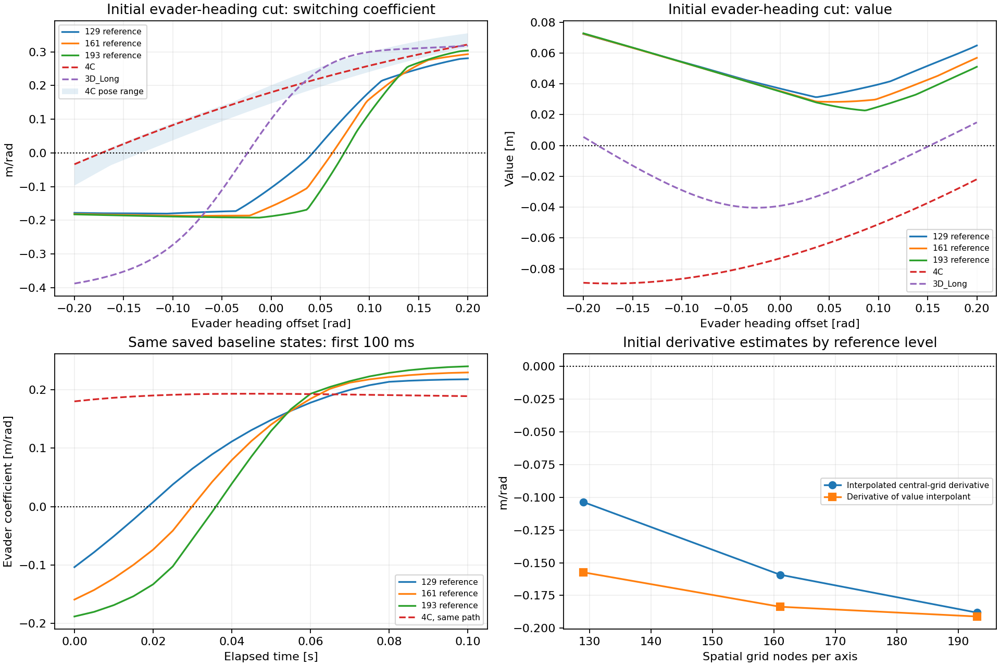
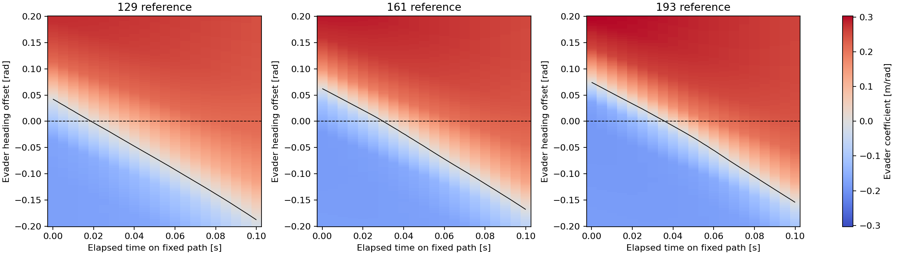

# Local numerical-reference refinement

This audit refines the deliberately selected development failure without training, new policies or new encounters. All grids query the same saved early trajectory and physical heading perturbations. The unchanged solver refines space, heading and CFL-limited time integration together.

The audited initial reference turn remains **negative (-3 rad/s)** across all three levels and both derivative estimators. Both unchanged PINNs choose +3 rad/s at this starting state. This strengthens the numerical evidence for an initial learned-direction mismatch, while the magnitude and nearby switching location still require separate assessment.

| Reference grid | Initial value | Interpolated central-grid evader derivative | Derivative of value interpolant (eps=1e-6) |
|---|---:|---:|---:|
| 129x129x96 | 0.03690285 m | -0.10366535 | -0.15732797 |
| 161x161x120 | 0.03532367 m | -0.15916361 | -0.18363326 |
| 193x193x144 | 0.03500071 m | -0.18808091 | -0.19106047 |

A positive evader coefficient selects +3 rad/s and a negative coefficient selects -3 rad/s. The two derivative columns estimate different derivatives of an approximate numerical solution; agreement or disagreement must be assessed rather than treating either as exact. Epsilon sensitivity for the interpolant derivative is saved separately from grid-refinement sensitivity.

The central-grid coefficient decomposes as `a = (ry*V_rx - rx*V_ry) - V_psi`:

| Grid | Projected spatial contribution | Relative-heading derivative | Their difference: evader coefficient |
|---|---:|---:|---:|
| 129 | -0.28845739 | -0.18479203 | -0.10366535 |
| 161 | -0.35066498 | -0.19150138 | -0.15916361 |
| 193 | -0.38278852 | -0.19470761 | -0.18808091 |

This algebra identifies which estimated contributions change. Because spatial, angular and time resolution change together, it does not isolate a single numerical source. Agreement between estimators of the same numerical solution is a consistency check, not independent ground truth.

| Refinement | Initial value change | Initial central-grid coefficient change | Mean absolute coefficient difference along path | Sign disagreements on 21 fixed path states |
|---|---:|---:|---:|---:|
| 129 → 161 | -0.00157917 m | -0.05549825 | 0.03294879 | 2 |
| 161 → 193 | -0.00032296 m | -0.02891730 | 0.02568480 | 2 |

Between the two finest levels, the initial grid-gradient coefficient changes by 0.02891730 m/rad (15.37% of the finest magnitude). Signs differ on 2 of the 21 fixed path queries; 3.39% of the full sampled local map changes sign. These raw sign counts include near-zero coefficients. They are descriptions of this sampled neighborhood, not convergence bounds.

Approximate zero locations from the fixed samples:

| Source | Nearest initial-heading-offset zero | First early-path time zero |
|---|---:|---:|
| 129 | 0.042301 rad, bracket [0.042, 0.044] | 0.018724 s, bracket [0.015, 0.020] |
| 161 | 0.062324 rad, bracket [0.062, 0.064] | 0.029899 s, bracket [0.025, 0.030] |
| 193 | 0.074298 rad, bracket [0.074, 0.076] | 0.035956 s, bracket [0.035, 0.040] |
| 4C | -0.172368 rad, bracket [-0.174, -0.172] | Not queried |
| 3D_Long | -0.024068 rad, bracket [-0.026, -0.024] | Not queried |

On the fixed initial heading cut, the nearest reference zero moves from +0.04230 to +0.06232 to +0.07430 rad as the grid refines. The canonical 4C zero is at -0.17237 rad, and 3D_Long at -0.02407 rad. Thus all audited references place the change of turn on the positive side of the starting heading, while both learned surfaces place it on the negative side. This explains their opposite initial decisions within these approximate comparisons. The 4C zeros also vary across equivalent poses (-0.17571 to -0.13196 rad), but every pose remains on the negative side.

The heading cut changes only the evader heading at fixed positions and fixed pursuer heading. The band shows 4C variation over the four existing equivalent poses. Reference comparisons use the canonical pose, which has the same relative state. The time trace uses identical saved states for every grid and for the plotted 4C coefficients; it does not resimulate a refined controller.

Black contours are zeros of the sampled/interpolated numerical coefficient field. Dashed horizontal lines mark the original saved path. The maps describe this fixed neighborhood; they are not certified optimal switching surfaces. Sampled zero-crossing brackets and linear estimates are saved in `sampled_zero_crossings.json`, without adaptive root searches.

The 129×129×96 rebuild reproduces the previous early value and coefficient queries within 1e-12. A local affine fixture checks the physical joint-heading direction and the value-interpolant finite difference. Original network weights, earlier evaluation outputs and final-state bytes remain unchanged. No policy was updated or rolled out in this audit.

Three finite grids do not prove convergence of the true value or its derivative. First-order numerical diffusion, angular/spatial discretization, interpolation and possible nonsmoothness remain relevant. The reference resolution check is a development diagnostic on one deliberately selected failure; it does not establish a general PINN or controller improvement.

The initial direction mismatch survives every refinement and both numerical derivative estimators. The two finest grids still differ in coefficient magnitude by about 15.4%, and in switching time on two of the 21 path queries; initial-direction evidence is stronger than a claim of a fully resolved boundary. Next, audit the learned HJI residual around the displaced local switching transition, using physics-only queries, before choosing a training modification. This can test whether the existing loss exposes the local error. No further training or new refined-policy rollout was performed here.

See [methodology](METHODOLOGY.md), [frozen protocol](protocol.json), [initial comparison](initial_comparison.csv), [refinement changes](refinement_changes.csv), [value secants](value_secants.csv), [sampled zero crossings](sampled_zero_crossings.json), and [execution manifest](manifest.json).
