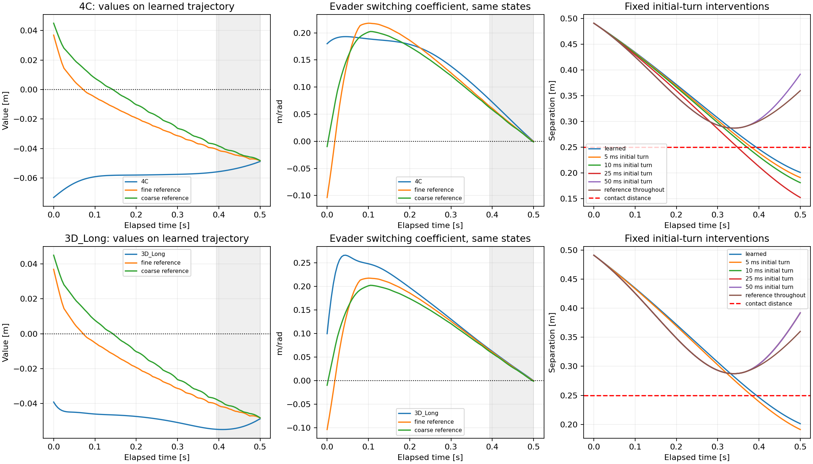
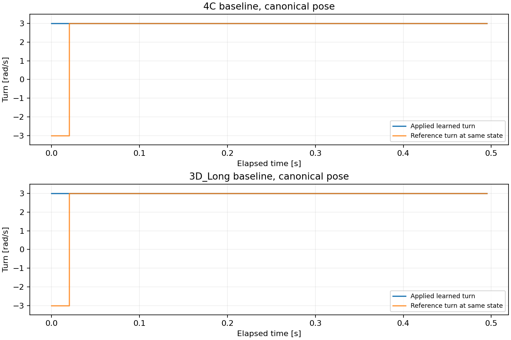

# Shared failure — fixed initial-turn diagnostic

This deliberately selected development encounter is group 603, already known to fail 4C and 3D_Long. Both models and all four poses were tested without training. The protocol fixed intervention durations before new traces or reference queries. This case study does not establish a general controller improvement.

The learned derivative computation passed finite differences: maximum discrepancy is 7.34e-11 for 4C and 5.23e-10 for 3D_Long. The models nevertheless choose the opposite initial evader turn from both reference grids. This is a discrepancy in the learned value surface relative to the references, rather than a detected autodiff implementation error.

A 5 ms initial-reference-turn correction fails for both models. Among the tested durations, 3D_Long first avoids contact after a 10 ms correction, whereas 4C first avoids contact after 50 ms. All four poses give the same contact outcomes, and those outcomes persist at both control intervals. Constant-initial-turn and reference-feedback prefixes give the same contact outcomes at every tested duration. These are the shortest successful tested durations, not measured exact thresholds.

Shorter assistance can worsen the outcome: for 4C the worst sampled minimum distance falls from 0.20127 m without assistance to 0.19121 m after 5 ms, 0.18127 m after 10 ms and 0.15246 m after 25 ms. At 50 ms it instead remains above 0.28724 m. The 3D model also worsens to 0.19121 m with 5 ms before escaping with 10 ms. Briefly applying a reference action is not a generally safe controller patch.

Reference resolution is a material limitation. The initial coarse/fine evader coefficients are -0.009707/-0.103665 m/rad: their signs agree but magnitudes differ by more than tenfold. The initial state passes the .005 margin and fails the .01 and .02 coarse/fine margins, so it was excluded from the earlier .01-margin turning-sign agreement statistic. On the unassisted trajectory, the two reference signs disagree at elapsed times .005, .010 and .015 s. We therefore cannot call this a fully resolved true-gradient comparison or infer a precise optimal switching boundary from these two grids.

Initial evader switching coefficients (positive selects +3 rad/s, negative selects -3 rad/s):

| Model | Pose | Learned coefficient | Coarse reference | Fine reference |
|---|---:|---:|---:|---:|
| 4C | 0 | 0.179954 | -0.009707 | -0.103665 |
| 4C | 1 | 0.187892 | -0.009707 | -0.103665 |
| 4C | 2 | 0.146842 | -0.009707 | -0.103665 |
| 4C | 3 | 0.200536 | -0.009707 | -0.103665 |
| 3D_Long | 0 | 0.099845 | -0.009707 | -0.103665 |
| 3D_Long | 1 | 0.099845 | -0.009707 | -0.103665 |
| 3D_Long | 2 | 0.099845 | -0.009707 | -0.103665 |
| 3D_Long | 3 | 0.099845 | -0.009707 | -0.103665 |

The reference coefficients are approximate grid derivatives. Their coarse/fine agreement and magnitudes should be judged against the previously used 0.005, 0.01 and 0.02 m/rad margins; they are not an exact optimal-direction certificate. The separately saved double-precision finite-difference checks test the derivative of each learned function, rather than its agreement with the game solution.

Fixed interventions at dt=.005, over the same four posed initial states. Initial-turn prefixes hold the original reference initial turn; feedback prefixes recompute reference feedback during the prefix. The pursuer always reevaluates the same fine-reference feedback rule on the actual trajectory. After the prefix the original learned controller resumes.

| Model | Variant | Definite contacts / 4 | Possible contacts / 4 | Worst sampled minimum distance |
|---|---|---:|---:|---:|
| 4C | learned | 4 | 4 | 0.201266 m |
| 4C | initial_turn_5ms | 4 | 4 | 0.191206 m |
| 4C | initial_turn_10ms | 4 | 4 | 0.181268 m |
| 4C | initial_turn_25ms | 4 | 4 | 0.152461 m |
| 4C | initial_turn_50ms | 0 | 0 | 0.287243 m |
| 4C | initial_turn_100ms | 0 | 0 | 0.287243 m |
| 4C | feedback_prefix_5ms | 4 | 4 | 0.191206 m |
| 4C | feedback_prefix_10ms | 4 | 4 | 0.181268 m |
| 4C | feedback_prefix_25ms | 4 | 4 | 0.152461 m |
| 4C | feedback_prefix_50ms | 0 | 0 | 0.287243 m |
| 4C | feedback_prefix_100ms | 0 | 0 | 0.287243 m |
| 4C | reference_all | 0 | 0 | 0.287243 m |
| 3D_Long | learned | 4 | 4 | 0.201266 m |
| 3D_Long | initial_turn_5ms | 4 | 4 | 0.191206 m |
| 3D_Long | initial_turn_10ms | 0 | 0 | 0.287243 m |
| 3D_Long | initial_turn_25ms | 0 | 0 | 0.287243 m |
| 3D_Long | initial_turn_50ms | 0 | 0 | 0.287243 m |
| 3D_Long | initial_turn_100ms | 0 | 0 | 0.287243 m |
| 3D_Long | feedback_prefix_5ms | 4 | 4 | 0.191206 m |
| 3D_Long | feedback_prefix_10ms | 0 | 0 | 0.287243 m |
| 3D_Long | feedback_prefix_25ms | 0 | 0 | 0.287243 m |
| 3D_Long | feedback_prefix_50ms | 0 | 0 | 0.287243 m |
| 3D_Long | feedback_prefix_100ms | 0 | 0 | 0.287243 m |
| 3D_Long | reference_all | 0 | 0 | 0.287243 m |

At handback in the canonical pose, the corrected-path coefficients explain how the learned decision changes. Positive means the learned evader selects +3 rad/s; negative means -3 rad/s. These rows query all functions at the same corrected-path state.

| Model | Prefix | Learned coefficient at handback | Coarse reference | Fine reference |
|---|---|---:|---:|---:|
| 4C | initial_turn_5ms | 0.157428 | -0.049729 | -0.142369 |
| 4C | initial_turn_10ms | 0.135205 | -0.088039 | -0.167343 |
| 4C | initial_turn_25ms | 0.071220 | -0.134201 | -0.175443 |
| 4C | initial_turn_50ms | -0.021815 | -0.157274 | -0.170791 |
| 3D_Long | initial_turn_5ms | 0.022016 | -0.049729 | -0.142369 |
| 3D_Long | initial_turn_10ms | -0.058761 | -0.088039 | -0.167343 |
| 3D_Long | initial_turn_25ms | -0.250120 | -0.134201 | -0.175443 |
| 3D_Long | initial_turn_50ms | -0.322084 | -0.157274 | -0.170791 |

For example, 4C returns to +3 rad/s after 25 ms (learned coefficient +0.07122) despite both references remaining negative (-0.13420/-0.17544), and contact follows. After 50 ms its coefficient is -0.02182, agreeing in sign with both references, and contact is avoided in this matchup. 3D_Long makes this sign transition by the tested 10 ms handback. The learned control transition is therefore misplaced relative to this reference-assisted path; the experiment does not yet identify why training produced that value surface.

Along the unassisted canonical trajectories, both reference values first become negative at elapsed time .145 s, before sampled contact near .39375 s. This is consistent with an early loss of estimated recoverability, but numerical value bias and the short-time reference-gradient disagreement limit any stronger claim.

Each value/coefficient comparison uses the same actual learned-trajectory states, not different states from already diverged rollouts. Gray shading marks mathematical continuation after the baseline first contact. Separation plots show the canonical pose; the table retains all four poses.

The prefix-end event is inserted exactly when it falls between nominal updates. The primary 5 ms intervention aligns with dt=.005. Results at dt=.01 are also saved, including this event handling. The reference feedback and numerical resolution remain approximations; neither a successful assisted prefix nor full-reference success constitutes a new learned capability.

Raw controls were replayed with float64 arc geometry. The original trace can use float32 learned-sign arrays, so bitwise state equality is not assumed: the largest state difference was 3.36e-8, and all definite/possible contact flags matched. Per-trace differences and replayed minimum-distance bounds are saved. The old baseline minimum separations reproduce within 4.79e-9 m and contact flags match. Existing model weights and previous output records remain unchanged.

Next, resolve the local numerical switching behavior more carefully before selecting a training change. A local comparison of reference refinement, value shape and physics residual around the learned control transition can distinguish reference smoothing from a persistent learned error. No new training or permanent reference-assisted controller was introduced here.

See [methodology](METHODOLOGY.md), [frozen protocol](protocol.json), [initial coefficients](initial_gradients.json), [finite differences](derivative_checks.json), [all intervention metrics](metrics.csv), [handback diagnostics](handback_diagnostics.csv), [baseline reproduction](baseline_reproduction.json), and [geometry replay](geometry_replay.json).
