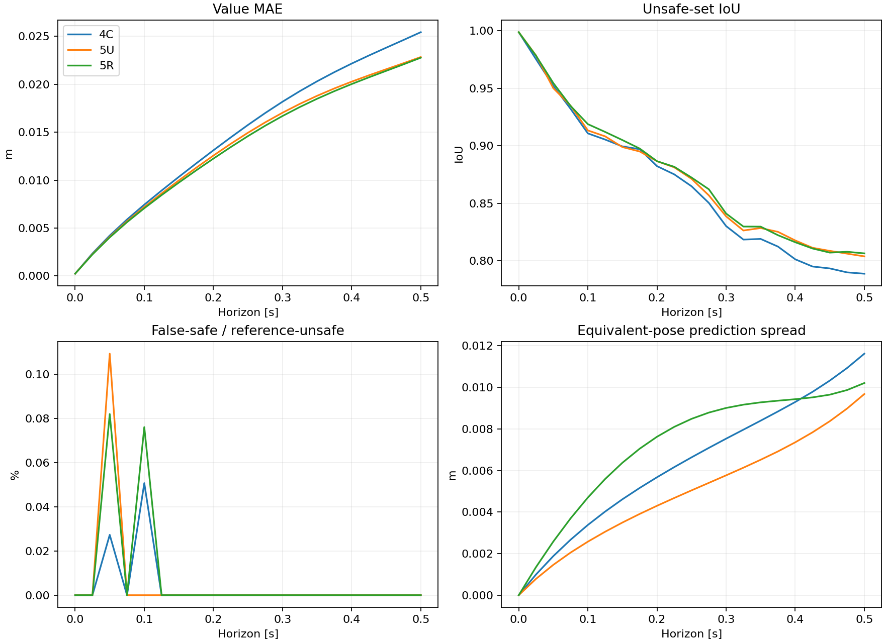
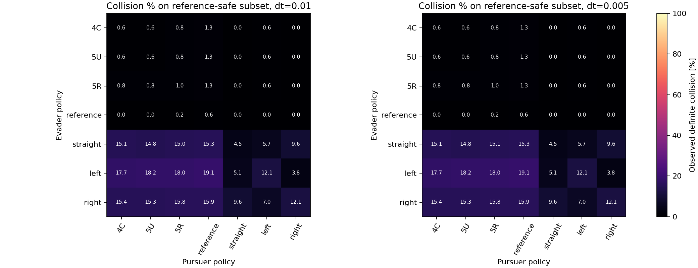

# Experiment 5 — added training helps values; residual sampling has no clear overall advantage

Both fixed continuations improve final-horizon value accuracy by about 10% relative to their common 4C parent on the fresh development set. The mixed sampler's advantage over uniform sampling is only 0.32%, with a paired group-bootstrap interval crossing zero. Its gradient and structural diagnostics trade gains against regressions, and it does not reduce the primary collision count. This run does not support replacing uniform sampling with this residual-bank rule as a demonstrated improvement.

## What we compared

The same frozen parent and two 2,000-update continuations were evaluated on 6,000 fresh relative configurations, four equivalent poses each and 21 horizons. This is 24,000 joint queries per horizon. These are new development states, so parent numbers differ slightly from the earlier development report. No numerical labels entered training, no optimizer was created for evaluation, and no future final set was queried. [Methodology](METHODOLOGY.md), [frozen value protocol](protocol.json), and [rollout protocol](rollouts/protocol.json) give the complete design.

## Primary value result

| Model | Final-time MAE (m) | Improvement over parent | Unsafe-set IoU | False-unsafe pose queries |
|---|---:|---:|---:|---:|
| 4C | 0.02543785 | 0.00% | 0.78884 | 1408 |
| 5U | 0.02284501 | 10.19% | 0.80391 | 1283 |
| 5R | 0.02277261 | 10.48% | 0.80650 | 1262 |

5R versus 5U reduces MAE by 0.00007240 m, or 0.3169%. Its paired 95% group-bootstrap relative-improvement interval is **-0.2478% to +0.8802%**. This does not establish a clear advantage. Parent-to-5U improvement is 10.19% (group interval 9.66–10.74%); parent-to-5R is 10.48% (9.86–11.07%). These intervals condition on the fixed training runs and approximate reference. They do not quantify training-seed variability or numerical-reference uncertainty.

The coarse/fine reference MAE difference at .5 s is .00214661 m, much larger than the .00007240 m difference between the continuations; that difference is a sensitivity indicator, not a rigorous error bound. The average MAE across the 20 nonzero horizons is .015466/.014382/.014160 m for 4C/5U/5R. All horizons and error tails are saved, including regressions: 5R's final 99th-percentile value error is .12262 m versus .11461 m for 5U, although its maximum error is lower (.17319 versus .18681 m).

No model has a false-safe query against the fine reference at .5 s on these states. At earlier horizons, 4C has 1 at .05 s and 2 at .10 s; 5U has 4 at .05 s; 5R has 3 at .05 s and 3 at .10 s. Zero observed errors at one horizon is not a safety guarantee.

## Gradient, physics and structure diagnostics

At .5 s, six-component gradient MAE is .052342/.048724/.048687 for 4C/5U/5R. The continuations are nearly tied by that magnitude metric. Evader turn-sign agreement on initially separated, reference-stable states at margin .01 is 97.440%/97.568%/97.361%; pursuer agreement is 98.859%/99.027%/99.172%. Thus 5R improves one actor's switching metric and worsens the other's versus 5U. The conditional subsets exclude small or grid-unstable reference coefficients and do not certify controls elsewhere.

The common uniform audit uses the same 8,192 fresh full-domain/time points for every model. Mean absolute VI residual is .012502/.011918/.012951 for 4C/5U/5R: 5R is worse globally than 5U. On the 1,666 late-horizon points, means are .021895/.021444/.020153, and late p99 residuals are .24630/.23909/.19611. The mixed rule improves late residuals and residual tails without a corresponding clear primary value or control gain. Sampled training losses are not compared because the training distributions differ.

Final equivalent-pose mean spread is .011619/.009678/.010207 m; 5U is better than 5R. Mean evader heading-alias gaps are .018082/.016252/.019295 m, another mixed-arm regression. Neither continuation enforces periodicity or exact pose invariance. Temporal-increase fractions above 1e-4 m are 13.913%/15.458%/14.857%, so neither improves this check relative to the parent. Terminal and obstacle maximum discrepancies are about 1.01e-7 m from float32 versus float64 coordinate arithmetic. Fractions below the physical -R bound by more than 1e-4 are .2958%/.2167%/.2667%; the exact terminal/obstacle form does not enforce that separate lower bound.

The secondary known-region diagnostic also remains unresolved. Against the existing refined local reference fields, value MAEs are .06543/.05288/.06676 m and stable evader turn-sign agreements are 62.846%/64.041%/62.086%. All three still choose +3 rad/s at all four representations of the old initial failure state, whereas both refined reference levels choose the negative initial turn. No new rollout of that old case was performed here; an initial direction check alone cannot prove its subsequent outcome.

## Closed-loop outcome

We simulated 200 fresh groups, all four poses, all 49 ordered pairs of seven policies, and both dt=.01 and .005: 78,400 mathematical trajectories. The reference-safe subset has 157 groups / 628 poses, defined by initial separation and both grid values above .01 m. At dt=.005 against the reference pursuer:

| Evader | Definite / possible contacts | Relative groups with contacts |
|---|---:|---:|
| 4C | 8 / 8 | 2 |
| 5U | 8 / 8 | 2 |
| 5R | 8 / 8 | 2 |
| Approximate reference | 4 / 4 | 1 |
| Straight | 96 / 96 | 24 |
| Constant left | 120 / 120 | 30 |
| Constant right | 100 / 100 | 25 |

The three learned evaders contact in the same two relative groups, 927 and 546, at all four poses. Their primary contact outcomes do not change when dt is halved. These are **not initially declared-safe collisions by the learned models**: every learned initial value in both groups is negative. Across the seven tested pursuer policies, any-definite-contact counts are 8/8/9 poses for 4C/5U/5R, with possible-contact counts 10/12/9; no clear mixed-sampler control advantage emerges. This finite-policy set is not an exhaustive adversarial search.

The reference controller's four contacts occur in group 927, with minimum separation .245209 m, below the .25 m collision radius. Both initial reference values are positive (fine .02620 m, coarse .03815 m). This occurs at both time steps and is reproduced by exact-arc replay, so we cannot dismiss it as the .01 s integration resolution. It exposes a remaining limitation of approximate reference values/gradients and their discretized feedback, rather than establishing that an exact winning strategy collides. Resolving grid/feedback accuracy in this case requires a separate diagnostic. The original solver and collision rule were not changed to remove the result.

## Verification, costs and files

Saved-array verification recomputed all 63 value metric rows, 6 gradient rows, 72 switching-sign rows, 6 physics audit rows and the paired bootstrap intervals. All 294 rollout metric rows were checked. Replaying 5,880,000 saved control updates reproduces final states, minimum-distance bounds and first contacts bitwise at both dt values. Protected checkpoints, original preparation/training records and the protected old final-state file retain their hashes. [Verification record](saved_array_verification.json) and [contact cases with initial predictions](rollouts/primary_contact_cases.json) are saved.

Value/reference evaluation took 157.44 s and rollout evaluation 145.96 s inside their phase timers. These exclude Python startup and later audit, verification, report and copying work. The original training phase took about 49 s per arm, excluding debugger startup, with an extra 327,680 candidate scores for 5R. Evaluation used managed CPU processes with two Torch threads; the earlier training was launched in VS Code. No additional training occurred in this phase.

`predictions.npz`, `development_states.npz`, `reference_values.npz`, `reference_gradients.npz` and `gradients_*.npz` preserve the value/gradient results. JSON/CSV files cover every fixed metric and subset. `uniform_physics_audit.npz` stores common audit points and residuals. `known_local_*.npz` stores the secondary local checks. `rollouts/` stores both trajectory/control archives, policy-pair tables, time-step sensitivity and the collision matrix. Source snapshots and output hashes provide provenance.

## Conclusion and next decision

Additional updates helped value accuracy, while this one fixed residual-sampling rule has not shown a clear overall benefit at matched update count. It has useful late-residual improvements but does not repair the switching failure and introduces other regressions. Keep 5U as the simpler comparison baseline rather than promoting 5R based on its tiny primary MAE lead. This does not rule out other sampling rules, different training seeds or larger-scale benefits.

Before another training change, examine the new reference-feedback failure in group 927 and separate reference uncertainty from learned control error in group 546. A later structural improvement can then be designed against a trustworthy diagnostic. The reserved future final set remains unused; these results are development evidence.
